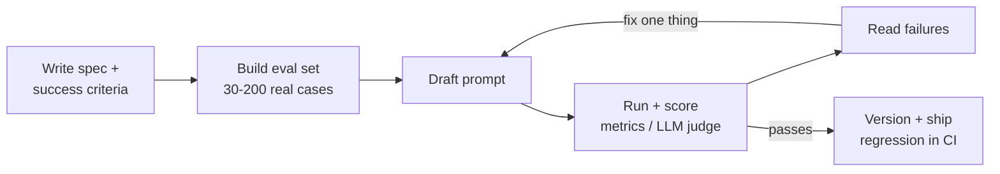

# Prompt Engineering

## Overview
**Prompt engineering** is designing the input to an LLM (instructions, context, examples, output format) so the model does the task reliably, without changing its weights. Treat a prompt like code: it has a spec, it is versioned, and it is tested against an eval set. Today much of the work is **context engineering**: deciding *what* goes into the window, not only how the instruction is worded.

## Anatomy of a Prompt

| Part | Purpose | Where it goes |
|---|---|---|
| **System / developer message** | Role, rules, tone, tools, hard constraints | System prompt (stable, cacheable) |
| **Task instructions** | What to do, success criteria, edge cases | System or top of user turn |
| **Context** | Documents, retrieved chunks ([[11.12 RAG]]), tool results, state | Before the question, in delimited blocks |
| **Examples** | Few-shot demonstrations of input → output | After instructions, before the real input |
| **Input** | The actual user query or data | Near the end |
| **Output spec** | Format, schema, length, what to do if unsure | End, or enforced by the API |

> [!TIP] Order for long prompts
> Put long documents **first** and the question and instructions **last**. Keep static parts (system prompt, tools, examples) at the start so the prefix can be reused by [[11.21 Prompt Caching]].

## Core Techniques

- **Be explicit**: say exactly what you want, including the "obvious" parts. Current models follow instructions literally; they do not guess at extra scope
- **Give the why**: "Keep answers under 3 sentences because they are read aloud on a phone" works better than "BE BRIEF". The model generalizes from the reason
- **Positive instructions**: "Write in plain prose paragraphs" beats "Don't use markdown". Negations name the thing you don't want
- **Delimit everything**: wrap inputs in XML tags (`<document>`, `<email>`, `<instructions>`) or fenced blocks so data is never confused with instructions
- **Role / persona**: a short role ("You are a senior SQL reviewer") sets vocabulary and depth. It does not add knowledge
- **Define done**: success criteria, the output audience, and an explicit escape hatch ("If the answer is not in the documents, reply `NOT_FOUND`") cut hallucinations
- **Decompose**: split a big task into a chain of smaller prompts ([[11.04 LLM Workflows]]), each easy to test. Better than one giant prompt doing five jobs
- **Ground with quotes**: for long-document QA, ask the model to first extract relevant quotes, then answer from them

## Few-Shot Prompting

**Few-shot** shows the model 2 to 10 input → output examples. It is the strongest lever for **format and style**, weaker for new knowledge.

- **Diverse**: cover the edge cases and every class; examples that are all alike get copied too closely
- **Balanced**: label skew in examples skews predictions (majority-label bias)
- **Representative**: match real input length and messiness, not toy inputs
- **Order matters**: models lean toward the label of the last examples (recency bias); shuffle and test
- **Dynamic few-shot**: retrieve the $k$ most similar labelled examples per query from a vector store ([[23.01 Vector Databases]]) instead of a fixed set
- **Tagged**: wrap each in `<example>` so the model knows they are demonstrations, not the task

> [!WARNING] Few-shot leakage
> Models copy surface details from examples: names, numbers, length, phrasing. If every example answer is 3 bullets, every output will be 3 bullets. Vary what you don't want copied.

## Reasoning: CoT vs Reasoning Models

| | **Standard model + CoT prompt** | **Reasoning / thinking model** |
|---|---|---|
| How it reasons | You ask for it: "think step by step", or few-shot worked solutions ([[11.13 Chain of Thought]]) | Trained (often via RL, e.g. [[11.52 GRPO]]) to produce a reasoning trace before answering |
| Control | Prompt wording | API knob (reasoning effort / thinking budget) |
| Best prompt style | Prescriptive steps, worked examples | High-level goal and constraints; let the model plan |
| Cost | Reasoning tokens are visible output | Thinking tokens are billed, often hidden or summarized |

- With reasoning models, **don't micromanage**: step-by-step scripts and "think carefully" add little and can hurt. Describe the goal, constraints, and how to check the answer
- Ask for a **self-check** ("verify the result against the constraints before finishing") instead of dictating the steps
- Separate reasoning from the answer (`<thinking>` / `<answer>` tags, or the API's thinking block) so parsers read only the answer
- The trace is **not a faithful explanation** of how the model decided; don't use it as an audit log ([[11.62 Mechanistic Interpretability]])

## Structured Output

| Level | How | Guarantee |
|---|---|---|
| **Prompt-only** | "Return JSON with keys a, b" + an example | None; expect stray prose, missing keys |
| **Prefill / stop sequences** | Start the assistant turn with `{`, stop on a closing tag | Better, still not valid by construction |
| **JSON mode** | API flag for valid JSON | Valid JSON, **not** your schema |
| **Schema-constrained** | JSON Schema via structured-output APIs (OpenAI, Claude, Gemini) or strict tool use ([[11.03 LLM Tool Calls]]) | Output matches the schema |
| **Grammar-constrained (self-hosted)** | Token masking with a CFG / JSON schema ([[11.26 XGrammar]], vLLM, SGLang) | Matches the grammar at decode time |

- Constrained decoding guarantees **shape, not truth**: a valid `"amount": 0` can still be wrong. Validate values (Pydantic) and keep an eval on content
- Keep schemas simple: flat objects, enums for categories, descriptions on every field (the model reads them)
- Put a `reasoning` field **before** the answer field if you want the model to think before committing; field order is generation order
- For long templated documents, have the model fill slots instead of writing the whole thing ([[11.09 Placeholder-Based Generation]])

## The Iteration Loop

- **Eval first**: without a test set, prompt changes are guesswork. Score with exact match, rubric, or [[24.05 LLM-as-Judge]] ([[11.15 LLM Evaluation Metrics]])
- **Change one thing at a time** and read the failures, not only the score
- **Version prompts** like code (git or a prompt registry) and run them as a regression suite on every change, including model upgrades ([[24.06 Online Evaluation & Prompt Regression]])
- **Re-tune on model change**: a prompt tuned for one model or version is not portable; rerun the eval

## Comparison: Technique vs When to Use

| Technique | Use when | Cost |
|---|---|---|
| Zero-shot + clear instructions | Common tasks, strong models | Lowest |
| Few-shot | Format, style, or label conventions matter | More input tokens |
| CoT prompting | Multi-step reasoning on a non-reasoning model | More output tokens |
| Reasoning model | Hard math, code, planning, multi-constraint tasks | Highest latency and tokens |
| Prompt chaining | Task has separable steps; need per-step checks | More calls, easier debugging |
| [[11.12 RAG]] | Needs private or fresh knowledge | Retrieval infra |
| Fine-tuning ([[11.31 Supervised Fine-Tuning]]) | Prompting plateaus; need consistent style at scale or a smaller model | Data + training |

## Anti-Patterns

> [!WARNING] Common mistakes
> - **ALL-CAPS threats and "CRITICAL!!!"**: newer models over-apply shouted rules to unrelated cases. State the rule once with its reason
> - **Contradictory instructions**: "be concise" + "explain thoroughly" in the same prompt; the model picks one at random per call
> - **Instruction soup**: dozens of rules accumulated from past bugs; nobody knows which still matter. Prune with evals
> - **Untrusted text mixed with instructions**: user input or retrieved docs pasted bare into the system prompt opens [[11.53 Prompt Injection]] and [[11.48 User Message Confusion]]. Delimit and label it as data
> - **Stuffing the window**: more context is not better; irrelevant chunks lower accuracy ([[11.28 Context Rot]], [[11.16 Context Window Management]])
> - **Parsing free text with regex** when the API can enforce a schema
> - **Dynamic content at the top** (timestamps, user IDs) breaks prefix caching
> - **Judging by vibes**: tuning on 3 hand-picked examples overfits the prompt to them

## Practical Use Cases

- **Extraction and classification**: schema-constrained output + few-shot edge cases + `NOT_FOUND` escape hatch
- **RAG answering**: documents first in tags, quote-then-answer, cite chunk IDs, refuse when unsupported
- **Agents**: system prompt defines tools, stop conditions, and when to ask the user ([[11.02 LLM Agents]], [[11.24 Clean Code for LLM Agents]])
- **Guardrails**: input/output checks as separate prompts or classifiers, not one more rule in the main prompt ([[11.10 LLM Guardrails]])
- **Synthetic data and judges**: rubric prompts for labelling or scoring, calibrated against human labels

## Related Concepts
- [[11_LLM_Dev_MOC]] - parent index
- [[11.13 Chain of Thought]] - reasoning prompts in depth
- [[11.12 RAG]] - augment prompts with retrieved context
- [[11.02 LLM Agents]] - agent instruction prompts
- [[11.03 LLM Tool Calls]] - strict tool use for structured output
- [[11.26 XGrammar]] - grammar-constrained decoding behind schema output
- [[11.21 Prompt Caching]] - prompt order affects cache hits
- [[11.16 Context Window Management]] - what to put in the window
- [[11.28 Context Rot]] - why more context can hurt
- [[11.53 Prompt Injection]] - risk of mixing data with instructions
- [[24.06 Online Evaluation & Prompt Regression]] - testing prompt changes in CI
- [[11.15 LLM Evaluation Metrics]] - scoring prompt variants
- [[11.31 Supervised Fine-Tuning]] - next step when prompting plateaus

## References
- "Language Models are Few-Shot Learners" (Brown et al., 2020)
- "Calibrate Before Use: Improving Few-Shot Performance of Language Models" (Zhao et al., 2021) - majority-label and recency bias
- Anthropic prompt engineering docs: docs.claude.com/en/docs/build-with-claude/prompt-engineering
- OpenAI prompting and reasoning best practices: platform.openai.com/docs/guides
