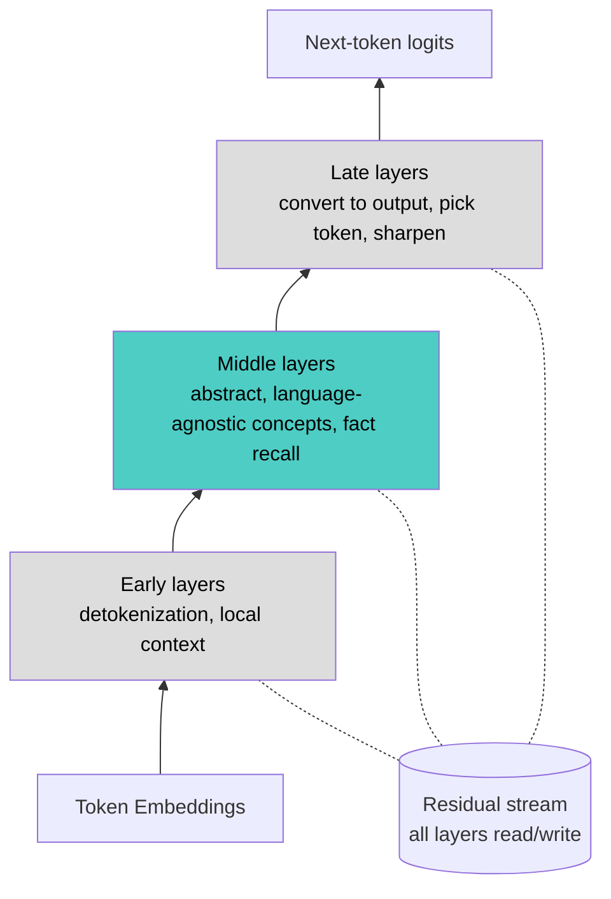

# Mechanistic Interpretability

## Overview
**Mechanistic interpretability** reverse-engineers the internal computation of a neural network — like decompiling a program that has no source code. LLM weights are learned, not designed, so nobody knows in advance *how* a model represents concepts or produces an answer. The field tries to explain behavior in terms of internal **features** and **circuits**, not just inputs and outputs.

> [!INFO] Why it matters
> - **Safety**: detect deception, hidden goals, or misaligned reasoning that output-only evaluation misses
> - **Science**: a learned system for language and reasoning that can be measured and edited at every unit
> - **Control & debugging**: fix or steer a specific behavior without retraining

## Key Concepts
- **Residual stream**: the shared vector every layer reads from and *adds* to; the main communication channel through the model
- **Attention heads move information** between token positions; **MLPs process information** within a position and act like key-value memories (Geva et al., 2021)
- **Linear representation hypothesis**: concepts are encoded as *directions* in activation space
  - Mostly, not always: some features are multi-dimensional, e.g., days of the week lie on a circle (Engels et al., 2024)
- **Superposition**: the model packs more concepts than it has neurons by overlapping directions → individual neurons are **polysemantic** (respond to unrelated things)
- **Sparse autoencoders (SAE) / dictionary learning**: decompose activations into many sparse, mostly **monosemantic features**
- **Feature splitting**: as the SAE dictionary grows, a broad feature splits into finer, more specific ones → there is no single "true" feature set
- **Circuit**: a subgraph of heads, MLPs, and features that implements a specific behavior
- **Attribution graphs / circuit tracing**: trace which features cause which, end-to-end, for a given prompt (uses transcoders / cross-layer transcoders)

## Methods

| Method | Type | Question it answers | Caveat |
|---|---|---|---|
| **Linear probe** | Observational | Is concept X decodable from this layer? | Decodable ≠ used by the model |
| **Logit lens / tuned lens** | Observational | What would the model predict if it stopped at this layer? | Early layers are not in the output basis; tuned lens learns a per-layer translator |
| **Ablation** (zero / mean / resample) | Causal | Does the behavior break without this component? | Zero-ablation is off-distribution; other components compensate |
| **Activation patching** (causal tracing, path patching) | Causal | Which activations carry the information that separates a clean prompt from a corrupted one? | Result depends on how the corrupted prompt is chosen |
| **Steering** | Causal | Does adding a direction change behavior? | Large coefficients break fluency |
| **SAE / transcoder features** | Decomposition | What are the units worth analyzing? | Reconstruction error; features depend on dictionary size |

> [!WARNING] Presence is not use
> A probe shows information *is there*; only an intervention (ablate, patch, steer) shows the model *uses it*. Treat observational results as hypotheses and confirm them causally.

## Layer Roles (Rough Consensus)

| Stage | What happens | Evidence |
|---|---|---|
| **Early** | Merge sub-word tokens into words (**detokenization**), local context, basic syntax | Lad, Gurnee & Tegmark (2024) "stages of inference" |
| **Middle** | Abstract concepts shared across languages; factual recall in MLPs; best layers for linear probes | ROME (Meng et al., 2022); multilingual feature sharing |
| **Late** | Map concepts to output language and token, calibrate confidence, suppress wrong candidates | **Logit lens**: predictions sharpen layer by layer |

- Lad et al. propose four stages: detokenization → feature engineering → prediction ensembling → residual sharpening
- Deleting or swapping some middle layers often hurts surprisingly little → layers do **iterative refinement**, not strict pipeline steps

> [!WARNING] There is no fixed "layers 1–8 = early" boundary
> - Every block has the same architecture; roles **emerge** during training
> - Role boundaries are **gradual**, not sharp
> - The same block can be critical for one task and irrelevant for another
> - One block runs many circuits at once (superposition)
> - Blocks are **redundant** — ablate one and others partially compensate
>
> → We can pinpoint *which heads/blocks matter for a specific task* (activation patching, attribution graphs), but not a general partition of the whole model. Modern work therefore uses **features and circuits** (which span blocks) as the unit of analysis, not blocks.

## Key Findings

| Finding | What it shows | Source |
|---|---|---|
| **Induction heads** | Two-head circuit for "A B … A → B" copying; a key mechanism of in-context learning; appears abruptly during training | Olsson et al., 2022 |
| **IOI circuit** | Full circuit for indirect-object identification in GPT-2 small, down to individual heads | Wang et al., 2022 |
| **Localized fact recall** | Facts editable by changing one MLP layer | ROME, Meng et al., 2022 |
| **Toy superposition** | Why neurons are polysemantic | Elhage et al., 2022 |
| **Othello-GPT** | A model trained only on move sequences builds a linearly decodable board state; editing it changes the moves it plays | Li et al., 2022; Nanda et al., 2023 |
| **Grokking** | A modular-addition network learns a Fourier-feature algorithm; the generalizing circuit forms gradually before test loss suddenly drops | Nanda et al., 2023 |
| **Scaled SAEs** | Millions of interpretable features in Claude 3 Sonnet; amplifying one changes behavior ("Golden Gate Claude") | Anthropic, 2024 |
| **Refusal direction** | Refusal is mediated by a single residual-stream direction; ablating it removes refusals | Arditi et al., 2024 |
| **Latent English** | Llama-2 passes through English-like representations mid-network even for non-English tasks | Wendler et al., 2024 |
| **Biology of an LLM** | Multi-hop reasoning (Dallas → *Texas* → Austin internally), planning rhymes ahead, hallucination when "known entity" features wrongly suppress a default "can't answer" circuit | Anthropic, 2025 |

- **Induction heads**: shown causally in small models; for large models the link to in-context learning is mostly correlational
- **ROME**: where a fact is *located* (causal tracing) does not predict the best layer to *edit* (Hase et al., 2023)
- **Refusal**: later work finds several directions forming a "concept cone" (Wollschläger et al., 2025). **Abliteration** applies the ablation to open weights to strip refusals → safety training on open-weight models is removable

> [!EXAMPLE] IOI circuit in GPT-2 small (12 blocks × 12 heads)
> Task: "When Mary and John went to the store, John gave a drink to ___" → **Mary**
>
> | Blocks | Head role |
> |---|---|
> | 0–3 | Duplicate-token heads: detect the repeated name |
> | 5–6 | Induction heads: help detect duplication |
> | 7–8 | S-inhibition heads: suppress the repeated name |
> | 9–10 | Name-mover heads: copy the correct name to the output |
>
> Matches the general picture: early = gather basics, middle = relate, late = emit answer.

## Chain-of-Thought Faithfulness
Interpretability can check whether a model's written reasoning matches its internal computation (Anthropic, 2025).

| Case | Stated reasoning | Internal computation |
|---|---|---|
| **Faithful** | Shows an intermediate step | Features for that step are active |
| **Made up** | Claims to have calculated a hard value | No trace of the calculation |
| **Motivated reasoning** | Step-by-step derivation | Works backward from a hinted answer |
| **Arithmetic** | Describes the schoolbook carry algorithm | Parallel pathways: rough magnitude + exact last digit |

→ Reasoning text is evidence about the computation, not a transcript of it.

## What Changes with Model Size
- **More cross-lingual sharing**: fraction of language-independent features rises with model size (Anthropic, 2025)
- **More complex circuits**: multi-step reasoning and planning become clearer; basic circuits (induction heads) exist at all sizes
- Sizes are **separate weight sets** — features found in an 8B model are not at the same location in the 70B one
- Stage boundaries tend to sit at similar **relative depth** across sizes (rough trend, not a rule)
- Layer counts and dimensions per model: see [[11.63 Transformer Depth & Width]]

## Open Problems
- **Dark matter**: SAE reconstruction error — activation variance features don't explain
- **Faithfulness**: features depend on SAE size and method; are they the model's real units or artifacts of the tool?
- **Feature absorption**: a general feature silently stops firing where a more specific one takes over (Chanin et al., 2024)
- **Downstream value**: SAE probes lost to plain linear probes at detecting harmful intent out-of-distribution, after which Google DeepMind deprioritised SAE research (2025)
- **Attention**: attribution graphs treat attention patterns as fixed, so they don't explain *why* a head attends where it does
- **Coverage**: attribution graphs explain individual prompts, not the whole model
- **Cost**: full analysis of frontier-scale models is very expensive

## Practical Use Cases
- **Steering**: add/subtract feature or concept directions (steering vectors, persona vectors) to change behavior at inference
- **Model editing**: targeted fact edits (ROME-style)
- **Safety auditing**: look for deception, sycophancy, or hidden-objective features
- **Compression**: interpretability findings guide which layers to prune

> [!TIP] Try it yourself
> 1. Pick a small open model with many sizes — **GPT-2 small**, **Pythia** (70M–12B, with training checkpoints)
> 2. **Logit lens** (TransformerLens / nnsight): decode the residual stream at each layer to watch the answer form
> 3. **Activation patching**: swap activations block by block to find which ones matter for a task
> 4. Explore pre-trained SAE features on **Neuronpedia** (e.g., Gemma Scope for Gemma 2, Gemma Scope 2 for Gemma 3)
> 5. Build attribution graphs on open models with Anthropic's open-source **circuit-tracer** library
>
> Reading: transformer-circuits.pub, Neel Nanda's getting-started guide

## Related Concepts
- [[11_LLM_Dev_MOC]] - parent index
- [[11.63 Transformer Depth & Width]] - layer counts and dimensions being analyzed
- [[11.01 Attention Mechanism]] - prerequisite: what attention heads compute
- [[13.17 Sparse Autoencoder (SAE)]] - SAE variants, training, and evaluation
- [[11.13 Chain of Thought]] - stated reasoning may not match internal computation
- [[11.40 Pruning & Sparsity]] - layer pruning motivated by mid-layer redundancy
- [[11.49 RLHF]] - trains the refusal and persona behaviors interpretability locates
- [[11.10 LLM Guardrails]] - contrast: output filters vs internal inspection
