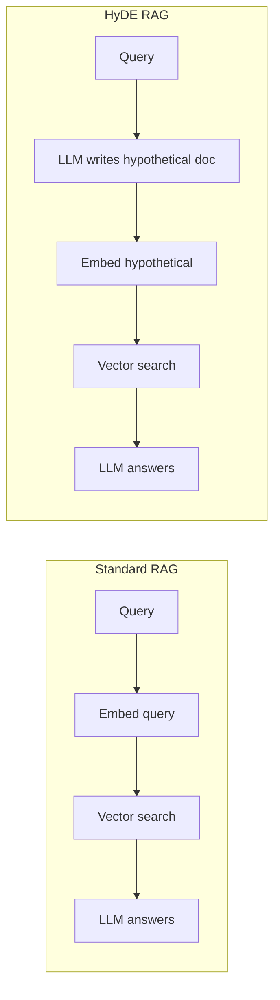
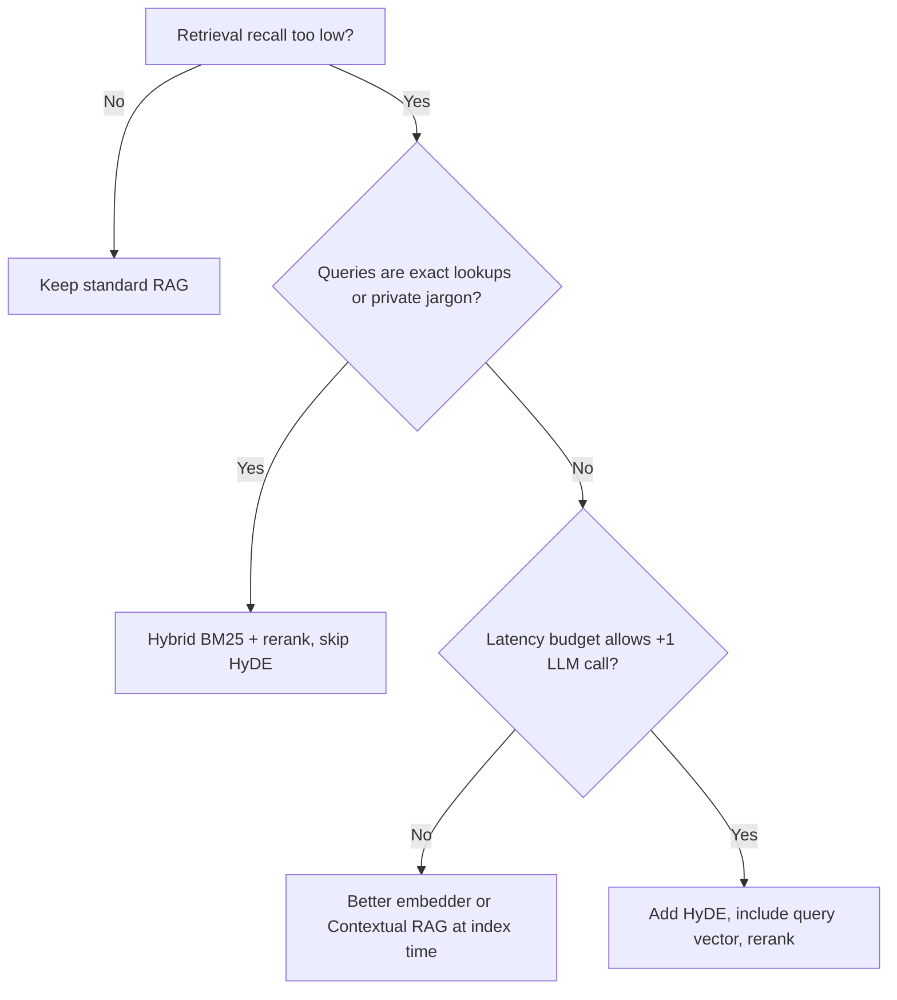

# HyDE vs Standard RAG

## Overview
**HyDE is not an alternative to RAG**: it swaps out one step inside the RAG pipeline. Standard RAG embeds the **raw query** and searches with it. HyDE has an LLM write a **hypothetical answer** first and searches with that instead. Indexing, augmentation, and generation stay the same. The real question is which **retrieval key** works better for your queries and corpus.

> [!INFO] Framing
> "HyDE vs RAG" really means **query-embedding retrieval vs hypothetical-document-embedding retrieval**. Both end with an LLM answering from real retrieved documents.

## Pipelines Side by Side

- The only difference is the step **before** embedding
- In the original paper, the search vector is the **mean** of N hypothetical-doc embeddings **plus** the query embedding:

$$\mathbf{v} = \frac{1}{N+1}\left(\sum_{k=1}^{N} f(d_k) + f(q)\right)$$

## Comparison Table

| Dimension | Standard RAG | HyDE RAG |
|---|---|---|
| **Retrieval key** | Query embedding | Hypothetical answer embedding (± query) |
| **Matching** | Query → document (asymmetric) | Document → document (symmetric) |
| **LLM calls per query** | 1 (generation) | 2+ (hypothesis + generation) |
| **Latency / cost** | Baseline | + one generation step (usually short, ~100–200 tokens) |
| **Training data needed** | None, but gains from a QA-tuned embedder | None; built for **zero-shot** |
| **Index changes** | — | None (same index) |
| **Strong on** | Exact terms, IDs, error codes; domain-tuned embedders | Short/vague questions, new domains, off-the-shelf embedders |
| **Main failure mode** | Query and answer phrased too differently → misses | LLM doesn't know the topic → hypothetical steers retrieval wrong |
| **Determinism** | Same query → same results | Depends on sampling unless temperature is 0 or results are cached |

## Where Each Wins

> [!TIP] Prefer HyDE when
> - The embedder is generic (not fine-tuned for your domain or for QA retrieval)
> - Queries are short questions and documents are long, expository passages
> - The LLM has **general** knowledge of the domain (medicine, law, public tech docs), so its fake answer uses the right vocabulary

> [!WARNING] Prefer standard RAG when
> - The corpus is **private or proprietary** (internal tickets, product codenames). The LLM invents the wrong vocabulary
> - Queries are **lookups** (SKU, function name, error code). Paraphrasing weakens the exact signal
> - You already use an **asymmetric / instruction-tuned embedder** (e.g. `query:`/`passage:` prefixes). It has already closed most of the query–document gap
> - The latency budget is tight (autocomplete, voice)

> [!EXAMPLE] Same question, two keys
> Query: *"why does my pod keep restarting?"*
> - **Standard**: embeds a 6-word question. It may match other short "pod restart" questions in the corpus instead of the answer
> - **HyDE**: embeds a paragraph about *CrashLoopBackOff, OOMKilled, liveness probe failures*. That lands next to the troubleshooting docs

## Combining Them

- **Include the query** in the averaged vector (the paper's default). This anchors retrieval if the hypothetical drifts
- **Run both in parallel**, then merge with **Reciprocal Rank Fusion**. Latency stays at max(both), not the sum
- **Hybrid search**: use the raw query for BM25 and the HyDE vector for dense search. Keyword precision plus semantic recall
- **Rerank** after either one. A cross-encoder scores the *real query* against the candidates and undoes HyDE drift
- **Route**: a cheap classifier sends lookups to standard retrieval and open questions to HyDE

## Decision Guide

> [!TIP] Measure, don't assume
> Compare Recall@K / MRR on a labeled query set with and without HyDE ([[11.15 LLM Evaluation Metrics]]). Once the embedder is domain-tuned, HyDE's gains often shrink to almost nothing.

## Related Concepts
- [[11_LLM_Dev_MOC]] - parent index
- [[11.45 Hypothetical Document Embeddings (HyDE)]] - full HyDE mechanics
- [[11.12 RAG]] - the baseline pipeline being modified
- [[11.44 Contextual RAG]] - index-side alternative with no per-query cost
- [[23.01 Vector Databases]] - where both retrieval keys are searched
- [[23.02 TF-IDF]] - keyword side when pairing HyDE with hybrid search

## References
- "Precise Zero-Shot Dense Retrieval without Relevance Labels" (Gao et al., 2022)
- "Retrieval-Augmented Generation for Knowledge-Intensive NLP Tasks" (Lewis et al., 2020)
