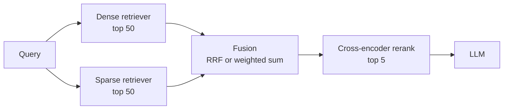

# Hybrid Search (Dense + Sparse)

## Overview
**Hybrid search** runs a **dense** (embedding) retriever and a **sparse** (keyword) retriever on the same query, then **fuses** the two ranked lists into one. Each covers the other's blind spot: dense handles paraphrase and meaning, sparse handles exact terms. It is the default first stage in most production [[11.12 RAG]] systems.

## Why Combine Them

| | **Dense** (embeddings) | **Sparse** (BM25 / SPLADE) |
|---|---|---|
| Matches on | Meaning, paraphrase, synonyms | Exact tokens |
| Wins | *"how do I cancel"* ≈ *"terminate subscription"* | `ERR_CONN_RESET`, `SKU-4471`, function names, rare jargon |
| Fails | IDs, codes, rare/new terms the embedder never saw | Vocabulary mismatch (different words, same meaning) |
| Out-of-domain | Degrades without fine-tuning | Robust: no training needed |
| Score scale | Cosine / dot product (bounded-ish) | Unbounded, query-length dependent |

> [!INFO] Sparse options
> - **BM25**: classic term-frequency × IDF with length normalization ([[23.02 TF-IDF]])
> - **Learned sparse** (e.g. **SPLADE**): a model outputs weighted vocabulary terms, including **expansion** terms not in the text. Keyword precision plus some semantic recall, still served from an inverted index

## Pipeline

- Retrieve a **wide** candidate set from each side (e.g. 50–100), fuse, then narrow
- Both retrievers run **in parallel**, so latency ≈ the slower one plus fusion (negligible)

## Fusion Methods

### Reciprocal Rank Fusion (RRF)
Uses **ranks only** and ignores scores:

$$\text{RRF}(d) = \sum_{r \in \text{retrievers}} \frac{1}{k + \text{rank}_r(d)}, \quad k \approx 60$$

- No normalization, no tuning: works out of the box
- A doc ranked high by *both* lists beats a doc ranked #1 by only one
- Throws away score magnitude (a near-perfect match and a barely-relevant one at the same rank count the same)

### Weighted Score Combination (Convex)

$$s(d) = \alpha \cdot \text{norm}(s_{\text{dense}}) + (1 - \alpha) \cdot \text{norm}(s_{\text{sparse}})$$

- Scores **must be normalized** first (min-max per query, or distribution-based); raw BM25 and cosine are on different scales
- **α** is tunable per corpus. With a small labeled set, a tuned α often **beats RRF** (Bruch et al., 2022)
- A doc missing from one list gets 0 (or the list minimum) for that side

> [!WARNING] α conventions differ
> Most tools use `α=1` for pure vector and `α=0` for pure keyword (Weaviate, LangChain ensemble weights), but check before copying values between systems. Some databases expose only RRF, or let you choose (e.g. Qdrant RRF / DBSF).

### Which to Use

| Situation | Choice |
|---|---|
| No labeled queries, want a safe default | **RRF** |
| Have 50–200 labeled queries | **Convex**, tune α on Recall@K |
| Retrievers have wildly different quality | Convex with α skewed to the better one |
| Fusing 3+ retrievers (dense, sparse, HyDE, multi-query) | **RRF**, which scales to N lists trivially |

## Tuning Tips

> [!TIP] Practical defaults
> - Start with RRF (`k=60`), top-50 from each side, rerank to top-5
> - Tune α only after you have an eval set ([[11.15 LLM Evaluation Metrics]]): Recall@K, MRR
> - ID/code-heavy corpora (support tickets, logs, code) → lean sparse; conversational/FAQ corpora → lean dense
> - Use the **same chunks** for both indexes so fusion compares like with like

> [!WARNING] Common mistakes
> - Adding raw BM25 + cosine scores without normalizing: BM25 dominates
> - Fusing only top-5 from each side: too few candidates for the reranker
> - Tokenizer mismatch: BM25 on English stemming over multilingual or code text silently misses matches

## Support in Common Stores

| Store | Hybrid support |
|---|---|
| **Weaviate** | Built-in BM25 + vector, `alpha` parameter |
| **Qdrant** | Sparse vectors + dense, fusion via RRF or DBSF |
| **Elasticsearch / OpenSearch** | BM25 native + kNN, RRF retriever / normalization pipeline |
| **Milvus** | Multi-vector hybrid search with RRF or weighted rankers |
| **Postgres** | `pgvector` + `tsvector` full-text, fuse in SQL |

See [[23.01 Vector Databases]] for the stores themselves.

## Practical Use Cases

- **Enterprise / support RAG**: users type ticket IDs, product codes, *and* fuzzy descriptions
- **Code search**: symbol names need exact match, intent needs semantics ([[11.23 Workspace Indexing]])
- **Base for other techniques**: [[11.44 Contextual RAG]] adds contextual BM25 on top; [[11.64 HyDE vs Standard RAG|HyDE]] can feed the dense side while the raw query feeds sparse

## Related Concepts
- [[11_LLM_Dev_MOC]] - parent index
- [[11.12 RAG]] - pipeline this retrieval stage plugs into
- [[23.02 TF-IDF]] - the sparse/BM25 half
- [[23.01 Vector Databases]] - the dense half and hybrid-capable stores
- [[11.44 Contextual RAG]] - extends hybrid with context-enriched chunks
- [[11.64 HyDE vs Standard RAG]] - another retriever to fuse via RRF
- [[11.23 Workspace Indexing]] - hybrid retrieval applied to codebases
- [[11.68 Reranking (Cross-Encoders)]] - stage 2 that rescores the fused candidates
- [[11.70 Query Transformation]] - multi-query lists fused with RRF
- [[11.74 ColBERT & Late Interaction]] - token-level reranker after hybrid fusion

## References
- "Reciprocal Rank Fusion outperforms Condorcet and individual Rank Learning Methods" (Cormack et al., 2009)
- "An Analysis of Fusion Functions for Hybrid Retrieval" (Bruch et al., 2022)
- "SPLADE: Sparse Lexical and Expansion Model for First Stage Ranking" (Formal et al., 2021)
