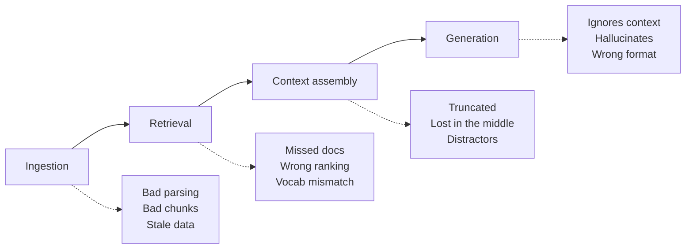
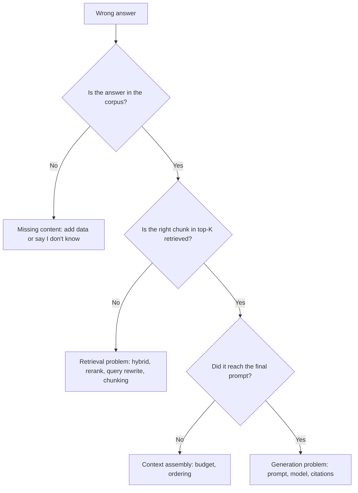

# RAG Failure Modes

## Overview
A RAG system can fail at **every stage**: ingestion, retrieval, context assembly, generation, and operations. The usual symptom is the same, a wrong or missing answer, but the fix depends entirely on **which stage broke**. Find the stage first, then pick the technique.

> [!INFO] Reference framework
> "Seven Failure Points When Engineering a Retrieval Augmented Generation System" (Barnett et al., 2024) catalogs failures seen in real deployments. The **FP** labels below come from that paper; the other rows are common additions.

## Where It Breaks

## 1. Ingestion & Indexing

| Problem | Symptom | Fix |
|---|---|---|
| **Missing content** (FP1) | Answer isn't in the corpus; model makes one up | Coverage audit; "I don't know" instruction; log unanswered queries |
| **Bad parsing** | Tables, PDFs, slides become garbled text | Layout-aware parsers; table → markdown; OCR for scans |
| **Chunk boundaries split facts** | Half the answer in each chunk | Overlap; semantic/recursive chunking; parent-child retrieval |
| **Chunks lose context** | Chunk says "the company" or "revenue grew 3%" but never says which one | [[11.44 Contextual RAG]]; prepend title/section headers |
| **Stale or duplicate data** | Old policy version retrieved over new one | Incremental re-indexing; version/timestamp metadata; dedupe |

## 2. Retrieval

| Problem | Symptom | Fix |
|---|---|---|
| **Missed top-ranked docs** (FP2) | Right chunk exists but ranks below top-K | Reranker; larger K before reranking |
| **Vocabulary mismatch** | User's words ≠ document's words | [[11.65 Hybrid Search (Dense + Sparse)]]; query rewriting; [[11.45 Hypothetical Document Embeddings (HyDE)\|HyDE]] |
| **Exact-term misses** | IDs, codes, names not found by embeddings | Add BM25 ([[11.65 Hybrid Search (Dense + Sparse)\|hybrid]]) |
| **Multi-hop questions** | Needs fact A to know what to search for fact B | Iterative/agentic retrieval; query decomposition |
| **Aggregation / global questions** | *"What are the main themes across all reports?"* | Top-K can't answer; use [[11.43 Graph RAG]] or map-reduce summarization |
| **Ambiguous / conversational queries** | *"What about the second one?"* | Rewrite with chat history into a standalone query |
| **Permission leakage** | User sees chunks from docs they can't access | Filter by ACL metadata **at retrieval**, never after generation |

## 3. Context Assembly

| Problem | Symptom | Fix |
|---|---|---|
| **Not in context** (FP3) | Retrieved, but dropped by token budget or consolidation | Compress/summarize chunks; smarter budget allocation |
| **Lost in the middle** | Model ignores relevant chunks placed mid-prompt | Put best chunks first/last; fewer, better chunks ([[11.28 Context Rot]]) |
| **Distractors** | Similar-but-wrong chunks mislead the model | Rerank; lower K; relevance threshold |
| **Conflicting sources** | Two chunks disagree; model picks one silently | Surface both with dates/sources; prefer newest by metadata |

## 4. Generation

| Problem | Symptom | Fix |
|---|---|---|
| **Not extracted** (FP4) | Answer is in context; model misses it | Better prompt; stronger model; less noise in context |
| **Wrong format** (FP5) | Ignores requested table/JSON/list | Structured output; format examples |
| **Incorrect specificity** (FP6) | Too generic or too detailed for the question | Clarify intent; tune prompt to the audience |
| **Incomplete** (FP7) | Partial answer when the info was available | Ask for all parts explicitly; decompose the question |
| **Ignores context** | Answers from parametric memory instead of docs | "Answer only from context" + required citations |
| **Unfaithful / hallucinated citations** | Cites [2] for a claim not in [2] | Faithfulness eval; claim verification ([[11.46 Falsification-Verification RAG (FVA-RAG)\|FVA-RAG]]) |

## 5. Operations & Security

- **Latency stacking**: query rewrite + HyDE + hybrid + rerank + generation adds up. Run steps in parallel and cache
- **Cost**: every chunk in context is billed per call; tighter K saves money ([[11.21 Prompt Caching]])
- **Silent quality drift**: corpus or embedding model changes and recall drops without anyone noticing. Run regression evals
- **Poisoned documents**: attacker-written content gets retrieved ([[11.47 Knowledge Base Poisoning]])
- **Indirect prompt injection**: retrieved text contains instructions ([[11.53 Prompt Injection]])
- **Embedding model upgrade**: new model means re-embedding the **entire** corpus; vectors from different models aren't comparable

## Diagnosing a Bad Answer

> [!TIP] Evaluate retrieval and generation separately
> Measure **context recall** (did we retrieve the gold chunk?) apart from **faithfulness** (did the answer stick to the context?). One end-to-end score hides which stage failed ([[11.15 LLM Evaluation Metrics]]).

## Related Concepts
- [[11_LLM_Dev_MOC]] - parent index
- [[11.12 RAG]] - the pipeline these failures happen in
- [[11.67 RAG Applications]] - which failures dominate in each domain
- [[11.65 Hybrid Search (Dense + Sparse)]] - main fix for retrieval misses
- [[11.44 Contextual RAG]] - fix for chunks losing context
- [[11.43 Graph RAG]] - fix for global / aggregation questions
- [[11.28 Context Rot]] - why more context isn't always better
- [[11.47 Knowledge Base Poisoning]] - security failure at ingestion
- [[11.15 LLM Evaluation Metrics]] - how to detect each failure
- [[11.68 Reranking (Cross-Encoders)]] - main fix for missed top-ranked docs (FP2)
- [[11.69 Chunking Strategies]] - fixes for chunk boundary and orphan-chunk failures
- [[11.71 RAG Evaluation]] - metrics that show which stage failed

## References
- "Seven Failure Points When Engineering a Retrieval Augmented Generation System" (Barnett et al., 2024)
- "Lost in the Middle: How Language Models Use Long Contexts" (Liu et al., 2023)
