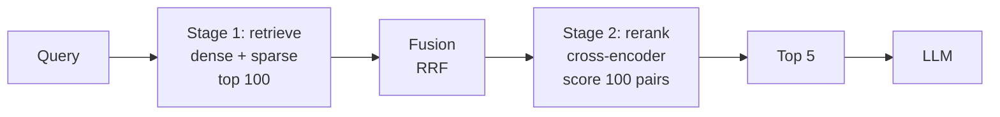

# Reranking (Cross-Encoders)

## Overview
**Reranking** is the second stage of **two-stage retrieval**. A fast retriever pulls a wide set of candidates (say 50 to 200), then a slower, more accurate model rescores each one against the query and keeps only the best few. The usual reranker is a **cross-encoder**: a transformer that reads the query and the document **together** and outputs one relevance score. In [[11.12 RAG]] it sits right after [[11.65 Hybrid Search (Dense + Sparse)|hybrid fusion]] and right before the LLM.

## Why Rerank

- First-stage retrievers are built for **recall at scale**: they must search millions of chunks in milliseconds, so they compare precomputed vectors or term counts
- That speed costs **precision**: the right chunk is often in the top 50 but not the top 5 (FP2 in [[11.66 RAG Failure Modes]])
- The LLM only sees the final few chunks, so their **order and quality** matter most ([[11.28 Context Rot]])
- A reranker spends heavy compute on a **small** set, so you get accuracy without scanning the whole corpus

## Bi-Encoder vs Cross-Encoder

| | **Bi-encoder** (embeddings) | **Cross-encoder** (reranker) |
|---|---|---|
| Input | Query and doc encoded **separately** | Query and doc in **one** input |
| Score | $\cos(E(q), E(d))$ | $f([q; d]) \to$ one number |
| Doc work at query time | None: doc vectors are precomputed | Full forward pass **per pair** |
| Interaction | Only at the end (one dot product) | Every query token attends to every doc token |
| Scales to | Millions to billions of docs ([[23.07 ANN Indexes (HNSW, IVF, PQ)\|ANN index]]) | Tens to hundreds of candidates |
| Accuracy | Good recall, weaker fine ranking | Higher precision on the top ranks |
| Role | Stage 1: retrieve | Stage 2: rerank |

> [!INFO] Middle ground
> **Late interaction** models like ColBERT keep one vector per token and compare them at query time. They sit between the two on both cost and accuracy. See [[11.74 ColBERT & Late Interaction]].

## How a Cross-Encoder Scores

- Build one sequence: `[CLS] query [SEP] document [SEP]`
- Run it through a transformer (BERT-style encoder or a small LLM). Self-attention mixes query and doc tokens in **every layer**, so the model can see that "it" in the doc refers to the thing the query asks about
- A small head on the final `[CLS]` vector outputs a score:

$$s(q, d) = \sigma\left(w^\top h_{\text{[CLS]}}\right)$$

- Sort candidates by $s$, keep the top $k$
- Training: (query, relevant doc, hard negatives) triples, usually from **MS MARCO**, with a classification or ranking loss
- Scores are **relative**: good for sorting one query's list, not reliable as an absolute "is this relevant" cutoff unless you calibrate

> [!EXAMPLE] Why joint reading helps
> Query: *"Can I return a laptop after 30 days?"*. A bi-encoder ranks a chunk about *"30-day laptop warranty"* high because the topics overlap. A cross-encoder reads both together and can tell the chunk is about warranty, not returns, and pushes it down.

## LLM as Reranker

A general LLM can be prompted to rank. Three styles:

| Style | How it works | Trade-off |
|---|---|---|
| **Pointwise** | Score each (query, doc) alone: "Relevant? yes/no" or 0 to 10; use token probability as score | Simple, parallel; scores drift across calls |
| **Pairwise** | "Which of A or B is more relevant?"; aggregate many comparisons (PRP, Qin et al., 2023) | Robust; many calls per query |
| **Listwise** | Give the LLM a window of docs, ask for a ranked list of IDs; slide the window over the candidates (RankGPT, Sun et al., 2023) | Sees docs side by side; long prompts, can drop or repeat IDs |

- Strong zero-shot, follows custom instructions ("prefer docs from 2025", "rank by policy, not FAQ")
- Much slower and costlier than a small cross-encoder. Common pattern: distill an LLM ranker into a small model, or use LLM reranking only on the last 10 to 20 candidates

## Common Rerankers

| Model | Type | Notes |
|---|---|---|
| **Cohere Rerank** (`rerank-v3.5`, `v4.0`, `v5.0` pro/fast) | Hosted API | Multilingual; v3.5 has a 4k context, v4 and v5 have 32k. Long docs are split into chunks automatically |
| **BGE reranker** (`bge-reranker-v2-m3`, `-v2-gemma`) | Open weights (BAAI) | v2-m3 is a 0.6B multilingual cross-encoder built on bge-m3; examples use `max_length=512` |
| **Jina Reranker** (`jina-reranker-v3`) | Open weights / API | 0.6B **listwise** model: query and all candidates in one context window |
| **ms-marco MiniLM** (`cross-encoder/ms-marco-MiniLM-L6-v2`) | Open weights (sentence-transformers) | Small, fast English baseline trained on MS MARCO; L2/L4/L12 variants trade speed for quality |
| **LLM** (GPT, Claude, Qwen, etc.) | Prompted | Listwise or pointwise; best for small K with custom criteria |

## Choosing Candidate K and Final K

- **Candidate K** (into the reranker): sets the **recall ceiling**. If the right chunk is not in the candidates, the reranker cannot find it
- **Final K** (out to the LLM): sets **precision and prompt cost**. More chunks mean more tokens and more distractors
- Tune both on an eval set ([[11.71 RAG Evaluation]]): pick candidate K where stage-1 Recall@K flattens, then pick final K by answer quality

| Setting | Starting point |
|---|---|
| Candidate K | 50 to 100 (from fused hybrid lists) |
| Final K | 3 to 10 |
| Optional | Drop candidates under a calibrated score threshold |

## Latency and Cost

$$\text{rerank cost} \approx K_{\text{cand}} \times \text{forward pass}(|q| + |d|)$$

- Cost grows **linearly with candidate K** and roughly **quadratically with pair length** (attention)
- Batch all pairs in one GPU call; a small MiniLM-class model scores hundreds of short pairs fast, a 0.6B+ model is several times slower
- Hosted APIs bill per search or per document; long docs split into chunks may count as several documents
- Rerankers are cheap next to the LLM call, and a tighter final K often **saves more** in LLM tokens than the reranker costs

## Pitfalls

> [!WARNING] Common mistakes
> - **Too few candidates**: reranking only the top 5 or 10 barely changes anything. The gain comes from rescuing docs ranked 20 to 100
> - **Max-length truncation**: many cross-encoders cut the pair at 512 tokens. Query + long chunk overflows, and the tail of the doc is **silently dropped**, often where the answer is. Keep chunks short ([[11.69 Chunking Strategies]]) or pick a long-context reranker
> - **Treating scores as probabilities**: raw logits differ by model and query; calibrate before using a fixed threshold
> - **Domain mismatch**: MS MARCO-trained models can underperform on code, legal, or non-English text. Test on your data, fine-tune if needed
> - **Reranking after truncating context**: rerank first, then trim to the token budget, not the other way round

## Practical Use Cases

- **Default RAG upgrade**: adding a reranker on top of hybrid search is often the cheapest quality win
- **Precision-heavy domains**: legal, medical, support, where one wrong chunk misleads the answer
- **Multi-retriever pipelines**: after fusing dense, sparse, and [[11.70 Query Transformation|rewritten-query]] results, the reranker gives one consistent ordering
- **Agent tool results**: rank search or tool outputs before they fill the context ([[11.73 Agentic RAG]])

## Related Concepts
- [[11_LLM_Dev_MOC]] - parent index
- [[11.65 Hybrid Search (Dense + Sparse)]] - stage 1 that feeds the reranker
- [[11.12 RAG]] - the pipeline reranking plugs into
- [[11.72 Embedding Models]] - the bi-encoder side of the contrast
- [[11.74 ColBERT & Late Interaction]] - middle ground between bi- and cross-encoders
- [[11.66 RAG Failure Modes]] - reranking fixes missed top-ranked docs
- [[11.71 RAG Evaluation]] - how to tune candidate and final K
- [[11.69 Chunking Strategies]] - chunk size vs reranker max length
- [[11.28 Context Rot]] - why fewer, better chunks matter

## References
- "Passage Re-ranking with BERT" (Nogueira & Cho, 2019)
- "Sentence-BERT: Sentence Embeddings using Siamese BERT-Networks" (Reimers & Gurevych, 2019)
- "Is ChatGPT Good at Search? Investigating Large Language Models as Re-Ranking Agents" (Sun et al., 2023)
- "Large Language Models are Effective Text Rankers with Pairwise Ranking Prompting" (Qin et al., 2023)
- Cohere Rerank docs: docs.cohere.com/docs/rerank
