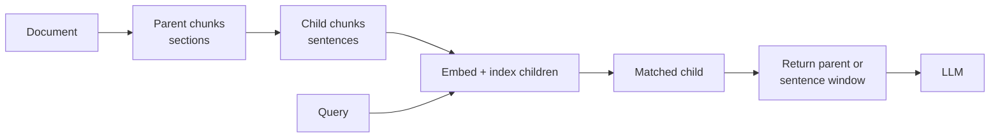

# Chunking Strategies

## Overview
**Chunking** splits documents into the units you embed, index, and retrieve. Each chunk becomes one vector, so the chunk sets **what the retriever can find** and **what the LLM gets to read**. Bad chunks cannot be fixed later by a better retriever or reranker. This note goes deeper than the short table in [[11.12 RAG]].

## Why It Matters: Granularity vs Context

| | **Small chunks** (1-3 sentences) | **Large chunks** (whole sections) |
|---|---|---|
| Embedding | Sharp: one idea per vector | Blurry: many ideas averaged into one vector |
| Retrieval precision | High | Lower: matches on a side topic drag in the rest |
| Context for the LLM | Too little: pronouns and "the company" lose their referent | Plenty |
| Token cost per hit | Low | High, and adds noise ([[11.28 Context Rot]]) |

- The tension: **the best unit to match on is smaller than the best unit to read**
- Several strategies below (parent-child, sentence-window, late chunking, chunk headers) exist only to break that trade-off
- Number of chunks for a document of $L$ tokens, chunk size $s$, overlap $o$: $n \approx \frac{L - o}{s - o}$. Overlap multiplies index size and embedding cost

## Strategy Comparison

| Strategy | How it splits | Strength | Weakness | Use when |
|---|---|---|---|---|
| **Fixed-size** | Every N tokens or characters | Trivial, predictable size | Cuts mid-sentence and mid-table | Baseline; uniform plain text |
| **Recursive character** | Tries separators in order (`\n\n`, `\n`, space) until pieces fit the size limit | Keeps paragraphs whole when it can | Still blind to meaning | **Default** for most prose |
| **Sentence** | Sentence tokenizer, then pack sentences up to a limit | Never breaks a sentence | Sentence detection fails on code, lists, abbreviations | Q&A over clean prose |
| **Semantic (embedding-based)** | Embed sentences, cut where similarity to the next one drops | Boundaries follow topic shifts | Extra embedding pass; uneven sizes; gains not consistent | Long text with clear topic changes, no headings |
| **Document structure** | Split on markdown headers, HTML tags, PDF sections | Chunks match how authors organized the text | Needs clean structure; sections vary wildly in size | Docs, wikis, manuals, markdown |
| **Parent-child (small-to-big)** | Index small child chunks, return their larger parent | Precise match, rich context | Two stores to keep in sync; more tokens per hit | Answers need surrounding context |
| **Sentence-window** | Index single sentences, return the sentence plus K neighbors | Very precise match, local context | Window may still miss the section's point | Fact lookup in dense text |
| **Late chunking** | Embed the whole document with a long-context model, then pool token vectors per chunk | Each chunk vector "sees" the full document | Needs a long-context embedder; document must fit its window | Pronoun-heavy or cross-referencing text |
| **Contextual chunk headers** | Prepend doc title, section path, or an LLM-written blurb to each chunk | Restores missing identifiers cheaply | LLM version costs one call per chunk | Almost always: at least add title + headings |

> [!INFO] Semantic chunking in tools
> LangChain's `SemanticChunker` (experimental) embeds sentence groups and splits where the distance between neighbors passes a threshold: `percentile` (default), `standard_deviation`, `interquartile`, or `gradient`. Raising the threshold gives fewer, larger chunks.

> [!WARNING] Semantic chunking is not a free win
> "Is Semantic Chunking Worth the Computational Cost?" (Qu et al., 2024) found its gains over fixed-size chunking were not consistent enough to justify the cost. Benchmark it on your corpus before adopting it.

## Small-to-Big Retrieval

- **Parent-child**: LangChain `ParentDocumentRetriever`; LlamaIndex `HierarchicalNodeParser` + `AutoMergingRetriever`, which swaps children for their parent when enough siblings are retrieved
- **Sentence-window**: LlamaIndex `SentenceWindowNodeParser` stores neighbors in metadata; `MetadataReplacementPostProcessor` swaps them in after retrieval
- **Propositions** go even smaller: an LLM rewrites text into atomic, standalone facts ("Dense X Retrieval", Chen et al., 2023)

## Late Chunking

> [!INFO] Chunk after encoding, not before
> Normal pipeline: split, then embed each chunk alone. **Late chunking** (Günther et al., Jina AI, 2024) runs the full document through a long-context embedding model first, then mean-pools the token embeddings inside each chunk's span. Tokens in "Its population is 3.8M" were already attended to "Berlin" earlier in the document.

- No extra training, no LLM calls: same cost as one long embedding pass
- Contrast with [[11.44 Contextual RAG]]: that adds context as **text** (works for BM25 too); late chunking adds it inside the **vector** only
- Contrast with [[11.74 ColBERT & Late Interaction]]: late interaction keeps every token vector; late chunking still outputs one vector per chunk

## Size and Overlap Guidance

> [!TIP] Starting point, then measure
> - Start with **recursive splitting** plus **title and section headers** on each chunk; it is a strong baseline
> - Never exceed the **embedding model's max input**: extra tokens are often silently truncated ([[11.72 Embedding Models]])
> - Factoid questions favor smaller chunks; summary or "explain how" questions favor larger chunks or small-to-big
> - Measure chunk size in **tokens of your embedder's tokenizer**, not characters
> - Overlap is a patch for bad boundaries. With structure-aware splits you often need little or none. Chroma's study found removing overlap improved token-level IoU
> - Store `doc_id`, section path, position, and page in chunk metadata: needed for citations, filtering, and parent lookup

## Tables, Code, and PDFs

- **Tables**: never split mid-row. Keep small tables whole as markdown. For big tables, split by row groups and **repeat the header row** in every chunk. Optionally embed an LLM summary but return the raw table
- **Code**: split on syntax units (function, class) with an AST parser such as tree-sitter, not on character counts. Prepend file path and enclosing class ([[11.23 Workspace Indexing]], [[11.29 One Function Per File for LLM Indexing]])
- **PDFs**: parse first, chunk second. Use a layout-aware parser (e.g. Unstructured, Docling) to fix reading order in columns, drop repeated headers and footers, and recover headings. Scans need OCR
- **Slides, figures, charts**: see [[11.76 Multimodal RAG]]
- **Lists and FAQs**: one Q&A pair or list item group per chunk; keep the question with its answer

## Evaluating Chunk Settings

- Build a small eval set: queries plus the **gold passage** (text span, not chunk ID, so it survives re-chunking)
- Compare settings on retrieval metrics first: Recall@K, MRR ([[11.71 RAG Evaluation]]), then check end-to-end answer quality
- Token-level view from Chroma's "Evaluating Chunking Strategies for Retrieval" (Smith & Troynikov, 2024), with $T_r$ retrieved tokens and $T_g$ gold tokens:

$$\text{IoU} = \frac{|T_r \cap T_g|}{|T_r \cup T_g|}$$

- IoU punishes both missed facts and wasted tokens, so it rewards chunks that are just big enough
- Fix the retriever, reranker, and K while sweeping chunk size, or you cannot tell what changed
- Track index size and ingestion cost too: smaller chunks and overlap mean more vectors

## Pitfalls

> [!WARNING] Common mistakes
> - Copying a default size (e.g. "1000 characters") from a tutorial without testing it
> - Splitting before cleaning: boilerplate, nav menus, and page footers become top-ranked chunks
> - Orphan chunks with no title or section: retrievable by nobody ([[11.66 RAG Failure Modes]])
> - Different chunks for the dense and sparse indexes, which breaks fusion ([[11.65 Hybrid Search (Dense + Sparse)]])
> - Changing the chunker without re-indexing everything, leaving a mixed index
> - Assuming long context removes the need to chunk ([[11.75 Long Context vs RAG]])

## Related Concepts
- [[11_LLM_Dev_MOC]] - parent index
- [[11.12 RAG]] - pipeline whose indexing stage this expands
- [[11.44 Contextual RAG]] - LLM-written chunk headers, the text-side fix
- [[11.66 RAG Failure Modes]] - bad chunks as an ingestion failure
- [[11.72 Embedding Models]] - max input length bounds chunk size
- [[11.74 ColBERT & Late Interaction]] - contrast: token vectors vs late-chunked vectors
- [[11.71 RAG Evaluation]] - how to compare chunk settings
- [[11.65 Hybrid Search (Dense + Sparse)]] - both indexes must share chunks
- [[11.68 Reranking (Cross-Encoders)]] - fixes ranking, not bad boundaries
- [[11.23 Workspace Indexing]] - AST chunking for code
- [[11.76 Multimodal RAG]] - chunking slides, figures, and scans
- [[11.75 Long Context vs RAG]] - when to skip chunking entirely

## References
- "Late Chunking: Contextual Chunk Embeddings Using Long-Context Embedding Models" (Günther, Mohr, Williams, Wang, Xiao, 2024), arXiv:2409.04701
- "Is Semantic Chunking Worth the Computational Cost?" (Qu, Tu, Bao, 2024), arXiv:2410.13070
- "Dense X Retrieval: What Retrieval Granularity Should We Use?" (Chen et al., 2023), arXiv:2312.06648
- "Evaluating Chunking Strategies for Retrieval" (Smith & Troynikov, Chroma, 2024)
- LangChain `SemanticChunker` and LlamaIndex node parser docs
