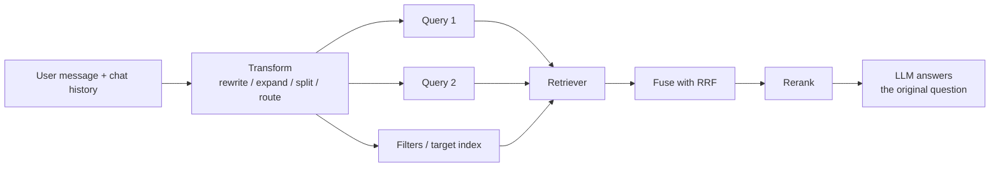

# Query Transformation

## Overview
**Query transformation** rewrites the user's message before it reaches the retriever. Users type vague, short, multi-part, or context-dependent questions, and the raw text is often a poor search key. A transformation step (usually one cheap LLM call) turns it into one or more queries that match how the documents are written. It sits between the user and the retrieval stage of [[11.12 RAG]].

> [!INFO] Two sides of the same gap
> The query and the document often use different words. You can fix the **query side** at query time (this note) or the **document side** at index time ([[11.44 Contextual RAG]], doc2query). Query-side fixes cost latency on every request. Index-side fixes cost once.

## Techniques

### Conversational Rewrite (Standalone Query)
- Follow-ups like *"what about the pro plan?"* mean nothing to a retriever on their own
- An LLM reads the chat history and writes a **standalone query**: *"pricing of the pro plan for the X product"*
- Almost always worth it in chat products. Skip it on the first turn, where there is no history to resolve
- Ma et al. (2023, "Rewrite-Retrieve-Read") showed the rewriter can be a small trained model instead of the big LLM

### Multi-Query and RAG-Fusion
- Generate 3-5 **paraphrases** of the query, retrieve for each, then merge the lists
- **RAG-Fusion** (Rackauckas, 2024) merges them with **Reciprocal Rank Fusion** (RRF): documents found by many variants rise to the top. The RRF formula is in [[11.65 Hybrid Search (Dense + Sparse)]]
- Fixes **wording sensitivity**: one phrasing misses a doc that another phrasing finds
- Searches run in parallel, so latency is one LLM call plus the slowest search

### Decomposition (Sub-Questions)
- Split a compound question into simpler ones: *"Compare the refund policy of plan A and plan B"* becomes two lookups
- **Parallel** sub-questions: independent parts, retrieve each, answer together
- **Sequential** sub-questions: the second depends on the first answer (multi-hop). Inspired by least-to-most prompting (Zhou et al., 2022), where each step uses earlier answers
- Sequential chains are where this turns into [[11.73 Agentic RAG]]

### Step-Back Prompting
- Ask a more **general** question first, then the specific one (Zheng et al., 2023, Google DeepMind; ICLR 2024)
- *"Was Einstein's 1905 paper on X peer reviewed?"* steps back to *"How did journal review work in 1905?"*
- Retrieve for **both** the original and the step-back question. The general passages give the background the specific passage assumes
- Helps on questions that need principles or context, not just one fact

### HyDE
- Have the LLM write a fake answer and search with its embedding instead of the query
- Same family: it changes the search key. Mechanics in [[11.45 Hypothetical Document Embeddings (HyDE)]], trade-offs in [[11.64 HyDE vs Standard RAG]]
- **Query2doc** (Wang et al., 2023, Microsoft) is the sparse-friendly cousin: append the generated pseudo-document to the query text and run BM25 on the combined text

### Query Expansion
- Add **synonyms, acronyms, and related terms** so keyword search finds more matches: *"k8s OOM"* adds *"Kubernetes out of memory, OOMKilled"*
- Sources: a domain glossary (cheap, no LLM), or an LLM-generated term list
- Matters most for the sparse side of hybrid search. Dense embeddings already handle many synonyms
- **Contrast, doc2query** (Nogueira et al., 2019): expands the **documents** instead, by appending the questions each document is likely to answer before indexing. No per-query cost

### Routing
- Pick **where** to search before searching: which index, which tool, or whether to retrieve at all
- *"What's my order status?"* goes to an orders API; *"how do returns work?"* goes to the policy docs; *"hi"* skips retrieval
- Implemented as an LLM classifier, a tool call ([[11.03 LLM Tool Calls]]), or a small fine-tuned classifier for speed
- A wrong route returns nothing useful, so log routes and evaluate them

### Self-Query (Metadata Filter Extraction)
- An LLM pulls **structured filters** out of the text and leaves a cleaner semantic query
- *"Python tutorials from 2024 under 10 minutes"* becomes query `python tutorial` + filter `year = 2024 AND duration < 10`
- Filters run in the vector store ([[23.01 Vector Databases]]), so dates, authors, and categories are matched exactly instead of hoped for in embeddings
- Needs a declared schema of filterable fields. LangChain calls this a self-query retriever

## Comparison Table

| Technique | What it fixes | Extra LLM calls | When to use |
|---|---|---|---|
| **Conversational rewrite** | Pronouns and references to earlier turns | 1 | Any multi-turn chat |
| **Multi-query / RAG-Fusion** | One phrasing misses relevant docs | 1 (outputs N queries) | Ambiguous or short queries, recall too low |
| **Decomposition** | Compound or multi-hop questions | 1 to plan, +1 per hop if sequential | Comparisons, "A and B" questions, chains of facts |
| **Step-back** | Missing background or principles | 1 | Reasoning questions in STEM, history, policy |
| **HyDE / Query2doc** | Question and answer phrased differently | 1 | Zero-shot domains, generic embedder |
| **Query expansion** | Vocabulary mismatch in keyword search | 0 (glossary) or 1 | Jargon, acronyms, BM25-heavy setups |
| **Routing** | Searching the wrong source | 1 (or a small classifier) | Several indexes, tools, or APIs |
| **Self-query** | Constraints buried in natural language | 1 | Catalogs, docs with dates, authors, types |

Several of these fit in **one prompt**: a single structured-output call can return a standalone query, 3 variants, filters, and a route together.

## Latency and Cost

- Each LLM call before retrieval adds time to first token, often a few hundred ms with a small model
- Use a **small, fast model** for rewriting. It is a narrow task; the big model is for the answer
- **Parallelize** the searches after the rewrite. N queries cost N embeddings and N searches, not N times the latency
- More queries mean more candidates. Pair with a reranker ([[11.68 Reranking (Cross-Encoders)]]) or the context window fills with near-duplicates
- **Cache** rewrites for repeated queries. Set temperature to 0 so the same input gives the same query
- Add techniques only when an eval shows a gain ([[11.71 RAG Evaluation]]): measure Recall@K before and after

> [!WARNING] Pitfalls
> - **Intent drift**: the rewrite answers a different question than the user asked. RAG-Fusion's own paper notes answers going off topic when generated queries are not close enough to the original
> - **Lost exact terms**: the LLM "cleans up" an error code, SKU, or name. Tell it to keep identifiers verbatim, and send the raw query to BM25 as well
> - **Wrong filters**: self-query invents a filter value that does not exist and returns zero results. Validate against the schema and fall back to no filter
> - **Over-decomposition**: simple lookups split into needless sub-questions, adding latency and noise
> - **Answering the rewrite**: always generate the final answer against the **original** user message, not the transformed query

> [!TIP] Practical default
> Start with conversational rewrite (chat only) plus hybrid search and a reranker. Add multi-query if recall is low, self-query if users mention dates or categories, and routing once you have more than one source.

## Practical Use Cases

- **Support chatbots**: rewrite follow-ups, route between order APIs and help docs
- **E-commerce and catalog search**: self-query turns *"red shoes under $50"* into filters plus a query
- **Research assistants**: decomposition and step-back for multi-part analytical questions
- **Internal docs with heavy jargon**: glossary-based expansion feeding the BM25 side

## Related Concepts
- [[11_LLM_Dev_MOC]] - parent index
- [[11.12 RAG]] - pipeline this step plugs into
- [[11.45 Hypothetical Document Embeddings (HyDE)]] - one query transformation, covered in depth
- [[11.64 HyDE vs Standard RAG]] - when HyDE helps or hurts
- [[11.65 Hybrid Search (Dense + Sparse)]] - RRF fusion and the sparse side expansion targets
- [[11.44 Contextual RAG]] - index-side alternative to query-side fixes
- [[11.68 Reranking (Cross-Encoders)]] - cleans up the larger candidate set
- [[11.73 Agentic RAG]] - sequential decomposition and routing grown into a loop
- [[11.71 RAG Evaluation]] - prove each transformation earns its latency
- [[11.66 RAG Failure Modes]] - query-stage failures these techniques address

## References
- "Query Rewriting for Retrieval-Augmented Large Language Models" (Ma et al., EMNLP 2023)
- "RAG-Fusion: a New Take on Retrieval-Augmented Generation" (Rackauckas, 2024)
- "Take a Step Back: Evoking Reasoning via Abstraction in Large Language Models" (Zheng et al., Google DeepMind, 2023)
- "Least-to-Most Prompting Enables Complex Reasoning in Large Language Models" (Zhou et al., 2022)
- "Query2doc: Query Expansion with Large Language Models" (Wang, Yang, Wei, EMNLP 2023)
- "Document Expansion by Query Prediction" (Nogueira et al., 2019)
- "Precise Zero-Shot Dense Retrieval without Relevance Labels" (Gao et al., 2022)
