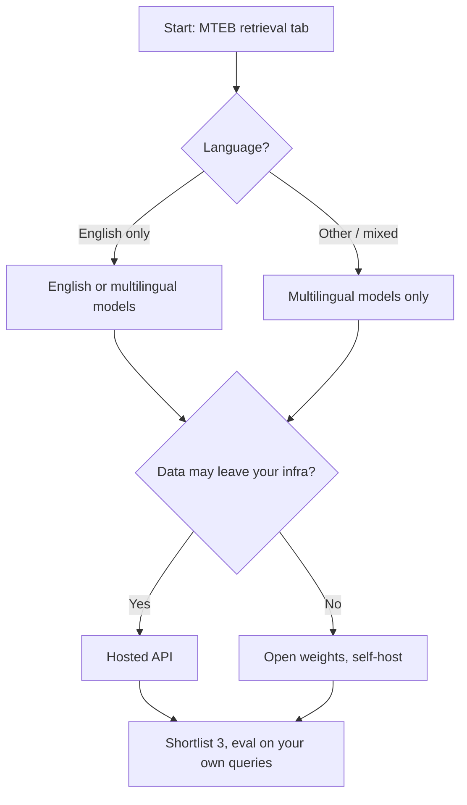

# Embedding Models

## Overview
An **embedding model** (also called a **bi-encoder**) turns a piece of text into one fixed-size vector, so that texts with similar meaning land close together. In [[11.12 RAG]] it does two jobs: it embeds every chunk once at index time, and it embeds each query at search time. Retrieval quality is capped by this model: if the right chunk is not near the query vector, no later step can find it.

> [!INFO] Bi-encoder vs cross-encoder
> A bi-encoder encodes query and document **separately**, so document vectors can be precomputed and searched fast. A cross-encoder reads both **together** and scores the pair. It is more accurate but too slow for a whole corpus, so it is used as a second stage ([[11.68 Reranking (Cross-Encoders)]]).

## How They Are Trained

Most modern embedders are a Transformer encoder (or a small LLM) plus a pooling step (mean of token vectors, or the `[CLS]` token), trained with **contrastive learning**: pull matching pairs together, push non-matching pairs apart.

- **Positive pair**: (query, relevant passage), (question, answer), (title, body)
- **In-batch negatives**: every other passage in the batch counts as a wrong answer for this query. Free negatives, so bigger batches help
- **Hard negatives**: passages that look relevant but are not (e.g. top BM25 hits that do not answer the query). They teach fine distinctions and matter more than easy random negatives
- **Loss (InfoNCE)**: a softmax over the positive and all negatives, with temperature $\tau$:

$$\mathcal{L} = -\log \frac{e^{\text{sim}(q, p^+)/\tau}}{e^{\text{sim}(q, p^+)/\tau} + \sum_{j} e^{\text{sim}(q, p_j^-)/\tau}}$$

- **Typical recipe**: (1) weakly supervised pre-training on huge amounts of web text pairs, then (2) fine-tuning on smaller labeled retrieval sets with mined hard negatives. E5 (Wang et al., 2022) and GTE (Li et al., 2023) both follow this two-stage pattern
- `sim` is usually cosine, which is why most embedders expect cosine or dot product on normalized vectors ([[23.06 Vector Similarity Metrics]])

> [!WARNING] False negatives
> A mined "hard negative" is sometimes actually relevant (the labels were incomplete). Training then pushes away a correct answer. Filter mined negatives, e.g. drop any that a cross-encoder scores close to the positive.

## Symmetric vs Asymmetric Retrieval

| | **Symmetric** | **Asymmetric** |
|---|---|---|
| Inputs look like | Each other (sentence vs sentence) | Different (short question vs long passage) |
| Examples | Duplicate questions, paraphrase, clustering | RAG, web search, QA over docs |
| What to do | Encode both sides the same way | Tell the model which side is which |

Many models handle asymmetry with a **prefix** or **instruction** added to the text. Each family has its own convention, and it must be the same at index time and query time.

| Family | Query side | Document side |
|---|---|---|
| E5 | `query: ` | `passage: ` (symmetric tasks: `query: ` on both) |
| Nomic | `search_query: ` | `search_document: ` |
| Cohere | `input_type="search_query"` | `input_type="search_document"` |
| Voyage | `input_type="query"` (prepends an instruction for you) | `input_type="document"` |

- Some LLM-based embedders accept a free-text **task instruction** on the query (e.g. "Given a bug report, retrieve the relevant code"). This lets one model adapt to many tasks
- Jina v3 swaps in a task-specific **LoRA adapter** instead of a text prefix

> [!WARNING] Silent failure
> Forgetting the prefix, or using the query prefix on documents, does not crash anything. Recall just drops. Read the model card before indexing.

## Choosing a Model

- **MTEB leaderboard**: the standard starting point. The Massive Text Embedding Benchmark (Muennighoff et al., 2022) launched with 8 task types, 58 datasets, 112 languages. MMTEB (Enevoldsen et al., 2025) extended it to 500+ tasks across 250+ languages
- **Domain**: legal, medical, code, and finance text differ from web text. Some vendors ship domain models (e.g. Voyage code, law, finance)
- **Language**: an English model on Thai or mixed-language text can be far worse than its score suggests. Filter the leaderboard by language
- **Max sequence length**: text past the limit is **silently truncated**. 512 tokens is common for older encoders; many newer models take 8k or more. Your chunk size ([[11.69 Chunking Strategies]]) must fit
- **Dimensions**: storage and search cost grow with dimension. 768 vs 3072 floats is a 4x difference in memory
- **Cost and latency**: hosted APIs charge per token; self-hosting costs GPU time. Re-embedding the corpus is the big bill, queries are small
- **Hosted vs open**: hosted is zero-ops but sends data out and can be deprecated. Open weights give control, can be fine-tuned, and never change under you

> [!WARNING] MTEB caveats
> - The **average score** mixes classification, clustering, and more. Look at the **Retrieval** column only
> - Some models train on data close to benchmark test sets, so scores can be inflated. Prefer models with documented training data
> - Small gaps (under a point) rarely survive on your own data
> - The only score that counts is **Recall@K on your queries** ([[11.71 RAG Evaluation]]). 50-100 labeled queries is enough to compare a shortlist

## Matryoshka Embeddings (Dimension Truncation)

**Matryoshka Representation Learning** (Kusupati et al., 2022) trains the model so that the **first** $m$ dimensions are a good embedding on their own, for several $m$ (e.g. 64, 128, ..., full). The loss is summed over each prefix length. Named after nested Russian dolls.

- You can **cut the vector** (keep the first 256 of 1024 values) and **re-normalize**. Quality drops a little, cost drops a lot
- Without Matryoshka training, truncation destroys quality. Only do it on models that support it
- Common use: **funnel search**. Search with short vectors to get candidates, then rescore with full vectors
- API form: OpenAI's `dimensions` parameter, Voyage's `output_dimension`, Cohere Embed v4+ dimension options

## Embedding Quantization

Separate from model weight [[11.39 Quantization]]: this compresses the **stored vectors**.

| Type | Bits per value | Size vs float32 | Retained quality (HF blog, 2024) |
|---|---|---|---|
| float32 | 32 | 1x | 100% |
| **int8** (scalar) | 8 | 4x smaller | ~97-99% |
| **binary** | 1 | 32x smaller | ~92.5%, ~96% with rescoring |

- **Binary**: keep only the sign of each value (`>0` becomes 1). Compare with **Hamming distance** (count differing bits), which is very fast
- **int8**: map each dimension's value range to 256 buckets, using ranges learned from a sample
- **Rescoring**: retrieve e.g. 4x top-K with binary vectors, then rescore those candidates with the float32 query
- Stacks with Matryoshka: truncate **and** binarize for very large corpora
- Several APIs return int8 / binary directly (Cohere, Voyage); vector stores also quantize internally ([[23.07 ANN Indexes (HNSW, IVF, PQ)]])

## Fine-Tuning on Your Data

Worth it when your domain has its own vocabulary and an off-the-shelf model's Recall@K is clearly too low.

1. **Collect pairs**: real (query, clicked/cited chunk) logs, or have an LLM write a question for each chunk (synthetic queries)
2. **Mine hard negatives**: retrieve with the base model, take high-ranked chunks that are not the positive
3. **Train** with an in-batch-negatives contrastive loss (in sentence-transformers: `MultipleNegativesRankingLoss`), starting from a strong open model
4. **Evaluate** on a held-out query set before and after; watch that general queries do not regress

> [!TIP] Try cheaper fixes first
> Hybrid search ([[11.65 Hybrid Search (Dense + Sparse)]]), a reranker, and better chunking often close the gap with no training. Fine-tune when those plateau.

## Switching Models Means Full Re-Embed

> [!WARNING] Vectors from different models are not compatible
> Each model has its own vector space. A query embedded with model B cannot search vectors from model A, even at the same dimension. Changing model, version, prefix, or truncation size means **re-embedding the whole corpus**.
> - Store the **model name + version + settings** next to every index
> - Keep raw chunk text so you can re-embed without re-parsing sources
> - Migrate with a **shadow index**: build the new one alongside, compare on your eval set, then switch reads
> - Exception: a vendor may state that models share one space (e.g. Cohere Embed 5 Pro and Fast). Trust only explicit claims

## Model Families

Specs checked on official docs and model cards on 2026-10-26. Versions move fast: re-check before relying on a number.

| Family | Open? | Dims (default, options) | Max tokens | Notable feature |
|---|---|---|---|---|
| **OpenAI text-embedding-3** (small / large) | Closed API | 1536 / 3072, shorten via `dimensions` | 8192 | Matryoshka-style shortening built into the API |
| **Cohere Embed v3** | Closed API | 1024 (light: 384) | 512 | Required `input_type`; int8 and binary output |
| **Cohere Embed v4 / Embed 5** | Closed API | v4: 1536 (256-1536); v5: 2048 (256-2048) | 128k | Text + images + PDF pages in one space; Matryoshka |
| **Voyage 4** family | Closed API (`voyage-4-nano` open weights) | 1024 (256, 512, 2048) | 32k | `input_type` prepends instruction; int8/binary output; code, law, finance models |
| **BGE-M3** (BAAI) | Open, MIT | 1024 | 8192 | Dense + sparse + multi-vector from one model; 100+ languages |
| **multilingual-E5-large** | Open, MIT | 1024 | 512 | `query:` / `passage:` prefixes |
| **GTE multilingual-base** (Alibaba) | Open, Apache-2.0 | 768 (elastic 128-768) | 8192 | 70+ languages; also outputs sparse weights |
| **Nomic Embed Text v1.5** | Open, Apache-2.0 | 768 (Matryoshka to 64) | 8192 | Training data and code released |
| **Jina Embeddings v3** | Open weights, CC BY-NC 4.0 | 1024 (Matryoshka to 32) | 8192 | Task LoRA adapters; non-commercial license |

> [!TIP] Reading the table
> - "Open" means you can self-host and fine-tune. Check the license: Jina v3 weights are **non-commercial**
> - BGE-M3's multi-vector mode is ColBERT-style late interaction ([[11.74 ColBERT & Late Interaction]])
> - For image or PDF retrieval, see [[11.76 Multimodal RAG]]

## Practical Use Cases

- **Default RAG stack**: a strong general embedder + BM25 hybrid + reranker. Pick the embedder by Recall@K on your own queries
- **Large corpus on a budget**: Matryoshka truncation + binary vectors + float rescoring
- **Multilingual knowledge base**: a multilingual model (BGE-M3, multilingual-E5, Cohere multilingual) so a Thai query can find an English doc
- **Private data**: open model self-hosted, fine-tuned on synthetic queries from your own chunks
- **Query-side tricks**: [[11.64 HyDE vs Standard RAG|HyDE]] and [[11.70 Query Transformation]] change what gets embedded, not the model

## Related Concepts
- [[11_LLM_Dev_MOC]] - parent index
- [[11.12 RAG]] - pipeline where the embedder is the first stage
- [[23.06 Vector Similarity Metrics]] - cosine vs dot product on embeddings
- [[23.07 ANN Indexes (HNSW, IVF, PQ)]] - how stored vectors are searched fast
- [[11.65 Hybrid Search (Dense + Sparse)]] - covers dense blind spots like IDs
- [[11.68 Reranking (Cross-Encoders)]] - contrast: joint encoding, second stage
- [[11.74 ColBERT & Late Interaction]] - multi-vector alternative to one vector
- [[11.69 Chunking Strategies]] - chunk size must fit max sequence length
- [[11.71 RAG Evaluation]] - how to compare embedders on your data
- [[11.39 Quantization]] - contrast: weight quantization, not vector quantization
- [[23.01 Vector Databases]] - where the embeddings are stored

## References
- "MTEB: Massive Text Embedding Benchmark" (Muennighoff, Tazi, Magne, Reimers, 2022)
- "MMTEB: Massive Multilingual Text Embedding Benchmark" (Enevoldsen et al., 2025)
- "Matryoshka Representation Learning" (Kusupati et al., 2022)
- "Text Embeddings by Weakly-Supervised Contrastive Pre-training" (Wang et al., 2022), E5
- "Towards General Text Embeddings with Multi-stage Contrastive Learning" (Li et al., 2023), GTE
- "BGE M3-Embedding: Multi-Lingual, Multi-Functionality, Multi-Granularity Text Embeddings Through Self-Knowledge Distillation" (Chen et al., 2024)
- "jina-embeddings-v3: Multilingual Embeddings With Task LoRA" (Sturua et al., 2024)
- "Binary and Scalar Embedding Quantization for Significantly Faster & Cheaper Retrieval" (Shakir, Aarsen, Lee, Hugging Face blog, 2024)
