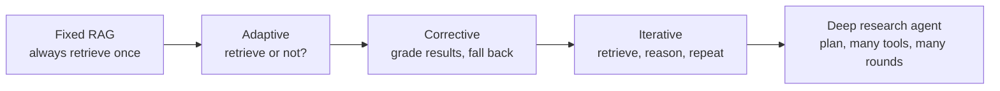
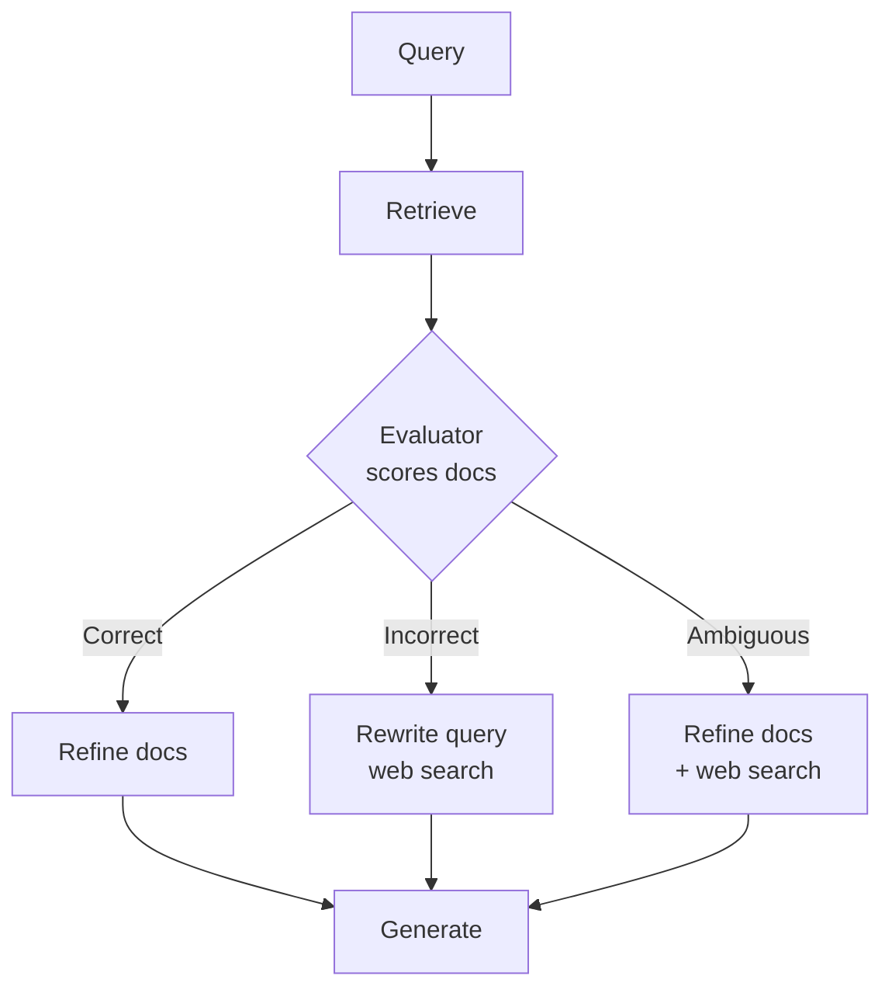

# Agentic RAG

## Overview
**Agentic RAG** lets the model control retrieval instead of running a fixed pipeline. In plain [[11.12 RAG]], every query goes through the same steps: embed, search top-K, stuff the prompt, answer. In agentic RAG the model decides **whether** to retrieve, **what** to search for, **which source** to use, and **when it has enough**. It trades extra cost and latency for better answers on hard, multi-step questions.

## The Spectrum

Agentic is not on or off. Each step to the right hands one more decision to the model.



- **Left side**: code decides. Cheap, fast, predictable.
- **Right side**: the model decides. Slower, costly, handles questions the left side cannot.

## Retrieval as a Tool Call

The simplest agentic setup: expose search as a tool ([[11.03 LLM Tool Calls]]) and let the agent loop ([[11.02 LLM Agents]]) call it.

- The model writes its own query, often better than the raw user message
- It can call search zero, one, or many times
- It can call different tools for different sources (vector store, SQL, web)

```text
search_docs(query: str, top_k: int = 5, filter: dict | None) -> list[Chunk]
```

> [!TIP] Tool design matters
> Return short chunks with source IDs. Say in the tool description what the index contains, so the model knows when *not* to use it.

## Adaptive Retrieval

**Adaptive retrieval** decides per query whether retrieval is needed at all. "What is 2+2?" needs no search. "Compare our Q3 and Q4 refund policy" needs several.

- **Adaptive-RAG** (Jeong et al., 2024): a small **classifier** predicts query complexity, then routes to one of three strategies:
  - **No retrieval**: the LLM answers from its own knowledge
  - **Single-step**: one retrieval, then answer
  - **Multi-step**: iterative retrieval for complex questions
- The classifier is trained on labels generated automatically from which strategy got the answer right
- Point: do not pay multi-step cost on easy questions, and do not fail hard questions with one-shot search

## Self-RAG

**Self-RAG** (Asai et al., 2023) trains one LM to retrieve on demand and critique itself using special **reflection tokens** it emits during generation.

| Token | Values | Question it answers |
|---|---|---|
| **Retrieve** | yes, no, continue | Do I need to retrieve now? |
| **IsRel** | relevant, irrelevant | Is this passage relevant to the input? |
| **IsSup** | fully, partially, no support | Is my output backed by the passage? |
| **IsUse** | 1 to 5 | How useful is the response overall? |

- Training: a separate **critic** model labels a corpus with reflection tokens offline, then the generator learns to produce them itself
- Inference: retrieval fires when the probability of `Retrieve=yes` passes a **tunable threshold**; critique scores rank candidate outputs
- Downside: needs a fine-tuned model. You cannot bolt it onto a closed API model as-is (but you can copy the idea with prompted grading steps)

## Corrective RAG (CRAG)

**CRAG** (Yan et al., 2024) adds a **retrieval evaluator** after search and acts on its verdict. It is plug-and-play: no change to the generator.



- **Retrieval evaluator**: a lightweight fine-tuned T5-large that scores each query-document pair
- **Web search fallback**: when the local corpus has nothing good, rewrite the query into keywords and search the web
- **Knowledge refinement** (decompose-then-recompose): split docs into small **strips**, score each, drop the irrelevant ones, join the rest in order. Less noise in the prompt

## Iterative / Multi-hop Retrieval

**Multi-hop** questions need fact A before you know to search for fact B ("Where was the director of film X born?"). One search on the raw question cannot find B. See the multi-hop row in [[11.66 RAG Failure Modes]].

- **IRCoT** (Trivedi et al., 2022): interleave retrieval with [[11.13 Chain of Thought|chain-of-thought]]. Each new reasoning sentence becomes the next search query; the new passages feed the next reasoning step. Prompting only, no training
- **ReAct** (Yao et al., 2022): the model writes Thought, Action, Observation in a loop. On HotpotQA the actions were `search[entity]`, `lookup[string]`, and `finish[answer]` over a Wikipedia API. This loop is the base of most tool-calling agents today ([[11.11 Agentic LLM]])
- Both need a **stop rule**: a max step count, or the model emitting a final answer

## Multi-source Routing

A **router** picks the right source for each query instead of searching everything.

- Sources: vector store, keyword index, SQL database, [[11.43 Graph RAG|knowledge graph]], web, internal APIs
- Router types: an LLM call with a list of sources, a small classifier, or simply one tool per source and let the agent choose
- Pair with [[11.70 Query Transformation]]: the router can also rewrite or split the query per source

## Deep-Research-Style Agents

The far right of the spectrum. The agent **plans** a research task, runs **many searches** across many sources, reads, reflects on gaps, searches again, and writes a long cited report.

- Often **multi-agent**: a lead agent plans and spawns subagents that each search one sub-question in their own context window, then the lead merges results
- A separate citation pass can attach each claim to a source
- Token use is much higher than a single chat turn; worth it only for broad, open-ended questions

## Comparison

| Method | Who decides | Extra cost | Best for |
|---|---|---|---|
| **Fixed RAG** | Code | None (baseline) | Simple lookups, FAQ, narrow corpus |
| **Retrieval as tool** | LLM, per turn | 1+ extra LLM call | Chat apps where many turns need no search |
| **Adaptive-RAG** | Small classifier | One cheap classifier call | Mixed traffic of easy and hard queries |
| **Self-RAG** | Fine-tuned LM via tokens | Fine-tuning; multiple candidates | Factuality and citation-heavy long answers |
| **CRAG** | Retrieval evaluator | Evaluator pass; web search on misses | Corpora with coverage gaps |
| **IRCoT / ReAct** | LLM, every step | N retrieval + LLM calls | Multi-hop QA |
| **Routing** | Router (LLM or classifier) | One routing call | Many heterogeneous sources |
| **Deep research** | Planner agent + subagents | Very high (many calls, many tokens) | Open-ended research reports |

## Trade-offs

> [!WARNING] What you pay
> - **Latency**: each loop step is a full LLM call plus a search. Five steps can mean many seconds
> - **Cost**: tokens grow with every step, since each call re-reads the history ([[11.16 Context Window Management]])
> - **Loops that don't stop**: the model keeps searching for an answer the corpus does not have. Always cap steps, tokens, and wall time
> - **Harder evaluation**: the path changes per run, so you must grade the trajectory (which searches, how many) as well as the final answer ([[11.71 RAG Evaluation]])
> - **More attack surface**: retrieved text now steers future actions, so [[11.53 Prompt Injection]] and [[11.47 Knowledge Base Poisoning]] hit harder

> [!TIP] When plain RAG is enough
> - Questions are mostly single-hop and the corpus covers them
> - Latency budget is tight (search box, voice)
> - Fix retrieval quality first: [[11.65 Hybrid Search (Dense + Sparse)|hybrid search]], [[11.68 Reranking (Cross-Encoders)|reranking]], [[11.69 Chunking Strategies|better chunks]]. An agent loop on top of bad retrieval just fails more slowly
> - Add agentic steps one at a time (start with a relevance check or a retrieve-or-not decision) and measure each

## Practical Use Cases

- **Support bots**: route between docs, ticket history, and account APIs; skip search on small talk
- **Multi-hop enterprise QA**: "Which team owns the service that failed in incident 412?" needs two lookups
- **Analyst research**: deep-research agents for market or literature reviews
- **Fact-checking**: grade retrieved evidence, fall back to web, or search for counter-evidence ([[11.46 Falsification-Verification RAG (FVA-RAG)]])

## Related Concepts
- [[11_LLM_Dev_MOC]] - parent index
- [[11.12 RAG]] - the fixed pipeline this generalizes
- [[11.02 LLM Agents]] - the agent loop that drives retrieval
- [[11.03 LLM Tool Calls]] - retrieval exposed as a tool
- [[11.11 Agentic LLM]] - ReAct, reflection, and planning patterns
- [[11.66 RAG Failure Modes]] - multi-hop failures this fixes
- [[11.70 Query Transformation]] - query rewriting used inside the loop
- [[11.71 RAG Evaluation]] - evaluating non-deterministic retrieval paths
- [[11.46 Falsification-Verification RAG (FVA-RAG)]] - agentic verification variant
- [[11.75 Long Context vs RAG]] - alternative to many retrieval rounds

## References
- "Self-RAG: Learning to Retrieve, Generate, and Critique through Self-Reflection" (Asai et al., 2023), arXiv:2310.11511
- "Corrective Retrieval Augmented Generation" (Yan et al., 2024), arXiv:2401.15884
- "Adaptive-RAG: Learning to Adapt Retrieval-Augmented Large Language Models through Question Complexity" (Jeong et al., 2024), arXiv:2403.14403
- "Interleaving Retrieval with Chain-of-Thought Reasoning for Knowledge-Intensive Multi-Step Questions" (Trivedi et al., 2022), arXiv:2212.10509
- "ReAct: Synergizing Reasoning and Acting in Language Models" (Yao et al., 2022), arXiv:2210.03629
- "How we built our multi-agent research system" (Anthropic Engineering, 2025)
