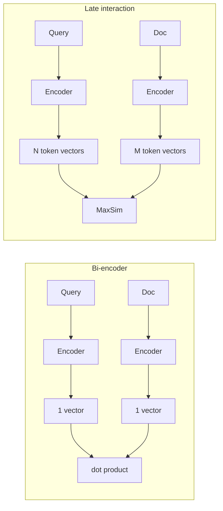

# ColBERT & Late Interaction

## Overview
**Late interaction** encodes the query and the document separately, but keeps **one vector per token** instead of one vector per text. Relevance is computed by matching those token vectors at search time. **ColBERT** (Khattab & Zaharia, SIGIR 2020) introduced the idea. It sits between fast single-vector search and accurate but slow cross-encoders.

## Three Interaction Styles

- **Bi-encoder** (no interaction): query and doc each become one vector. Score = one dot product.
- **Cross-encoder** (full interaction): query and doc go through the model *together*. Every query token attends to every doc token. See [[11.68 Reranking (Cross-Encoders)]].
- **Late interaction**: encode separately like a bi-encoder, then compare **token vectors** cheaply after encoding.

| | **Bi-encoder** | **Late interaction (ColBERT)** | **Cross-encoder** |
|---|---|---|---|
| Interaction | None (one vector each) | Token-level, after encoding | Full attention over the pair |
| Accuracy | Good | Close to cross-encoder | Best |
| Query-time speed | Fastest | Fast (cheap MaxSim) | Slow (one model pass per pair) |
| Storage | 1 vector per doc | 1 vector per **token** (large) | Nothing to store |
| Precompute docs offline | Yes | Yes | No |
| Typical role | First-stage retrieval | Retrieval or reranking | Reranking top-K only |

> [!INFO] Why "late"
> The interaction between query and doc happens **late**, after each side is encoded on its own. Docs can be encoded once, offline. A cross-encoder interacts **early**, inside the model, so nothing can be cached.

## MaxSim Scoring

For each query token, find its **most similar** doc token. Sum those best matches:

$$S(q, d) = \sum_{i=1}^{|q|} \max_{j=1}^{|d|} \; E_{q_i} \cdot E_{d_j}^{\top}$$

- $E_{q_i}$: embedding of query token $i$. $E_{d_j}$: embedding of doc token $j$
- Vectors are normalized, so the dot product is cosine similarity ([[23.06 Vector Similarity Metrics]])
- Each query term "looks for" its best evidence in the doc. A doc must cover *all* query terms to score high
- Cost is one small matrix multiply plus a row-wise max. Far cheaper than a transformer pass

> [!EXAMPLE] Intuition
> Query: *"python memory leak"*. A single vector blurs the three words into one point. MaxSim lets "leak" match "leaking" in one sentence and "python" match "CPython" in another, then adds both matches.

## ColBERT v1 vs ColBERTv2 vs PLAID

| | **ColBERT** (2020) | **ColBERTv2** (2021, NAACL 2022) | **PLAID** (CIKM 2022) |
|---|---|---|---|
| What it is | The late-interaction model | Better training + compressed storage | Search engine for ColBERTv2 indexes |
| Key idea | BERT token vectors + MaxSim | **Residual compression** + **denoised supervision** | Prune candidates using centroids only |
| Main result | Competitive with BERT rerankers, ~2 orders of magnitude faster | 6-10x smaller index, state-of-the-art quality in and out of domain | Up to 7x faster on GPU, 45x on CPU vs vanilla ColBERTv2 |

- **ColBERT v1**: 128-dim token vectors. End-to-end search uses FAISS over all token vectors to gather candidates, then MaxSim reranks them. Short queries are padded with `[MASK]` tokens (**query augmentation**) so the model can add soft expansion terms
- **Residual compression** (v2): token vectors cluster tightly by meaning. Each vector is stored as its **nearest centroid ID** plus a **residual** (the small difference), quantized to 1 or 2 bits per dimension
- **Denoised supervision** (v2): train with **hard negatives** mined by ColBERT itself, and **distill** scores from a cross-encoder (MiniLM) with a KL-divergence loss. This cleans up noisy labels from MS MARCO
- **PLAID**: first scores passages with **centroid interaction** (centroid IDs only, no decompression), prunes low-scoring ones, then fully decompresses only the survivors. Tens of milliseconds on GPU at 140M passages

## Storage Cost and How It Shrinks

Per-token vectors are the main cost. A 300-token chunk stores 300 vectors, not one.

| Representation (128-dim token vector) | Bytes per vector |
|---|---|
| ColBERT v1, 16-bit floats | 256 |
| ColBERTv2, 2-bit residual (4-byte centroid ID + 32 bytes) | 36 |
| ColBERTv2, 1-bit residual (4 + 16 bytes) | 20 |

- On MS MARCO (about 9M passages), the index drops from **154 GiB** (v1) to **16 GiB** (1-bit) or **25 GiB** (2-bit) with ColBERTv2
- Other levers: **binarize** doc token vectors (Vespa's ColBERT embedder stores 1 bit per value, 32x smaller than float), **drop tokens** (punctuation, stopwords), **pool** similar token vectors, or **quantize** with PQ ([[23.07 ANN Indexes (HNSW, IVF, PQ)]])
- **MUVERA** (Google, 2024) turns a set of token vectors into one fixed-size vector, so a normal single-vector ANN index can do the first stage. Exact MaxSim reranks after

> [!WARNING] Storage surprises
> - Index size scales with **total tokens**, not document count. Long chunks multiply cost ([[11.69 Chunking Strategies]])
> - An HNSW graph over every token vector is huge. Many setups skip the ANN index on the multi-vector field and use it only for reranking

## Reranker vs First-Stage Retriever

| Role | How | When |
|---|---|---|
| **Reranker** | Fetch top 100-1000 with BM25 or a bi-encoder, rescore with MaxSim | Add accuracy to an existing stack. Only candidates need token vectors at query time |
| **First-stage retriever** | Full ColBERT index (PLAID) over the corpus | Corpus fits the index budget. Want better recall than a single vector gives |

- As a reranker it is a cheaper middle step before (or instead of) a cross-encoder
- Late interaction tends to generalize **out of domain** better than single-vector models, because matching stays at the token level ([[11.72 Embedding Models]])

## Tooling

| Tool | What it gives you |
|---|---|
| **Stanford ColBERT repo** (`stanford-futuredata/ColBERT`) | Reference code: train, index (`nbits=2` in examples), search. Main branch ships ColBERTv2 + PLAID. Checkpoint `colbertv2.0` trained on MS MARCO |
| **RAGatouille** (AnswerDotAI) | Simple Python wrapper: `index()`, `search()`, fine-tuning with hard-negative mining. Linux/WSL only, no native Windows |
| **Vespa** | ColBERT embedder, MaxSim written as tensor ranking expressions. Docs position it for **ranking**, not ANN retrieval |
| **Qdrant** | Multivector field with `max_sim` comparator (since v1.10.0) |
| **Weaviate** | Multi-vector embeddings (ColBERT, ColPali style). Preview in v1.29, GA in v1.30 |

See [[23.01 Vector Databases]] for the stores in general.

## Practical Use Cases

- **Precision-sensitive RAG**: legal, technical, or support docs where every query term must be covered ([[11.12 RAG]])
- **Out-of-domain corpora** with no budget to fine-tune a bi-encoder
- **Cheap reranking** on CPU where a cross-encoder is too slow
- **Visual documents**: **ColPali** (Faysse et al., ICLR 2025) applies late interaction to **page images**. A vision-language model emits one vector per image patch, matched with MaxSim. No OCR step. See [[11.76 Multimodal RAG]]
- Pair with [[11.65 Hybrid Search (Dense + Sparse)]]: hybrid for candidates, ColBERT to rerank

## Related Concepts
- [[11_LLM_Dev_MOC]] - parent index
- [[11.68 Reranking (Cross-Encoders)]] - full-interaction contrast, slower but more accurate
- [[11.72 Embedding Models]] - single-vector bi-encoders it improves on
- [[11.65 Hybrid Search (Dense + Sparse)]] - first stage feeding a ColBERT reranker
- [[11.76 Multimodal RAG]] - ColPali applies late interaction to images
- [[23.07 ANN Indexes (HNSW, IVF, PQ)]] - indexing and compressing token vectors
- [[23.01 Vector Databases]] - stores with multi-vector support
- [[23.06 Vector Similarity Metrics]] - dot product inside MaxSim
- [[11.12 RAG]] - pipeline this retriever plugs into

## References
- "ColBERT: Efficient and Effective Passage Search via Contextualized Late Interaction over BERT" (Khattab & Zaharia, SIGIR 2020), arXiv:2004.12832
- "ColBERTv2: Effective and Efficient Retrieval via Lightweight Late Interaction" (Santhanam et al., NAACL 2022), arXiv:2112.01488
- "PLAID: An Efficient Engine for Late Interaction Retrieval" (Santhanam et al., CIKM 2022), arXiv:2205.09707
- "ColPali: Efficient Document Retrieval with Vision Language Models" (Faysse et al., ICLR 2025), arXiv:2407.01449
- "MUVERA: Multi-Vector Retrieval via Fixed Dimensional Encodings" (Dhulipala et al., 2024), arXiv:2405.19504
- Qdrant docs: Vectors / Multivectors. Vespa docs: Embedding (ColBERT embedder). Weaviate v1.30 release notes
