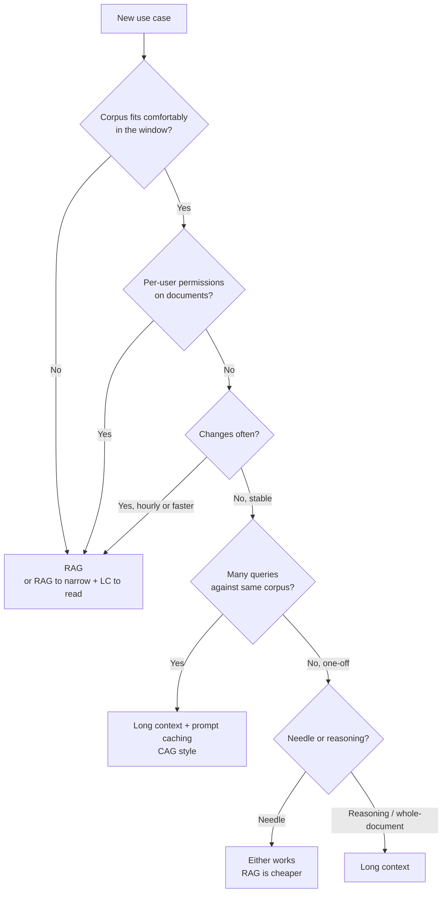

# Long Context vs RAG

## Overview
Modern models accept hundreds of thousands of tokens, so a common question is: **stuff everything into the prompt, or retrieve only what is needed?** **Long context (LC)** means sending the whole corpus or whole documents to the model. **RAG** ([[11.12 RAG]]) means searching first and sending a few relevant chunks. Neither wins everywhere. The choice depends on corpus size, how often it changes, query volume, and whether the task needs one fact or the whole picture.

## Key Concepts

- **Needle task**: the answer sits in one passage ("what is the refund window?"). Retrieval handles these well
- **Reasoning task**: the answer needs many parts of the text at once (summaries, multi-hop questions, "how does the plot end?"). Retrieval often misses pieces
- **Prefill**: the model's pass over all input tokens before it writes anything. Its cost and latency grow with input length
- **Context rot**: quality drops as input grows, even inside the advertised window. "Lost in the middle" is one form of it. See [[11.28 Context Rot]], not repeated here
- **Prompt caching**: reuse the KV cache of an unchanged prefix, so a stable corpus is paid for once per cache lifetime instead of on every call. See [[11.21 Prompt Caching]]

## Comparison Table

| | **Long context** | **RAG** |
|---|---|---|
| Cost per query | High: every call pays for the full input (much lower with a cache hit on a stable prefix) | Low: only a few chunks plus the query |
| Latency | Slow first token on a cold prefix; fast on a cache hit | Retrieval round trip plus a short prefill |
| Needle accuracy | Good when the fact is near the start or end; drops in the middle and with distractors | Good if the retriever finds the chunk; zero if it does not |
| Reasoning accuracy | Better: the model sees everything, including cross-document links | Weaker on multi-hop, implicit, and vague questions |
| Freshness | Re-send or rebuild the cache on every change | Re-index only the changed documents |
| Corpus size limit | Hard ceiling: the context window, and a softer, lower ceiling from context rot | Practically unbounded (millions of documents) |
| Citations | Possible, but the model must point to spans itself | Natural: each answer maps to retrieved chunk IDs |
| Access control | Hard: one prompt per permission set, or leaks | Filter by user ACL at retrieval time |
| Setup effort | Minimal: concatenate and send | Chunking, embeddings, index, reranker, evals |
| Debugging | Opaque: was the fact ignored or misread? | Inspectable: check what was retrieved |

> [!INFO] What the research says
> - Li et al. (2024) compared both with Gemini-1.5-Pro, GPT-4o, and GPT-3.5-Turbo. With enough budget, LC beat RAG on **average accuracy**, but RAG cost far less. About 63% of queries got the **same answer** from both
> - Their RAG failures clustered in four kinds of query: multi-step, implicit (needs the whole text), general/vague, and long complex queries
> - Xu et al. (2023) found a 4K model with simple retrieval matched a 16K extended-context model on long-context tasks with much less compute, and that **retrieval helped even at 32K**
> - Jin et al. (2024) found that adding more retrieved passages helps at first, then **hurts**, because of "hard negatives" (passages that look relevant but are not). Reordering passages helps

## Cache-Augmented Generation (CAG)

**CAG** (Chan et al., 2024) drops the retriever entirely. You load the whole knowledge base into the context once, precompute and store its KV cache, then answer every query against that cache.

- No retrieval step, so no retrieval errors and no index to maintain
- Works only when the knowledge base is **small enough to fit** and **stable**; the paper frames it for constrained knowledge bases
- In practice, a provider's prompt caching gives you most of CAG with no custom serving: put the corpus in a cached prefix and append the question

> [!WARNING] Caching fixes cost, not quality
> A cached 500-page prefix is cheap to reuse, but the model still reads 500 pages per query. Context rot and distractor effects stay the same.

## Hybrid Patterns

- **Route per query (Self-Route)**: try RAG first and let the model answer "unanswerable" if the chunks are not enough. Only those queries go to full long context. Li et al. report cost far below LC with accuracy close to it
- **Retrieve big, read long**: retrieve **whole documents or large sections** instead of small chunks, then let long context reason over them. Fewer missed pieces, still bounded cost ([[11.69 Chunking Strategies]])
- **RAG to narrow, LC to read**: search picks the 5-20 relevant documents out of millions; the model reads those in full
- **Cached core + retrieved tail**: a stable core (policies, schema, manual) sits in a cached prefix; fresh or user-specific data is retrieved and appended after it
- **Agentic loop**: an agent searches, opens whole files, and searches again as needed ([[11.73 Agentic RAG]])

## Decision Diagram

## Rules of Thumb

> [!TIP] Rough thresholds (qualitative)
> - **Small and stable** (a handbook, one contract, a small codebase): long context with caching. Skip the RAG stack
> - **Fits, but fills a large share of the window**: expect context rot. Test LC against RAG on your own eval set ([[11.71 RAG Evaluation]])
> - **Larger than the window, or growing**: RAG is required. Use long context only for the final read
> - **High query volume on a changing corpus**: RAG. Caches break on every change
> - **Needs citations, audit, or ACLs**: RAG, or a hybrid where retrieval enforces permissions
> - **One-off deep analysis of a few long documents**: long context. Building an index is not worth it

> [!WARNING] Common mistakes
> - Trusting the advertised window: the usable window is smaller ([[11.28 Context Rot]])
> - Judging LC by needle-in-a-haystack tests only: real tasks have distractors
> - Tuning RAG top-k upward to "be safe": more chunks can lower quality (Jin et al., 2024). Rerank instead ([[11.68 Reranking (Cross-Encoders)]])
> - Putting timestamps or user data at the top of a cached corpus prompt: it breaks the cache

## Practical Use Cases

- **Contract or report review**: one or a few long documents, reasoning-heavy. Long context
- **Support bot over a large, changing help center**: RAG with hybrid search ([[11.65 Hybrid Search (Dense + Sparse)]])
- **Internal assistant over a fixed manual, many users**: cached long context
- **Enterprise search with permissions**: RAG with ACL filters, then read top documents in full
- **Codebase Q&A**: retrieve relevant files, then load them whole ([[11.23 Workspace Indexing]])

## Related Concepts
- [[11_LLM_Dev_MOC]] - parent index
- [[11.12 RAG]] - the retrieval side of this trade-off
- [[11.28 Context Rot]] - why long context degrades before the limit
- [[11.21 Prompt Caching]] - makes long context cheap for stable corpora
- [[11.16 Context Window Management]] - deciding what enters the window
- [[11.73 Agentic RAG]] - iterative retrieval that reads whole documents
- [[11.69 Chunking Strategies]] - chunk size sets how much context RAG gives
- [[11.67 RAG Applications]] - when not to use RAG at all
- [[11.66 RAG Failure Modes]] - retrieval misses that push toward long context

## References
- "Lost in the Middle: How Language Models Use Long Contexts" (Liu et al., 2023)
- "Retrieval meets Long Context Large Language Models" (Xu et al., 2023; ICLR 2024)
- "Retrieval Augmented Generation or Long-Context LLMs? A Comprehensive Study and Hybrid Approach" (Li et al., 2024; EMNLP 2024 Industry)
- "Long-Context LLMs Meet RAG: Overcoming Challenges for Long Inputs in RAG" (Jin et al., 2024)
- "Don't Do RAG: When Cache-Augmented Generation is All You Need for Knowledge Tasks" (Chan et al., 2024)
