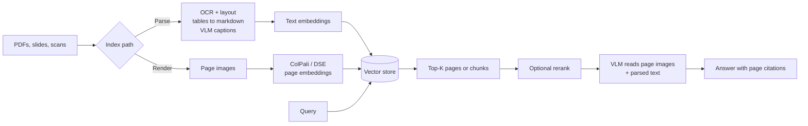

# Multimodal RAG

## Overview
**Multimodal RAG** is [[11.12 RAG]] over documents that are not plain text: PDFs with tables and charts, slide decks, scanned pages, screenshots. Some of the meaning lives in layout, figures, and numbers in cells, and a plain text extractor loses it. There are three main ways to index this content. Retrieval then usually hands the results to a **vision-language model (VLM)**, an LLM that can read images as well as text.

## Key Concepts
- **OCR** (optical character recognition): turns pixels of text into characters. Needed for scans
- **Layout-aware parsing**: detects blocks (title, paragraph, table, figure) and reading order before extracting text
- **Image captioning**: a VLM writes a text description of a figure, which is then embedded like normal text
- **Shared embedding space**: one model maps images and text into the same vector space, so a text query can match an image directly
- **Late interaction**: keep one vector per token or image patch and score with **MaxSim** (each query token takes its best-matching patch, then sum). See [[11.74 ColBERT & Late Interaction]]
- **Page as the unit**: visual retrievers usually index whole pages, not text chunks

## Three Indexing Approaches

| | **1. Parse to text** | **2. Multimodal embeddings** | **3. Page screenshot embeddings** |
|---|---|---|---|
| How | OCR + layout parser; tables to markdown; figures captioned by a VLM; then normal text embedding | Embed text and images separately with a CLIP-style model in one shared space | Render each page as an image; a VLM-based retriever embeds the image directly |
| Examples | Unstructured, Docling, LlamaParse + any text embedder | CLIP (Radford et al., 2021), SigLIP, Jina-CLIP | **ColPali**, **ColQwen** (multi-vector); **DSE** (one vector per page) |
| Vectors per item | One per chunk | One per image or text chunk | ColPali: one per patch (about 1,000 per page); DSE: one per page |
| Strengths | Works with any text stack, hybrid search, and text LLMs; cheap storage | Simple; good for photo-like images | No parsing pipeline; keeps layout, charts, and fonts; strongest on visually rich pages |
| Weaknesses | Slow, brittle ingestion; errors in OCR or table structure flow downstream | CLIP-style models are weak on text-dense pages | Many vectors per page; needs GPU to embed; answer needs a VLM |

> [!INFO] What the ColPali paper found
> On the **ViDoRe** benchmark, ColPali (built on PaliGemma-3B) scored 81.3 average nDCG@5. The best parse-to-text pipeline (Unstructured + captioning + BGE-M3) scored 67.0, and Jina-CLIP scored 17.7. Offline, the parsing pipeline took about 7.2 s per page versus 0.39 s for ColPali page encoding (Faysse et al., 2024).

> [!INFO] DSE
> **Document Screenshot Embedding** (Ma et al., 2024) uses a VLM (initialized from Phi-3-vision) to encode a screenshot into **one dense vector**, taken from the end-of-sequence token. It was tested on Wiki-SS (1.3M Wikipedia page screenshots) and SlideVQA slides. One vector per page means much less storage than ColPali, served by any normal vector index.

## Pipeline

## Generation with a VLM
- Pass the **retrieved page images** (often top 1 to 5) to a VLM with the question. The model reads tables and charts as they appear, with no lossy conversion
- Passing parsed text alongside the image helps with small fonts and exact numbers
- A text-only LLM still works with approach 1, but chart and figure meaning then depends on caption quality

> [!TIP] Mix and match
> Retrieval and generation are separate choices. A common setup: retrieve with ColPali or DSE, then send page images to a VLM. Another: parse to text for hybrid search ([[11.65 Hybrid Search (Dense + Sparse)]]) and keep a link from each chunk to its page image for generation.

## Practical Concerns

### Storage of many vectors per page
- ColPali stores 1,030 vectors of dimension 128 per page, about **257.5 KB per page** in float16 (paper's figure). One million pages is roughly 257 GB of vectors
- Ways to cut it: **token pooling** (colpali-engine's hierarchical pooler with factor 3 kept about 97.8% of performance with about 67% fewer vectors), quantization, or a single-vector model like DSE for the first stage
- The store must support multi-vector MaxSim search (e.g. Qdrant multivectors) or you rerank candidates yourself. See [[23.01 Vector Databases]] and [[23.07 ANN Indexes (HNSW, IVF, PQ)]]

### Cost of VLM calls
- Each page image costs many input tokens, often more than its extracted text. Fewer, better pages matter more here than in text RAG
- Captioning every figure at ingestion (approach 1) is a one-time VLM cost per figure; reading pages at query time is a cost per question
- Cache repeated page images where the provider supports it ([[11.21 Prompt Caching]])

### Tables and charts
- Tables: convert to markdown or HTML with headers kept; split long tables by rows but repeat the header in each chunk ([[11.69 Chunking Strategies]])
- Charts: a caption alone often drops the numbers. Either extract the data (some parsers turn charts into tables) or let the VLM read the chart image at answer time

### Citations to page and region
- Page-level retrieval gives the **page number** for free; store doc ID and page as metadata
- **Region** citations need bounding boxes: layout parsers output a box per element, so a chunk can point to its exact area on the page
- For ColPali-style models, **similarity maps** (colpali-engine's interpretability module) show which patches matched each query token

### Evaluation
- **ViDoRe** (Visual Document Retrieval Benchmark): page-level retrieval over visually rich documents, scored with nDCG@5
- **ViDoRe V2** (2025) adds harder, more realistic queries because V1 was close to saturated. **ViDoRe V3** extends to end-to-end RAG over enterprise-style documents in several languages
- Build your own set too: questions whose answers live in tables, charts, and scans, scored for page recall and answer faithfulness ([[11.71 RAG Evaluation]])

> [!WARNING] Common mistakes
> - Using a default text extractor on scanned PDFs: empty or garbage text, silent retrieval misses ([[11.66 RAG Failure Modes]], bad parsing row)
> - Flattening tables into a run of words: rows and columns get mixed up
> - Using CLIP for text-heavy pages: it was trained on photos and captions, not documents
> - Indexing page images but sending only OCR text to the LLM: you paid for visual retrieval and threw the visuals away

## Tools

| Tool | What it does |
|---|---|
| **Unstructured** | Open-source (Apache-2.0) partitioning of PDFs, HTML, Word, images; `fast`, `hi_res` (layout model), and `ocr_only` strategies |
| **Docling** | Open-source (MIT) parser from IBM Research; layout, reading order, table structure, OCR, chart to table; exports markdown and JSON |
| **LlamaParse** | Hosted parsing service from LlamaIndex; tables, charts, scans to markdown or JSON |
| **colpali-engine** | Reference code and models: ColPali, ColQwen2, ColQwen2.5, ColSmol; token pooling; similarity maps |
| **Byaldi** | Simple wrapper over colpali-engine for indexing and search; can store base64 page images with the index; no quantization yet |

## Practical Use Cases
- **Financial reports and filings**: answers sit in tables and charts ([[11.67 RAG Applications]])
- **Slide decks and manuals**: meaning is in diagrams and layout, not full sentences
- **Scanned archives** (contracts, forms, old records): OCR or screenshot retrieval is the only way in
- **Choose approach 1** when you need text search, exact numbers, and cheap storage; **approach 3** when pages are visual and parsing keeps breaking

## Related Concepts
- [[11_LLM_Dev_MOC]] - parent index
- [[11.12 RAG]] - the base pipeline this extends
- [[11.74 ColBERT & Late Interaction]] - the scoring method behind ColPali
- [[11.72 Embedding Models]] - text and multimodal embedders
- [[11.66 RAG Failure Modes]] - bad parsing is the failure this fixes
- [[11.69 Chunking Strategies]] - how parsed text and tables get split
- [[11.71 RAG Evaluation]] - measuring page recall and faithfulness
- [[11.68 Reranking (Cross-Encoders)]] - second stage after page retrieval
- [[23.07 ANN Indexes (HNSW, IVF, PQ)]] - serving many vectors per page
- [[11.67 RAG Applications]] - domains full of tables and charts

## References
- "ColPali: Efficient Document Retrieval with Vision Language Models" (Faysse et al., 2024)
- "Unifying Multimodal Retrieval via Document Screenshot Embedding" (Ma et al., 2024)
- "Learning Transferable Visual Models From Natural Language Supervision" (Radford et al., 2021)
- "ViDoRe Benchmark V2: Raising the Bar for Visual Retrieval" (2025)
