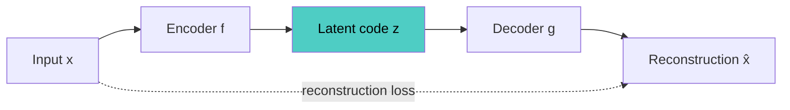

# Autoencoders

## Overview
An **autoencoder (AE)** is a neural network trained to reconstruct its own input through a constrained intermediate representation. An **encoder** maps input $x$ to a **latent code** $z$, and a **decoder** maps $z$ back to $\hat{x}$. The constraint (narrow bottleneck, sparsity, noise, or a prior) stops the network from learning the identity function and forces it to keep only the structure that matters.

## Key Concepts
- **Reconstruction loss**: $L = \lVert x - g(f(x)) \rVert^2$ (MSE); binary cross-entropy when inputs are in $[0, 1]$
- **Bottleneck**: the latent layer; its size and constraint decide what the model must throw away
- **Undercomplete**: latent smaller than input → compression is forced by size
- **Overcomplete**: latent larger than input → needs another constraint (sparsity, noise) or it copies the input
- **Self-supervised**: the input is its own label; no annotation needed
- **Link to PCA**: a linear autoencoder with MSE learns the same subspace as PCA (Baldi & Hornik, 1989); nonlinear layers generalize it to curved manifolds
- **Tied weights**: decoder weights = transpose of encoder weights; fewer parameters, mild regularization

## All Types at a Glance

| Type | What constrains it | Latent | Generative | Main use |
|---|---|---|---|---|
| **Undercomplete (vanilla)** | Bottleneck narrower than input | Continuous, deterministic | No | Dimensionality reduction, anomaly detection |
| **Sparse** | Sparsity penalty or top-k; usually overcomplete | Sparse | No | Feature learning, LLM interpretability |
| **Denoising** | Corrupted input, clean target | Continuous | No | Robust features, denoising, pretraining |
| **Contractive** | Penalty on the encoder's Jacobian norm | Continuous | No | Features stable under small input changes |
| **Variational (VAE)** | KL divergence to a prior | Distribution | Yes | Generation, latent diffusion compression |
| **VQ-VAE** | Snap to nearest codebook vector | Discrete tokens | Yes, with a prior model | Image and audio tokenizers |
| **Adversarial (AAE) / Wasserstein (WAE)** | Discriminator or MMD matches latents to a prior | Continuous | Yes | Alternative to the VAE's KL term |
| **Masked (MAE)** | Most input patches hidden | Patch embeddings | No | Self-supervised ViT pretraining |

Architecture choices combine with any type above:
- **Convolutional**: conv encoder, transposed-conv decoder → images
- **Sequence**: RNN or transformer encoder-decoder → time series, text
- **Stacked / deep**: many layers; historically pretrained layer by layer (Hinton & Salakhutdinov, 2006)

## Choosing a Type

| Goal | Use |
|---|---|
| Compress or visualize data | Undercomplete |
| Detect anomalies | Undercomplete or denoising |
| Generate new samples | VAE; VQ-VAE + prior |
| Feed images or audio to a transformer as tokens | VQ-VAE |
| Pretrain on unlabeled data | Masked or denoising |
| Find interpretable features | Sparse |

## Practical Use Cases
- **Anomaly detection**: train on normal data only; flag inputs with high reconstruction error
- **Dimensionality reduction**: nonlinear alternative to PCA before clustering or visualization
- **Denoising and inpainting**: recover clean signal from corrupted input
- **Compression for generative models**: latent diffusion runs in an autoencoder's latent space, not pixel space
- **Pretraining**: learn an encoder from unlabeled data, then fine-tune on a small labeled set

> [!WARNING] Common pitfalls
> - **Identity mapping**: an overcomplete autoencoder with no constraint copies its input and learns nothing
> - **Reconstructs anomalies too**: a high-capacity model can generalize well enough to rebuild abnormal inputs, hiding them
> - **Low loss ≠ useful latent**: reconstruction quality says nothing about whether $z$ is good for a downstream task
> - **Blurry outputs**: MSE averages over plausible reconstructions

## Related Concepts
- [[13_Deep_Learning_CV_MOC]] - parent index
- [[13.17 Sparse Autoencoder (SAE)]] - type: sparsity constraint
- [[13.18 Denoising Autoencoder]] - type: reconstruct clean from corrupted input
- [[13.19 Variational Autoencoder (VAE)]] - type: probabilistic, generative
- [[13.20 VQ-VAE]] - type: discrete latent codes
- [[13.21 Masked Autoencoder (MAE)]] - type: masked-patch pretraining
- [[13.15 U-Net]] - contrast: skip connections bypass the bottleneck
