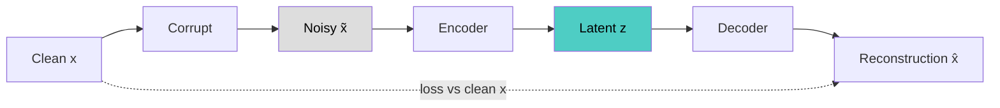

# Denoising Autoencoder

## Overview
A **denoising autoencoder (DAE)** (Vincent et al., 2008) receives a **corrupted** input and is trained to reconstruct the **clean** original. Because input and target differ, copying is impossible even with an overcomplete latent, so the model has to learn the structure of the data to undo the damage.

## Key Concepts
- **Loss**: $L = \lVert x - g(f(\tilde{x})) \rVert^2$ with $\tilde{x} \sim q(\tilde{x} \mid x)$ — compare to the clean input, never the noisy one
- **Manifold view**: corruption pushes points off the data manifold; the model learns to push them back
- **Score connection**: the direction from $\tilde{x}$ to its reconstruction approximates $\nabla_x \log p(x)$ (Vincent, 2011) → the basis of score-based and diffusion models
- **Noise level** is the main hyperparameter: too little → near-identity; too much → nothing left to recover
- **Stacked DAE**: train layer by layer, then fine-tune; an early pretraining method (Vincent et al., 2010)

## Corruption Types

| Corruption | How | Typical data |
|---|---|---|
| **Gaussian noise** | Add $\epsilon \sim \mathcal{N}(0, \sigma^2)$ | Images, audio, continuous features |
| **Masking noise** | Set a random fraction of inputs to zero | Images, tabular, text tokens |
| **Salt-and-pepper** | Set random inputs to min or max | Binary or grayscale images |
| **Swap noise** | Replace a value with one from another row, same column | Tabular |
| **Token deletion / shuffling / infilling** | Edit the token sequence | Text |

## Descendants

| Model | Corruption | Predicts |
|---|---|---|
| **BERT** | Mask ~15% of tokens | Masked tokens |
| **BART** | Mask, delete, shuffle, infill text spans | Original sequence |
| **Masked Autoencoder** | Hide ~75% of image patches | Missing pixels |
| **Diffusion models** | Gaussian noise at many levels | Noise (or clean image) at each level |

→ Most modern self-supervised and generative pretraining is denoising with a different corruption.

## Practical Use Cases
- **Signal cleanup**: image, audio, and sensor denoising
- **Robust features**: representations that ignore small input perturbations
- **Tabular pretraining**: swap-noise DAE features as input to a downstream model
- **Anomaly detection**: less likely than a plain autoencoder to reconstruct abnormal inputs
- **Imputation**: treat missing values as masking noise

> [!TIP] Picking the corruption
> Match it to the noise you expect at inference, or to the invariance you want. For tabular data prefer swap noise: Gaussian noise breaks categorical and skewed columns.

## Related Concepts
- [[13_Deep_Learning_CV_MOC]] - parent index
- [[13.16 Autoencoders]] - overview of all autoencoder types
- [[13.21 Masked Autoencoder (MAE)]] - denoising with patch masking as the corruption
- [[13.19 Variational Autoencoder (VAE)]] - contrast: noise in the latent, not the input
- [[13.15 U-Net]] - common denoiser backbone in diffusion models
