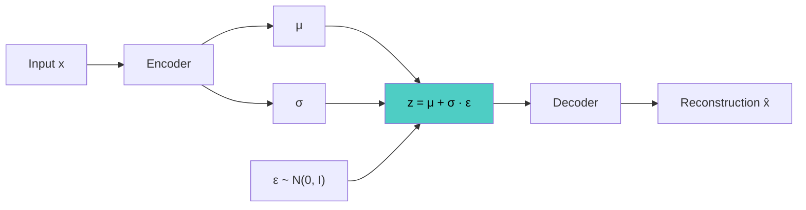

# Variational Autoencoder (VAE)

## Overview
A **variational autoencoder** (Kingma & Welling, 2013) is a **generative** autoencoder: the encoder outputs a probability distribution over the latent instead of a single point, and a KL penalty keeps those distributions close to a simple prior. The result is a smooth latent space you can sample from to generate new data.

## Key Concepts
- **Probabilistic encoder**: $q_\phi(z \mid x) = \mathcal{N}(\mu, \sigma^2)$; **decoder**: $p_\theta(x \mid z)$; **prior**: $p(z) = \mathcal{N}(0, I)$
- **ELBO** (evidence lower bound) — the training objective, maximized:

$$\log p(x) \ge \mathbb{E}_{q_\phi(z \mid x)}[\log p_\theta(x \mid z)] - D_{KL}(q_\phi(z \mid x) \,\Vert\, p(z))$$

- **Two loss terms**: reconstruction (rebuild $x$) + KL (keep the latent close to the prior)
- **Closed-form KL** for a Gaussian: $\frac{1}{2}\sum_j (\mu_j^2 + \sigma_j^2 - \log \sigma_j^2 - 1)$
- **Reparameterization trick**: $z = \mu + \sigma \odot \epsilon$, $\epsilon \sim \mathcal{N}(0, I)$ → randomness moves outside the network, so gradients flow through $\mu$ and $\sigma$
- **Generation**: sample $z \sim \mathcal{N}(0, I)$, run the decoder

## Autoencoder vs VAE

| Aspect | Autoencoder | VAE |
|---|---|---|
| Latent | A point | A distribution |
| Latent space | Irregular, with gaps | Smooth and continuous |
| Sampling new data | Not meaningful | Sample from the prior |
| Interpolation | Often leaves the data manifold | Stays plausible |
| Reconstruction | Sharper | Blurrier |

## Variants

| Variant | Change | Purpose |
|---|---|---|
| **β-VAE** | Weight $\beta > 1$ on the KL term | Disentangled factors, at a reconstruction cost |
| **Conditional VAE** | Condition encoder and decoder on a label | Controlled generation |
| **IWAE** | Several samples per input, tighter bound | Better likelihood |
| **Hierarchical** (NVAE, VDVAE) | Many latent layers | Sharp, high-resolution images |
| **KL-regularized AE** (latent diffusion) | Tiny KL weight + perceptual and adversarial loss | Image compressor for diffusion models |
| **VQ-VAE** | Discrete codebook, no KL | Tokenizers; see [[13.20 VQ-VAE]] |

> [!WARNING] Common pitfalls
> - **Posterior collapse**: a strong decoder ignores $z$ and the KL term goes to zero. Fix with KL annealing, free bits, or a weaker decoder
> - **Blurry samples**: a per-pixel Gaussian likelihood averages over plausible outputs
> - **KL weight**: too high → latent carries no information; too low → gaps reappear and sampling breaks

## Practical Use Cases
- **Latent diffusion**: Stable Diffusion's VAE compresses images 8× per side; the diffusion model works in that latent
- **Generation and interpolation**: smooth transitions between samples
- **Anomaly detection**: score inputs by reconstruction probability
- **Molecule and material design**: optimize in a continuous latent, decode to a structure
- **Semi-supervised learning**: learn from unlabeled data alongside a few labels

## Related Concepts
- [[13_Deep_Learning_CV_MOC]] - parent index
- [[13.16 Autoencoders]] - overview of all autoencoder types
- [[13.20 VQ-VAE]] - discrete alternative without a KL term
- [[13.18 Denoising Autoencoder]] - contrast: noise on the input, not the latent
- [[13.15 U-Net]] - denoiser that runs inside the VAE latent
