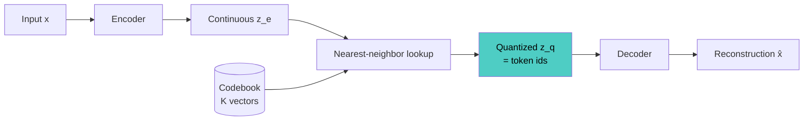

# VQ-VAE

## Overview
**VQ-VAE** (Vector Quantized VAE; van den Oord et al., 2017) is an autoencoder with a **discrete** latent: each encoder output is replaced by its nearest vector in a learned **codebook**, so an input becomes a grid of integer indices. This turns images and audio into token sequences that a transformer can model like text.

## Key Concepts
- **Quantization**: $z_q = e_k$ where $k = \arg\min_j \lVert z_e - e_j \rVert$
- **Loss** ($\text{sg}$ = stop-gradient):

$L = \lVert x - \hat{x} \rVert^2 + \lVert \text{sg}[z_e] - e \rVert^2 + \beta \lVert z_e - \text{sg}[e] \rVert^2$

- **Reconstruction term**: trains encoder and decoder
- **Codebook term**: moves code vectors toward encoder outputs (often replaced by an EMA update)
- **Commitment term**: keeps encoder outputs close to their chosen code; $\beta = 0.25$ in the paper
- **Straight-through estimator**: argmin has no gradient, so the decoder's gradient is copied straight to the encoder output
- **No KL term**: with a uniform prior over codes it is a constant
- **Two-stage generation**: train the VQ-VAE, then train a **prior** (autoregressive or masked transformer) over the token grid; sample tokens → decode

## VAE vs VQ-VAE

| Aspect | VAE | VQ-VAE |
| --- | --- | --- |
| Latent | Continuous Gaussian | Discrete code indices |
| Regularizer | KL to prior | Commitment loss |
| Sampling | Fixed prior $\mathcal{N}(0, I)$ | Learned prior over tokens |
| Failure mode | Posterior collapse | Codebook collapse |
| Pairs with | Diffusion models | Autoregressive / masked transformers |

## Variants

| Variant | Change | Used in |
| --- | --- | --- |
| **VQ-VAE-2** | Hierarchy of coarse and fine code maps | High-resolution image generation |
| **VQGAN** | Adds perceptual and adversarial losses | Sharper tokenizers; transformer image models |
| **dVAE** | Gumbel-softmax relaxation instead of nearest-neighbor | DALL·E 1 |
| **Residual VQ (RVQ)** | Stack of quantizers, each coding the previous residual | Audio codecs: SoundStream, EnCodec |
| **FSQ** | Round a few dimensions to fixed levels; no learned codebook | Simpler training, full code usage |
| **LFQ** | One binary decision per dimension | MAGVIT-v2 video tokenizer |

> [!WARNING] Codebook collapse
> Only a small fraction of codes get used, wasting capacity. Track **codebook utilization** (or perplexity). Fixes:
> - EMA codebook updates
> - Reset dead codes to recent encoder outputs
> - Low-dimensional, L2-normalized codes
> - Switch to FSQ, which has no codebook to collapse

## Practical Use Cases
- **Image tokenizers** for autoregressive and masked image generators
- **Neural audio codecs**: RVQ tokens are the input to audio and speech language models
- **Video tokenizers**: compress space and time before a generative model
- **Multimodal LLMs**: discrete tokens let one transformer handle text, image, and audio in a shared vocabulary

> [!TIP] Reading the config
> The two numbers that matter are **codebook size** (vocabulary) and **downsampling factor** (tokens per image). A 256×256 image at 16× downsampling becomes 16×16 = 256 tokens.

## Related Concepts
- [[13_Deep_Learning_CV_MOC]] - parent index
- [[13.16 Autoencoders]] - overview of all autoencoder types
- [[13.19 Variational Autoencoder (VAE)]] - continuous counterpart with a KL term
- [[13.21 Masked Autoencoder (MAE)]] - BEiT-style variants predict discrete tokens
- [[11.01 Attention Mechanism]] - transformers model the resulting token sequence
