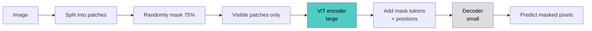

# Masked Autoencoder (MAE)

## Overview
A **masked autoencoder** (He et al., 2021) is a self-supervised pretraining method for Vision Transformers: hide most of an image's patches and train the model to reconstruct the missing pixels. It is BERT's masked-prediction idea adapted to images, and it lets a ViT learn strong representations from unlabeled data.

## Key Concepts
- **High mask ratio (75%)**: images are spatially redundant, so a low ratio lets the model interpolate from neighbors without understanding the scene
- **Asymmetric design**:
  - **Encoder** (large ViT) sees only the visible 25% of patches — no mask tokens
  - **Decoder** (small) gets encoded patches plus mask tokens and predicts pixels
- **Cheap pretraining**: the encoder processes a quarter of the tokens → 3× or more faster, lower memory
- **Loss**: MSE on **masked patches only**; normalizing pixels per patch improves quality
- **Decoder is discarded** after pretraining; only the encoder is fine-tuned
- **Minimal augmentation**: random crop and flip are enough; masking itself is the augmentation

## Comparison with Related Methods

| Method | Reconstruction target | Mask ratio | Encoder sees mask tokens |
|---|---|---|---|
| **BERT** (text) | Token ids | ~15% | Yes |
| **BEiT** | Discrete visual tokens from a pre-trained tokenizer | ~40% | Yes |
| **SimMIM** | Raw pixels | ~60% | Yes |
| **MAE** | Raw pixels | 75% | No |

| Aspect | MAE | Contrastive (SimCLR, MoCo, DINO) |
|---|---|---|
| Signal | Reconstruct missing content | Match augmented views |
| Augmentation dependence | Low | High |
| Linear-probe accuracy | Weaker | Stronger |
| Fine-tuning accuracy | Strong | Strong |
| Scales with model size | Very well | Well |

> [!INFO] Headline result
> ViT-Huge reaches 87.8% ImageNet-1K top-1 using only ImageNet-1K data. The gap between linear probing (~76% for ViT-L) and fine-tuning (~86%) shows the features are strong but not linearly separable.

## Extensions

| Extension | Change |
|---|---|
| **VideoMAE** | Tube masking at 90–95%; video is even more redundant |
| **AudioMAE** | Masks spectrogram patches |
| **ConvNeXt V2** | Fully convolutional MAE using sparse convolutions |
| **I-JEPA** | Predicts masked regions in embedding space, not pixels |
| **SatMAE** | Multi-spectral and temporal satellite imagery |

## Practical Use Cases
- **Domain pretraining**: medical, satellite, or industrial images where unlabeled data is plentiful and labels are scarce
- **Backbone for dense tasks**: detection and segmentation with a plain ViT (ViTDet)
- **Label-efficient fine-tuning**: pretrain once, fine-tune on small labeled sets

> [!TIP] When to pick MAE
> Choose MAE when you will **fine-tune** the encoder. If you need frozen features (retrieval, k-NN, linear probe), a contrastive or self-distillation model is usually better.

## Related Concepts
- [[13_Deep_Learning_CV_MOC]] - parent index
- [[13.16 Autoencoders]] - overview of all autoencoder types
- [[13.18 Denoising Autoencoder]] - MAE is denoising with masking as corruption
- [[13.20 VQ-VAE]] - tokenizer that supplies BEiT-style discrete targets
- [[11.01 Attention Mechanism]] - core of the ViT encoder
