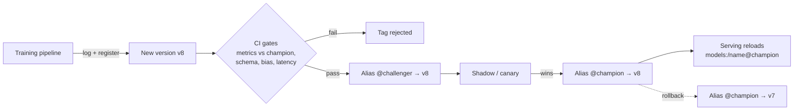

# Model Registry

## Overview
A **model registry** is the system of record for trained models: a catalog of named models, their immutable **versions**, the lineage that produced each one, and pointers saying which version is live where. It is the handoff point between training and serving: pipelines **write** versions to it, deployment and CI/CD **read** from it ([[22.03 CI-CD for ML]]).

## Key Concepts

- **Registered model**: a named slot for one use case (`fraud-classifier`), not one file
- **Model version**: an immutable artifact (weights + environment + signature) with an auto-incrementing number. Never overwrite; register a new version
- **Lineage**: link from version to the training run, code commit, data snapshot, metrics, and parameters. Answers "what produced the model in prod?"
- **Signature / schema**: input and output types, so serving can validate requests and catch feature mismatches
- **Aliases**: mutable named pointers to a version (`@champion`, `@challenger`). Promotion = move the alias; rollback = move it back. Serving loads by alias, so no code change is needed
- **Tags and annotations**: free-form metadata (`validation_status=passed`, owner, ticket) used as gates by CI
- **Access control and audit**: who registered, who promoted, when. Needed for regulated domains

> [!WARNING] Stages are legacy
> The old MLflow fixed stages (`None → Staging → Production → Archived`) are **deprecated** since MLflow 2.9 in favour of **aliases** (added in 2.8) and tags. Stages forced one global "Production" per model and mixed environment with approval state. New work should use aliases; Unity Catalog models do not support stages at all.

## Promotion Flow



- Two common layouts for environments:
  - **One registry, aliases per env**: `@staging`, `@prod` on the same model. Simple, but dev and prod share a namespace
  - **Registry per env** (e.g. Unity Catalog `dev.ml.fraud`, `prod.ml.fraud`): copy the approved version into the prod catalog. Stronger isolation and permissions
- "Deploy models" (promote the same artifact) vs "deploy code" (retrain in each env from the same code): see [[22.03 CI-CD for ML]]

## MLflow Example

```python
client = mlflow.MlflowClient()
client.set_registered_model_alias("fraud-classifier", "champion", version=8)
model = mlflow.pyfunc.load_model("models:/fraud-classifier@champion")
```

- MLflow 3 adds the **LoggedModel** entity: models are first-class objects with their own ID (`models:/<model_id>`), linked to runs, metrics, and traces, rather than only artifacts inside a run
- On Databricks the default registry in MLflow 3 is **Unity Catalog** (`catalog.schema.model` names)
- Full tracking API in [[12.10 MLflow]]

## Comparison Table

| Registry | Hosting | Promotion model | Notes |
|---|---|---|---|
| **MLflow (OSS)** | Self-hosted tracking server + DB + artifact store | Aliases + tags | Framework-agnostic `pyfunc` flavour; the common default |
| **Databricks Unity Catalog** | Managed | Aliases; separate catalogs per env | Governance, lineage to tables and features |
| **SageMaker Model Registry** | AWS managed | Model package groups + approval status (`PendingManualApproval`, `Approved`, `Rejected`) | Approval events trigger deploy pipelines |
| **Vertex AI Model Registry** | GCP managed | Version aliases (with a `default` alias) | Deploys straight to Vertex endpoints |
| **W&B Registry** | Managed / self-hosted | Aliases on artifact versions | Strong if you already track with W&B |
| **Hugging Face Hub** | Managed | Git revisions, tags, branches | Fine for sharing weights; weak on approval workflow |

## LLM-Era Additions

- **Register what you serve**: for LLM apps the "model" is often base model ID + adapter ([[11.32 PEFT]]) + prompt + config. Version them together or the registry lies about prod
- **Prompt registries** (MLflow 3, LangSmith, Langfuse) apply the same version + alias idea to prompts ([[11.14 Prompt Engineering]])
- Large weights: store in object storage and register the URI; don't push multi-GB files through a tracking server

## Practical Use Cases

- **Reproducible rollback**: prod breaks, move `@champion` back to the previous version in seconds
- **Champion/challenger**: keep both aliases live and route a traffic slice to the challenger ([[31.02 Serving Architecture]])
- **Audit**: regulator asks which data trained the credit model in March; lineage answers it
- **CI gate**: a pipeline only promotes versions tagged `validation_status=passed`

> [!TIP]
> - Load by **alias** in serving code, never by hard-coded version number
> - Automate registration from the training pipeline; manual uploads skip lineage
> - Store the evaluation report as an artifact on the version, not in a separate wiki

## Related Concepts
- [[22_MLOps_MOC]] - parent index
- [[12.10 MLflow]] - most common registry implementation
- [[22.03 CI-CD for ML]] - pipelines that register and promote versions
- [[22.02 Feature Store]] - sibling system of record for features
- [[31.02 Serving Architecture]] - serving loads models from the registry
- [[24.01 Model Drift Detection]] - drift triggers a new version
- [[11.32 PEFT]] - adapters as registry artifacts for LLMs

## References
- MLflow Model Registry docs: mlflow.org/docs/latest/model-registry
- Databricks: Manage model lifecycle in Unity Catalog (docs.databricks.com)
- SageMaker Model Registry docs (docs.aws.amazon.com/sagemaker)
