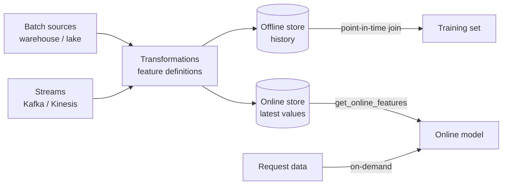

# Feature Store

## Overview
A **feature store** is a data system that defines ML features once and serves the same values two ways: large historical tables for **training** and low-latency lookups for **online inference**. Its main job is to kill **training-serving skew** (the model saw one feature definition in training and a different one in prod) and to make features reusable across teams.

## Key Concepts

- **Entity**: the key features hang off (`user_id`, `merchant_id`, `device_id`)
- **Feature view / feature group**: a named, versioned set of features for an entity, with its source, transformation, and freshness (TTL)
- **Offline store**: full history in a warehouse or lake (Parquet / Delta / Iceberg, BigQuery, Snowflake). Used to build training sets and batch scoring
- **Online store**: latest value per entity in a key-value store ([[23.03 Redis]], DynamoDB, Bigtable). Used at request time with single-digit to low-tens of ms budgets
- **Materialization**: the job that computes features and pushes them from offline to online on a schedule or from a stream
- **Point-in-time correct join**: when building training rows, each label gets the feature values **as of the label's timestamp**, never later ones. Prevents leakage
- **On-demand features**: computed at request time from request data (e.g. distance from the user's home to this transaction)
- **Feature registry**: catalog of definitions, owners, lineage, and which models use what

## Point-in-Time Correctness

> [!EXAMPLE] The leakage it prevents
> Label: transaction at 10:00 was fraud. Feature: `txn_count_24h` for that card. A naive join takes today's value, which includes the chargeback activity after 10:00, so the model learns from the future and looks great offline. A point-in-time join takes the latest value with `feature_ts <= 10:00`. This is the single biggest reason to use a feature store instead of ad-hoc SQL.

## Comparison Table

| Option | Type | Offline / online | Notes |
|---|---|---|---|
| **Feast** | Open source | Pluggable: warehouse or files offline; Redis, DynamoDB, Postgres, etc. online | Lightweight; you run the materialization jobs; transformations are mostly upstream |
| **Tecton** | Managed (acquired by Databricks, 2025) | Managed both, strong streaming | Real-time aggregations as a product |
| **Databricks Feature Engineering (Unity Catalog)** | Managed | Delta tables offline, online tables / serving | Features are UC tables with lineage to models |
| **SageMaker Feature Store** | AWS managed | S3 offline, managed online store | Feature groups, integrates with SageMaker pipelines |
| **Vertex AI Feature Store** | GCP managed | BigQuery as the offline source, managed online serving | BigQuery-native |
| **Hopsworks** | Open source + managed | Hudi / Delta offline, RonDB online | Full platform with its own registry |
| **DIY** (warehouse tables + Redis) | Build it | Whatever you wire | Fine for 1-2 models; skew and PIT joins become your problem |

## When You Need One

| Signal | Need a feature store? |
|---|---|
| Batch-only scoring, one or two models | Usually **no**: versioned warehouse tables + dbt are enough |
| Real-time inference with features from history (counts, aggregates) | **Yes**: online store + materialization |
| Same features reused by many models / teams | **Yes**: shared definitions and discovery |
| Repeated training-serving skew incidents | **Yes** |
| Streaming aggregates (last 5 min clicks) | Yes, and pick one with real streaming support |

> [!WARNING] Common pitfalls
> - **Two codepaths**: feature computed in SQL for training and re-implemented in Java for serving. The store only helps if both read one definition
> - **Stale online values**: materialization lag or a failed job silently serves yesterday's features. Monitor freshness per feature view
> - **TTL too long**: missing entities fall back to very old values instead of null
> - **Feature sprawl**: hundreds of unowned features nobody dares delete. Require owners and track usage
> - **Ignoring nulls at serve time**: new users have no history; define defaults explicitly and train with the same defaults

## LLM and Agent Use

- Real-time user and account context for prompts (plan tier, recent orders, risk score) is the same online-lookup problem; some teams serve it from the feature store instead of ad-hoc DB calls
- Embeddings can be stored as features, but similarity search belongs in a vector DB ([[23.01 Vector Databases]])

## Practical Use Cases

- **Fraud and risk**: streaming aggregates per card/merchant, served in milliseconds
- **Recommendations and ranking**: user and item features shared across many models
- **Churn / propensity**: batch features from the offline store for nightly scoring
- **Backfills**: recompute history for a new feature and get a training set without waiting months

## Related Concepts
- [[22_MLOps_MOC]] - parent index
- [[43.01 Feature Engineering Patterns]] - patterns to operationalize
- [[22.01 Model Registry]] - parallel system of record for models
- [[42.02 Data Contracts]] - define feature schemas and owners
- [[23.03 Redis]] - common online store
- [[41.01 Parquet File Format]] - common offline storage format
- [[24.01 Model Drift Detection]] - monitor feature distributions in prod
- [[31.02 Serving Architecture]] - where online features are fetched

## References
- Feast docs: docs.feast.dev
- Databricks Feature Engineering in Unity Catalog docs (docs.databricks.com)
- *Designing Machine Learning Systems* (Chip Huyen, 2022), ch. 10: Infrastructure and Tooling for MLOps
