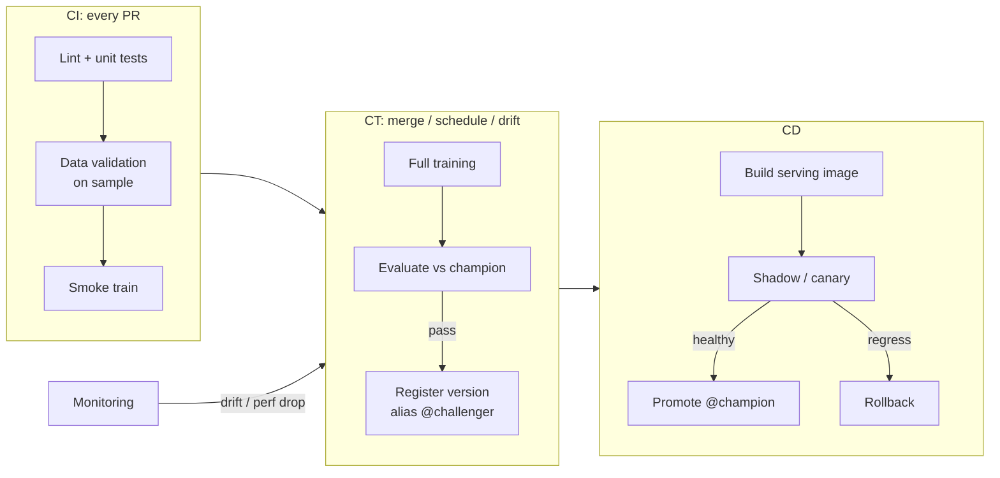

# CI/CD for ML

## Overview
**CI/CD for ML** applies continuous integration and delivery to systems where behaviour depends on **code, data, and model** together. A change to any of the three can break production, so the pipeline tests all three and adds a third loop, **continuous training (CT)**, that retrains and redeploys when data changes.

## Key Concepts

- **CI**: on every commit, test the code *and* validate data and model behaviour, not only unit tests
- **CD**: deliver a **training pipeline** and/or a **model** to serving, with automated gates and safe rollout
- **CT**: retrain on a schedule or on a trigger (new data, [[24.01 Model Drift Detection|drift]], performance drop), then run the same gates
- **Artifacts**: the pipeline produces a versioned model in the [[22.01 Model Registry]]; deployment reads from it by alias
- **Gates**: automated checks that block promotion (metric vs current champion, latency, schema, fairness slices)
- **Reproducibility**: pinned dependencies, container images, data snapshot IDs, and seeds, so a version can be rebuilt

## What to Test

| Layer | Checks | Typical tools |
|---|---|---|
| **Code** | Lint, types, unit tests for feature logic and pre/post-processing | pre-commit ([[74.02 pre-commit]]), pytest, ruff |
| **Data** | Schema, nulls, ranges, freshness, distribution vs reference | [[42.01 Great Expectations]], Pandera, [[42.02 Data Contracts]] |
| **Training** | Pipeline runs end to end on a small sample; loss decreases; no NaNs | Smoke run in CI |
| **Model quality** | Metrics on a held-out set beat or match champion; per-slice metrics; no regression on known hard cases | Eval script, MLflow |
| **Model behaviour** | Invariance and directional tests (changing the name doesn't flip the label), calibration | Custom tests |
| **Serving** | Signature matches, container builds, latency and memory under load, contract test on the API | Docker, load tests |
| **LLM apps** | Prompt and model regression suite, judge-scored rubrics, safety checks | [[24.06 Online Evaluation & Prompt Regression]], [[24.05 LLM-as-Judge]] |

## Pipeline

## Deploy Code vs Deploy Models

| | **Deploy models** | **Deploy code** |
|---|---|---|
| What moves across envs | The trained artifact (train in dev/staging, promote the same file) | The training code; each env retrains on its own data |
| Pros | Simple; what you tested is what ships | Prod model trained on prod data; works when dev can't access prod data |
| Cons | Training env needs prod-grade data | Retrains cost compute; more moving parts |
| Fits | One-off or expensive models, LLM fine-tunes | Regularly retrained tabular models, strict data isolation |

## Rollout Strategies

| Strategy | How | Use when |
|---|---|---|
| **Shadow** | New model scores live traffic, results logged, not served | First deploy of a risky change; no user impact |
| **Canary** | Small % of traffic to new model, widen if healthy | Default for online models |
| **A/B test** | Split traffic, compare business metrics with stats | Offline metrics don't predict business impact |
| **Blue-green** | Two full envs, switch the router | Fast rollback, infra-level changes |
| **Bandit / interleaving** | Adaptive traffic allocation, ranking comparisons | Recommenders, search |

## Maturity Levels (Google MLOps)

| Level | Description |
|---|---|
| **0: Manual** | Notebooks, manual handoff of a model file; no CI/CD |
| **1: Pipeline automation** | Training pipeline automated with CT; model deploys from registry |
| **2: CI/CD of pipelines** | The pipeline itself is tested and deployed by CI/CD; many pipelines, fast iteration |

## Tooling

- **CI runners**: GitHub Actions, GitLab CI, Jenkins; GPU runners for smoke training or LLM evals
- **Orchestration**: Kubeflow Pipelines, Airflow, Argo Workflows, Prefect, Dagster, ZenML, SageMaker / Vertex Pipelines
- **Data and model versioning**: DVC, lakeFS, Delta / Iceberg time travel; [[12.10 MLflow]] for runs and registry
- **Branching**: keep experiment branches short; see [[74.03 Git Branch Management for DS-ML]]

> [!WARNING] Common pitfalls
> - **Only unit tests**: code passes, but a schema change upstream silently degrades the model
> - **Gates on a single aggregate metric**: overall AUC up, one important segment down. Gate on slices
> - **Comparing against a fixed threshold** instead of the current champion on the same eval set
> - **Non-deterministic CI**: flaky evals from random seeds or LLM sampling; fix seeds, use temperature 0 or repeat runs and gate on the mean
> - **Full training in every PR**: slow and costly. Smoke-train on a sample in CI; full training in CT
> - **No rollback path**: serving loads a hard-coded version instead of a registry alias

## Practical Use Cases

- **Tabular model with weekly retrain**: CT on schedule, gate vs champion, canary, auto-rollback on drift alerts
- **LLM feature**: prompt and model changes go through a regression eval in PR CI; canary with online judges
- **Fine-tuned model**: deploy-models pattern; expensive training happens once, the artifact is promoted through envs
- **Regulated domain**: CI stores the eval report and data snapshot ID on each registry version for audit

## Related Concepts
- [[22_MLOps_MOC]] - parent index
- [[22.01 Model Registry]] - versions and aliases the pipeline promotes
- [[22.02 Feature Store]] - shared feature definitions avoid skew in CI and prod
- [[24.01 Model Drift Detection]] - trigger retraining on drift
- [[24.06 Online Evaluation & Prompt Regression]] - CI gates for LLM apps
- [[42.01 Great Expectations]] - data validation step
- [[74.02 pre-commit]] - code quality hooks in CI
- [[31.02 Serving Architecture]] - where canary and shadow traffic are routed

## References
- "MLOps: Continuous delivery and automation pipelines in machine learning" (Google Cloud Architecture Center)
- "Hidden Technical Debt in Machine Learning Systems" (Sculley et al., 2015)
- "The ML Test Score: A Rubric for ML Production Readiness" (Breck et al., 2017)
- "Beyond Accuracy: Behavioral Testing of NLP Models with CheckList" (Ribeiro et al., 2020)
