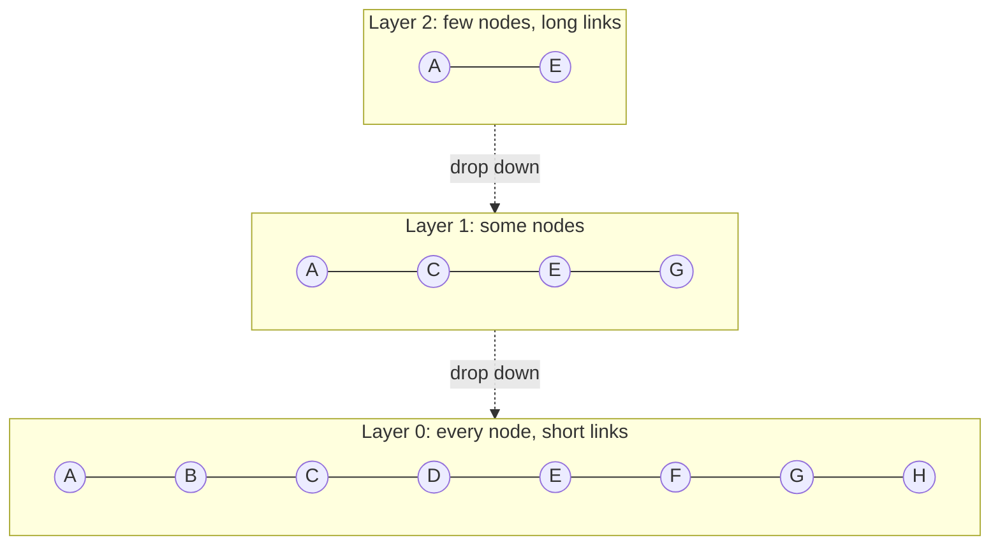

# HNSW (Hierarchical Navigable Small World)

## Overview
**HNSW** is a graph-based ANN index. Every vector is a node linked to its near neighbors, and the graph is stacked in layers like a skip list: a few nodes on top for long jumps, every node at the bottom for short, precise hops. Search walks greedily toward the query. Most vector databases use it by default, because it gives high recall at low latency when the vectors fit in RAM.

> [!INFO] Origin
> Malkov & Yashunin (arXiv 2016, IEEE TPAMI 2018). It extends their earlier **NSW** (navigable small world) graph by adding the layer hierarchy, which fixes NSW's poor scaling. For how HNSW compares with the other index families, see [[23.07 ANN Indexes (HNSW, IVF, PQ)]].

## Key Ideas
- **Small-world graph**: any node is reachable in a few hops, because a few links are long and most are short
- **Skip-list layers**: each higher layer holds a random, exponentially smaller subset of nodes. Upper layers find the right region; layer 0 finds the exact neighbors
- **Greedy routing**: from the current node, move to whichever neighbor is closer to the query. Stop when no neighbor is closer
- **Diverse links**: the neighbor-selection heuristic keeps links pointing in different directions, so the walk doesn't get stuck inside one cluster

## Structure

- A node that appears on a layer also appears on every layer below it (A and E reach layer 2)

- A node's top layer is drawn at random:

$$l = \lfloor -\ln(U) \cdot m_L \rfloor, \quad U \sim \text{Uniform}(0,1), \quad m_L = \frac{1}{\ln M}$$

- With that $m_L$, each layer up holds about $1/M$ as many nodes as the one below
- Each node keeps up to `M` links on upper layers and up to `2M` on layer 0

## Search
1. Start at the single **entry point** on the top layer
2. On each upper layer, walk greedily (candidate list of size 1) to the closest node, then drop one layer
3. On layer 0, run best-first search with a candidate list of size `efSearch`
4. Return the best `k` from that list

- Larger `efSearch` means more nodes visited: higher recall, slower query
- The paper reports search cost growing roughly **logarithmically** with the number of vectors

## Insert (Build)
1. Draw the new node's top layer $l$
2. Walk greedily from the entry point down to layer $l+1$
3. On each layer from $l$ down to 0: search with a list of size `efConstruction`, choose up to `M` neighbors with the heuristic, and link both ways
4. If a neighbor now has too many links, prune its list with the same heuristic
5. If $l$ is above the current top layer, the new node becomes the entry point

> [!TIP] The neighbor heuristic in one line
> Go through candidates from closest to farthest. Keep a candidate only if it is closer to the new node than to every neighbor already kept. This drops redundant links into the same cluster and keeps "bridge" links between clusters.

## Memory Math
FAISS gives about $4d + 8M$ bytes per vector for HNSW with float32 vectors (upper layers add a little more).

| Setup | Vector bytes | Link bytes | Per vector | 10M vectors |
|---|---|---|---|---|
| d = 768, M = 16 | 3,072 | 128 | ~3.2 KB | ~32 GB |
| d = 768, M = 32 | 3,072 | 256 | ~3.3 KB | ~33 GB |
| d = 1536, M = 16 | 6,144 | 128 | ~6.3 KB | ~63 GB |

- **The vectors dominate, not the links.** To shrink HNSW, compress the vectors (SQ8, PQ, binary) and rescore with full vectors. Lowering `M` saves little and costs recall
- The walk reads memory at random. HNSW slows down badly once the index spills from RAM to disk; DiskANN was built for that case

## Tuning Procedure
Starting values for each library are in [[23.07 ANN Indexes (HNSW, IVF, PQ)#Tuning Knobs|23.07 Tuning Knobs]].
- `M` and `efConstruction` are fixed at build time. Changing them means a rebuild
- `efSearch` can change per query. Build once, then sweep `efSearch` until recall@k meets the target
- Higher dimensions or harder data usually need a larger `M`. The hnswlib docs say `M` of 12 to 48 suits most uses
- To check `efConstruction`, hnswlib suggests searching with `ef = efConstruction` and looking at recall: below 0.9 means the graph can still improve. Past some point, extra build time buys nothing

## Updates and Deletes
- **Inserts are online**: no training step, unlike IVF or PQ
- **Deletes are hard**: removing a node can cut paths other searches depend on
  - **FAISS** HNSW indexes do not support removal
  - **hnswlib** has `mark_deleted`, which hides a node from results, and `allow_replace_deleted`, which reuses deleted slots for new inserts
  - Most databases soft-delete, then repair or rebuild segments in the background
- Heavy churn slowly lowers recall. Re-measure recall and rebuild when it drifts
- The graph depends on insertion order and threading, so two builds of the same data are not identical

## Variants and Combinations
- **HNSW over compressed vectors**: FAISS `IndexHNSWSQ` and `IndexHNSWPQ` store quantized vectors in the graph to save memory
- **HNSW as the IVF coarse quantizer**: with very many IVF clusters, an HNSW over the centroids finds the `nprobe` nearest quickly (FAISS factory strings like `IVF65536_HNSW32,...`). See [[23.09 IVF-PQ]]
- **Filtered HNSW**: extra edges or filter-aware traversal for metadata filters ([[23.07 ANN Indexes (HNSW, IVF, PQ)#Filtering with ANN|23.07 Filtering]])
- **DiskANN / Vamana**: the same graph idea, moved onto SSD for billion-scale data

## When to Use

| Use HNSW when | Look elsewhere when |
|---|---|
| Vectors fit in RAM as floats (or SQ8) | Memory is the limit at tens of millions+ → [[23.09 IVF-PQ]] |
| You need high recall at low latency | Billion-scale on one machine → DiskANN |
| Data arrives continuously, no training sample | Deletes are a large share of writes |
| Most RAG and semantic search workloads | Under ~100k vectors: Flat search is exact and fast enough |

## Related Concepts
- [[23_Database_Retrieval_MOC]] - parent index
- [[23.07 ANN Indexes (HNSW, IVF, PQ)]] - overview, defaults and filtering across index families
- [[23.09 IVF-PQ]] - contrast: compressed, memory-cheap alternative
- [[23.01 Vector Databases]] - stores that use HNSW as their default index
- [[23.06 Vector Similarity Metrics]] - the distance the graph is built on
- [[72.19 Similarity Search]] - general algorithm view of nearest neighbor search

## References
- "Efficient and robust approximate nearest neighbor search using Hierarchical Navigable Small World graphs" (Malkov & Yashunin, arXiv 2016, IEEE TPAMI 2018)
- "Approximate nearest neighbor algorithm based on navigable small world graphs" (Malkov et al., Information Systems, 2014)
- hnswlib README and ALGO_PARAMS (github.com/nmslib/hnswlib)
- FAISS wiki: "Guidelines to choose an index"
