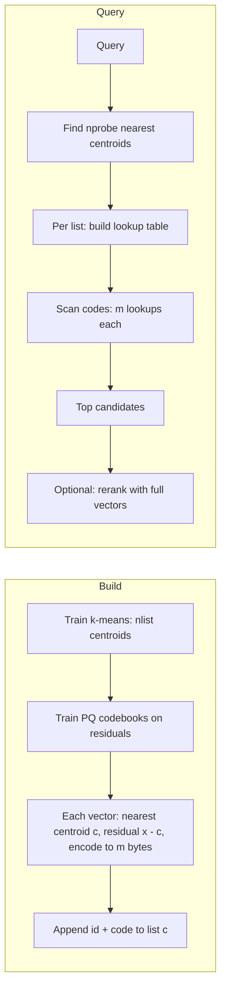

# IVF-PQ (Inverted File + Product Quantization)

## Overview
**IVF-PQ** combines two ideas. **IVF** splits the vectors into clusters so a query scans only a few of them. **PQ** compresses each vector into a few dozen bytes, so the scan is cheap and the index fits in RAM. It is the usual choice when float vectors are too big for memory: tens of millions to billions of vectors, often on GPU.

> [!INFO] Origin
> Jégou, Douze & Schmid, "Product Quantization for Nearest Neighbor Search" (IEEE TPAMI 2011). The paper calls the combined index **IVFADC**. For how IVF-PQ compares with the other index families, see [[23.07 ANN Indexes (HNSW, IVF, PQ)]].

## Two Parts

| Part | Job | What is stored |
|---|---|---|
| **Coarse quantizer** (IVF) | Pick which clusters to scan | `nlist` centroids, `d` floats each |
| **Fine quantizer** (PQ) | Compress the vectors inside each cluster | `m` codebooks of $2^{\text{nbits}}$ centroids, plus `m` codes per vector |

## Pipeline

## Product Quantization
- Split each vector into `m` sub-vectors of $d/m$ dims
- Each sub-space gets its own codebook of $k^* = 2^{\text{nbits}}$ centroids (256 for 8 bits), trained with k-means
- A vector's code is `m` centroid indices. With 8 bits that is `m` bytes
- Only $m \cdot k^*$ centroids are stored, but they can represent $(k^*)^m$ distinct vectors

**Asymmetric distance (ADC)**: the query stays exact and only the database vectors are compressed:

$$\tilde{d}(q, x)^2 = \sum_{j=1}^{m} \left\lVert q_j - c_j\big[\text{code}_j(x)\big] \right\rVert^2$$

- Precompute a table $T[j][i] = \lVert q_j - c_{j,i} \rVert^2$ once per query: $m \times 256$ entries
- Each database distance is then `m` table lookups and adds, instead of `d` multiply-adds on floats
- **SDC** (symmetric) also quantizes the query. It is cheaper but less accurate, so ADC is the usual default

## Why Encode Residuals
- IVF-PQ encodes $x - c$ (the vector minus its cluster centroid), not $x$ itself
- Residuals are smaller and look alike across clusters, so the same `m` bytes keep more detail
- Cost: the query's residual differs per cluster, so a lookup table is built for each probed list. For L2 distance, FAISS can precompute part of these tables (`use_precomputed_table`)

## Memory Math
Per vector: `m` bytes of code plus the ID (8 bytes in FAISS). Centroids and codebooks add a small fixed cost.

| Index (d = 768, float32) | Per vector | 100M vectors |
|---|---|---|
| Flat | 3,072 B | ~307 GB |
| HNSW, M = 32 ([[23.08 HNSW]]) | ~3,328 B | ~333 GB |
| IVF-Flat | 3,080 B | ~308 GB |
| **IVF-PQ, m = 96** | 104 B | **~10 GB** |
| **IVF-PQ, m = 48** | 56 B | **~5.6 GB** |

- 65,536 centroids at 768 dims add about 200 MB, which is small at this scale

## Parameters

| Parameter | Meaning | Trade-off |
|---|---|---|
| `nlist` | Number of clusters | More clusters: shorter lists, faster scans, but higher `nprobe` and more training data needed |
| `nprobe` | Clusters scanned per query | The main query-time knob for recall vs latency |
| `m` | Sub-quantizers (bytes per vector at 8 bits) | More: more accurate, more memory. `d` must be divisible by `m` |
| `nbits` | Bits per code | 8 is the default. 4 bits enables fast-scan SIMD kernels |
| Rerank depth | Candidates rescored with full vectors | Raises recall, costs extra reads of full vectors |

Starting values for `nlist` and `nprobe` are in [[23.07 ANN Indexes (HNSW, IVF, PQ)#Tuning Knobs|23.07 Tuning Knobs]].

## The Recall Ceiling and Reranking
- PQ distances are approximate, so the order among candidates is noisy. Even with `nprobe = nlist`, IVF-PQ does **not** return the exact top-k. Recall plateaus below 1
- The fix is a **refine step**: fetch `k × factor` candidates by PQ distance, then rescore them with exact distances on the full vectors (FAISS `IndexRefineFlat`, or `RFlat` in an index factory string)
- The full vectors don't need to be in RAM. Only a few hundred per query are read, so they can sit on SSD

## Training
- k-means needs a representative sample. FAISS warns when it gets fewer than 39 training points per centroid. That rule applies to the `nlist` centroids and to each 256-centroid PQ codebook
- Train once, then add vectors. A big shift in the data means retraining and re-encoding
- A new embedding model always means a full rebuild ([[11.72 Embedding Models]])

## Variants
- **OPQ** (Ge et al., CVPR 2013): learns a rotation before PQ so each sub-space carries a similar share of the variance. Usually raises recall at the same code size. FAISS adds it with an `OPQ` prefix in the index factory
- **Fast-scan PQ**: 4-bit codes give 16-entry tables that fit in SIMD registers, so the scan runs much faster (FAISS `IndexIVFPQFastScan`)
- **IVF-SQ8**: scalar quantization instead of PQ. 4x compression, higher recall, much more memory than PQ
- **GPU IVF-PQ**: in FAISS GPU and NVIDIA cuVS. Strong for large query batches
- **HNSW coarse quantizer**: with millions of clusters, an HNSW over the centroids finds the nearest lists quickly ([[23.08 HNSW]])
- **DiskANN** keeps PQ codes in RAM to steer a graph stored on SSD

## IVF-PQ vs HNSW

| | **IVF-PQ** | **HNSW** |
|---|---|---|
| Memory per vector | Tens of bytes | Full vector + links (KBs) |
| Recall without rerank | Moderate, plateaus below 1 | High |
| Training | Required (k-means + codebooks) | None |
| Inserts | Easy, but clusters go stale on drift | Easy, online |
| GPU / batch search | Strong | Possible, less common |
| Best for | 10M to 1B+ vectors on a memory budget | Up to tens of millions in RAM, low latency |

> [!WARNING] Common mistakes
> - Training on too few vectors, or on a sample that doesn't match production data
> - Expecting exact results from `nprobe = nlist`: PQ error remains
> - Picking an `m` that doesn't divide `d`
> - Using cosine similarity without normalizing vectors before training and adding ([[23.06 Vector Similarity Metrics]])
> - Skipping the refine step when recall matters

## Related Concepts
- [[23_Database_Retrieval_MOC]] - parent index
- [[23.07 ANN Indexes (HNSW, IVF, PQ)]] - overview, defaults and filtering across index families
- [[23.08 HNSW]] - contrast: graph index, RAM-heavy, higher recall
- [[23.01 Vector Databases]] - stores that offer IVF_PQ (Milvus, FAISS-backed systems)
- [[11.72 Embedding Models]] - dimension sets memory; a new model means retraining
- [[11.39 Quantization]] - contrast: quantizing model weights, not stored vectors

## References
- "Product Quantization for Nearest Neighbor Search" (Jégou, Douze & Schmid, IEEE TPAMI 2011)
- "Optimized Product Quantization" (Ge, He, Ke & Sun, CVPR 2013)
- FAISS wiki: "Faiss indexes", "Guidelines to choose an index", "The index factory"
- Milvus docs: IVF_PQ index
