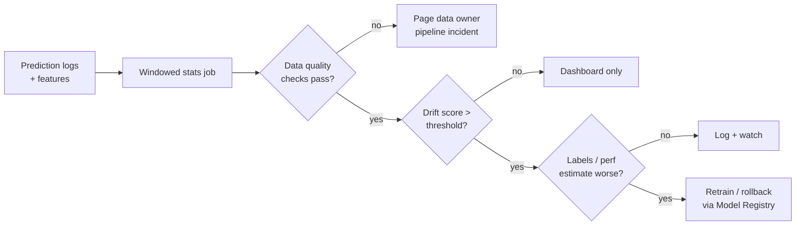

# Model Drift Detection

## Overview
**Model drift** is the gap between the world a model was trained on and the world it now serves. **Drift detection** compares a **reference** window (training data or a known-good production period) with a **current** window, using statistical tests on inputs and outputs. The aim is to catch the drop in quality *before* ground-truth labels arrive, which can take days or months (loan defaults, churn).

## Key Concepts

### Types of Drift

| Type | What changes | Formal view | Example |
|---|---|---|---|
| **Data (covariate) drift** | Input distribution | $P(X)$ shifts, $P(Y\mid X)$ stable | New traffic source brings younger users |
| **Concept drift** | Input→label relationship | $P(Y\mid X)$ shifts | Fraudsters change tactics; same features, new meaning |
| **Prior (label) drift** | Class balance | $P(Y)$ shifts | Fraud rate doubles during holidays |
| **Prediction drift** | Model output distribution | $P(\hat{Y})$ shifts | Share of "approve" decisions falls from 60% to 40% |
| **Upstream / schema drift** | Pipeline, not the world | Nulls, units, renamed categories | A service starts sending cents instead of dollars |

- Concept drift can only be *confirmed* with labels. Data and prediction drift are **proxies** you can watch in real time.
- Drift speed matters: **sudden** (a pipeline bug, a policy change), **gradual** (behaviour slowly changing), **seasonal/recurring** (weekday vs weekend). Seasonal patterns cause false alarms unless the reference window covers the same period.

> [!WARNING] Most "drift" is a data bug
> In practice, the biggest jumps usually come from upstream changes (schema, units, a broken join, defaults filling in for missing values), not from the world changing. Run data quality checks ([[42.01 Great Expectations]], [[42.02 Data Contracts]]) before running statistical drift tests.

### Detection Methods

**Population Stability Index (PSI)**: bin the feature (often by reference deciles), then compare bin proportions:

$$\text{PSI} = \sum_{i=1}^{B} (c_i - r_i)\,\ln\frac{c_i}{r_i}$$

where $r_i$, $c_i$ are the reference and current shares of bin $i$. A common credit-risk rule of thumb: $<0.1$ stable, $0.1$–$0.25$ moderate shift, $>0.25$ significant. These cut-offs are a convention, not a statistical test.

**Kullback–Leibler divergence**: $D_{KL}(P\Vert Q) = \sum_x P(x)\ln\frac{P(x)}{Q(x)}$. It is asymmetric and becomes infinite when $Q(x)=0$, so empty bins need smoothing. PSI is the symmetrised form: $D_{KL}(P\Vert Q) + D_{KL}(Q\Vert P)$.

**Jensen–Shannon divergence**: compares each side to the mixture $M = \tfrac12(P+Q)$:

$$D_{JS}(P\Vert Q) = \tfrac12 D_{KL}(P\Vert M) + \tfrac12 D_{KL}(Q\Vert M)$$

It is symmetric and bounded (in $[0, \ln 2]$, or $[0,1]$ with log base 2). Its square root is a true metric (**JS distance**).

**Kolmogorov–Smirnov (KS) test**: for continuous features, uses the largest gap between the two empirical CDFs, $D = \sup_x |F_r(x) - F_c(x)|$, and returns a p-value.

**Other options**:
- **Chi-squared test**: for categorical features (counts per category)
- **Wasserstein (earth mover's) distance**: how far mass moved; keeps the units of the feature
- **Multivariate / domain classifier**: train a classifier to tell reference rows from current rows. If its AUC is well above 0.5, the joint distribution has shifted, including feature interactions that per-feature tests miss
- **Embedding drift**: for text/images/LLM inputs, compare embedding distributions (distance between centroids, or a domain classifier on the embeddings)

> [!WARNING] p-values at scale
> With 1M rows, KS and chi-squared tests flag tiny, harmless shifts as "significant". At high volume, use effect-size measures (PSI, JS, Wasserstein) with thresholds tuned on history. Keep p-value tests for small samples, and correct for multiple testing when you test hundreds of features.

### Windows & Reference Selection
- **Fixed reference**: the training set. Simple, but it alarms forever once the world has moved and the model has been accepted anyway.
- **Rolling reference**: last N days of production. Adapts to change, but slow gradual drift goes unseen because the baseline moves with it.
- **Window size**: small windows are noisy; large windows react slowly. Match it to traffic volume and to how fast you could act.
- **Segment** by key slices (country, device, model version). Drift that averages out globally often shows up clearly in one segment.

## Comparison Table

| Method | Feature type | Symmetric | Bounded | Sensitive to sample size | Best for |
|---|---|---|---|---|---|
| **PSI** | Binned numeric / categorical | Yes | No | Low (depends on binning) | Tabular scorecards, dashboards |
| **KL** | Distributions | No | No | Low | Theory; rarely alert on it directly |
| **JS** | Distributions | Yes | Yes | Low | General default for alert thresholds |
| **KS test** | Continuous | Yes | $D\in[0,1]$ | High (p-value) | Small/medium samples |
| **Chi-squared** | Categorical | — | No | High (p-value) | Low-cardinality categories |
| **Wasserstein** | Continuous | Yes | No | Low | Shifts you can read in the feature's own units |
| **Domain classifier** | Any, multivariate | — | AUC $\in[0.5,1]$ | Medium | Feature interactions, embeddings |

## Alerting & Response

- **Rank features by importance**: drift in a top-5 feature matters more than drift in feature 300. Weight alerts by importance (or SHAP contribution).
- **Alert on performance, use drift to explain it**: when labels exist, performance metrics are the main signal. Drift tells you *where* to look.
- **Estimate performance without labels**: methods such as NannyML's confidence-based performance estimation (CBPE) estimate accuracy from calibrated predicted probabilities. They work for covariate drift, not concept drift.
- **Retrain triggers**: drift + measured or estimated decline → retrain on recent data → evaluate → promote via [[22.01 Model Registry]] and [[22.03 CI-CD for ML]].

> [!TIP] Log what you need for drift on day one
> Store model inputs, outputs, model version and a request ID that can later be joined to labels. You cannot compute last month's drift from metrics you never logged.

## Tools

| Tool | Notes |
|---|---|
| **Evidently** | OSS Python library; drift presets and reports, per-column test selection |
| **NannyML** | OSS; performance estimation without labels (CBPE, DLE), multivariate drift |
| **Alibi Detect** | OSS; statistical and learned detectors (MMD, classifier-based), works on text and images |
| **whylogs** | OSS data profiling; lightweight statistical profiles you can merge |
| **Arize, Fiddler, cloud-native monitors** (SageMaker Model Monitor, Vertex AI Model Monitoring) | Managed; dashboards, slicing, alerting |

## Practical Use Cases

> [!EXAMPLE] Credit scoring
> Monthly PSI on each scorecard feature and on the score itself is a standard model-risk control. A score PSI above 0.25 triggers a model review.

- **Fraud / ads / recommendations**: fast-changing domains; daily windows, segmented by market, with prediction drift as the earliest signal.
- **LLM applications**: input drift = new topics or languages in prompts (embedding drift). Output drift = changes in judge scores, refusal rate, or length. See [[24.04 LLM Observability & Tracing]] and [[24.05 LLM-as-Judge]].
- **Feature pipelines**: compare feature distributions at training time and at serving time to catch **training–serving skew** ([[22.02 Feature Store]]).

## Related Concepts
- [[24_Monitoring_MOC]] - parent index
- [[24.02 Observability Stack]] - where drift metrics and alerts live
- [[24.04 LLM Observability & Tracing]] - LLM counterpart: feedback and score drift
- [[11.15 LLM Evaluation Metrics]] - metrics for LLM output drift
- [[22.01 Model Registry]] - rollback/promote when drift triggers retraining
- [[42.01 Great Expectations]] - rule-based checks to run before statistical tests
- [[43.01 Feature Engineering Patterns]] - point-in-time features avoid false skew
- [[23.06 Vector Similarity Metrics]] - distances used for embedding drift

## References
- Evidently, NannyML and Alibi Detect documentation
- Rabanser et al., "Failing Loudly: An Empirical Study of Methods for Detecting Dataset Shift" (2019)
