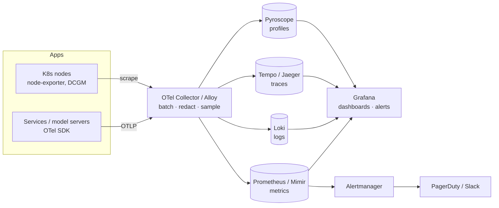

# Observability Stack

## Overview
An **observability stack** is the pipeline that collects, stores and queries **telemetry** (metrics, logs, traces and, more recently, profiles), so you can answer questions about a running system that you did not plan for in advance. The modern default: instrument with [[24.03 OpenTelemetry]], route through a **collector**, then store each signal in a backend built for it (Prometheus/Mimir, Loki, Tempo), with Grafana on top for dashboards and alerts.

## Key Concepts

### The Signals

| Signal | Answers | Shape | Cost driver |
|---|---|---|---|
| **Metrics** | *Is* something wrong? Trends, SLOs, alerts | Numeric time series + labels | **Cardinality** (unique label combinations) |
| **Logs** | *What* happened in this component? | Timestamped events, ideally structured JSON | Volume (GB/day) |
| **Traces** | *Where* in the request path did it go wrong? | Tree of spans per request | Span volume (controlled by sampling) |
| **Profiles** | *Which code* uses CPU or memory? | Stack samples over time | Sampling rate |

- **Correlation is the point.** A metric spike → **exemplar** (a sample trace ID attached to the metric) → trace → logs filtered by the same `trace_id`. Without shared IDs and labels you have three separate tools, not observability.
- **Push vs pull**: Prometheus *scrapes* (pulls) `/metrics` endpoints. OTLP *pushes* to a collector. Most stacks use both.

### What to Measure
- **RED** (for services): **R**ate, **E**rrors, **D**uration
- **USE** (for resources): **U**tilisation, **S**aturation, **E**rrors (CPU, GPU, memory, queues)
- **Four golden signals** (Google SRE): latency, traffic, errors, saturation
- **ML additions**: prediction distribution, feature null rates, model version, inference batch size, GPU memory/utilisation, queue depth. For LLMs: tokens, TTFT and cost ([[24.04 LLM Observability & Tracing]])

### Collector Layer
The **OpenTelemetry Collector** is a vendor-neutral pipeline: **receivers** (OTLP, Prometheus, filelog) → **processors** (batch, memory limiter, attribute filtering/redaction, tail sampling) → **exporters** (to any backend). Common deployments: an **agent** on each node or as a sidecar, plus a central **gateway** for tail sampling and fan-out. Component details live in [[24.03 OpenTelemetry]].

> [!INFO] Grafana Alloy
> **Grafana Alloy** is Grafana Labs' distribution of the OTel Collector. It replaces Grafana Agent (end-of-life 1 Nov 2025) and Promtail (end-of-life 2 Mar 2026). On a Grafana stack, Alloy is the default collector.

### Reference Architecture

## Comparison Table

| Layer | Open source options | Notes |
|---|---|---|
| Instrumentation | OpenTelemetry SDKs, Prometheus client libraries | OTel is the vendor-neutral standard |
| Collection | OTel Collector, Grafana Alloy, Fluent Bit, Vector | Fluent Bit / Vector are log-focused |
| Metrics store | **Prometheus** (single node), **Mimir**, Thanos, VictoriaMetrics | Mimir/Thanos add long-term storage and horizontal scaling on object storage |
| Log store | **Loki**, Elasticsearch/OpenSearch, ClickHouse | Loki indexes only labels → cheap, but full-text search is slower |
| Trace store | **Tempo**, Jaeger | Tempo stores traces in object storage, indexed by trace ID |
| Profiles | Pyroscope, Parca | Continuous profiling |
| Visualisation | **Grafana** | One UI for all signals; alerting built in |
| Managed (all-in-one) | Datadog, New Relic, Honeycomb, Grafana Cloud, cloud-native (CloudWatch, Cloud Monitoring) | Faster to start, cost grows with volume |

## Practical Use Cases

> [!EXAMPLE] Model-serving latency regression
> The p99 alert fires on the inference service. The exemplar on the latency histogram links to a slow trace. The trace shows the feature-store lookup span took most of the time. Loki logs with that `trace_id` show Redis connection-pool timeouts. Root cause found without SSH.

- **SLO-based alerting**: alert on error-budget **burn rate** (e.g. "at this rate the monthly budget runs out in 2 days") instead of fixed thresholds. Fewer pages, and each page matters.
- **GPU fleet**: NVIDIA DCGM exporter → Prometheus for utilisation, memory and temperature. Put these next to request metrics to spot under-used or saturated GPUs.
- **Drift and model quality**: batch jobs push drift scores as metrics ([[24.01 Model Drift Detection]]), so the same alerting path covers model-quality issues.
- **Cost**: telemetry volume becomes its own bill. Track it next to infrastructure cost ([[32.01 Cost Monitoring Tools]]).

> [!WARNING] Cardinality explosions
> Never put unbounded values (user ID, request ID, raw prompt, full URL) in metric labels. Each unique value creates a new time series and can bring Prometheus down. High-cardinality detail belongs in traces and logs.

> [!TIP] Practical defaults
> - Structured JSON logs that always carry `trace_id`, `service`, `version`
> - Tail sampling at the gateway: keep 100% of errors and slow requests, sample the rest
> - Redact PII in the collector, before it reaches any backend
> - Dashboards as code (Grafana provisioning / Jsonnet), reviewed like other code ([[22.03 CI-CD for ML]])

## Related Concepts
- [[24_Monitoring_MOC]] - parent index
- [[24.03 OpenTelemetry]] - instrumentation standard and collector internals
- [[24.04 LLM Observability & Tracing]] - LLM-specific spans on the same stack
- [[24.01 Model Drift Detection]] - ML-quality signals to send through it
- [[24.07 API Server Profiling]] - deeper single-service investigation
- [[32.01 Cost Monitoring Tools]] - related: cost observability
- [[22.03 CI-CD for ML]] - deploy events and pipeline metrics
- [[73.02 Docker]] - containers emitting the telemetry

## References
- OpenTelemetry Collector documentation
- Grafana Labs: "From Agent to Alloy" FAQ
- Google SRE Book, "Monitoring Distributed Systems"
