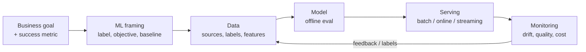

# ML System Design Patterns

## Overview
**ML system design patterns** are reusable answers to problems that come up in every production ML system: keeping training and serving consistent, meeting latency targets with expensive models, shipping models safely, and closing the feedback loop. The model is usually a small part of the system. Most of the design work is in data flow, serving and operations around it, as the "hidden technical debt" paper (Sculley et al., 2015) pointed out.

## Key Concepts

### A Design Framework

- **Start with a non-ML baseline** (rules, heuristics, popularity). It sets the bar, works as a fallback, and is sometimes enough.
- **Connect offline and online metrics**: AUC improving offline means nothing if the business metric doesn't move in an A/B test.
- **Set constraints first**: latency budget (p99), throughput, freshness, cost per prediction, explainability and regulation.

### Data & Training Patterns
- **Transform / single feature definition**: one feature definition runs in both training and serving, to avoid **training–serving skew** ([[22.02 Feature Store]], [[43.01 Feature Engineering Patterns]])
- **Point-in-time correct training sets**: join features *as of* the label timestamp. This prevents leakage
- **Workflow pipeline**: training as a DAG of containerised steps (ingest → validate → train → evaluate → register). The same pipeline is reproducible from code and data versions
- **Data validation gate**: schema and quality checks block bad data before training ([[42.01 Great Expectations]], [[42.02 Data Contracts]])
- **Rebalancing**: down-sample, weight or reframe when classes are imbalanced ([[12.14 Imbalanced Classification]])
- **Checkpoints / warm start**: resume training and fine-tune from the last good model instead of retraining from scratch

### Serving Patterns
- **Batch (precompute) serving**: score everything offline, serve results from a key-value store. The cheapest option when inputs are known ahead of time
- **Stateless serving function**: model behind a REST/gRPC endpoint that scales horizontally ([[31.02 Serving Architecture]])
- **Two-phase / cascade**: a cheap model handles most traffic and passes hard cases to an expensive model or a human. Same idea as LLM routing ([[32.04 Multi-Model Cost Strategy]])
- **Multi-stage retrieve → rank → re-rank**: candidate generation over millions of items (two-tower embeddings + ANN, [[23.07 ANN Indexes (HNSW, IVF, PQ)]]), then a heavier ranker on hundreds of items, then business rules. Used for search, recommendations and RAG ([[11.68 Reranking (Cross-Encoders)]])
- **Keyed predictions**: clients send an ID with each input so batch or async results can be matched back to requests
- **Fallback**: on timeout or model error, return a cached, popular or rule-based answer instead of failing the request

### Deployment & Evaluation Patterns
- **Shadow deployment**: the new model scores live traffic but its results are not shown to users. Compare it with production offline
- **Canary / progressive rollout**: send 1% → 10% → 100% of traffic, with automatic rollback on metric regression
- **Champion / challenger & A/B testing**: randomised split, measured on the business metric
- **Continuous evaluation**: compare predictions with labels as they arrive, and trigger retraining ([[24.01 Model Drift Detection]])
- **Model registry as the source of truth**: versioned artefacts with stage transitions ([[22.01 Model Registry]])

### Feedback Patterns
- **Data flywheel**: production predictions + user feedback → new labels → better model
- **Human-in-the-loop**: route low-confidence predictions to reviewers. Their decisions become training data
- **Watch for feedback loops**: a recommender trained only on what it already showed reinforces its own bias. Reserve some exploration traffic (e.g. bandits)

## Comparison Table

| Problem | Pattern | Trade-off |
|---|---|---|
| Training–serving skew | Shared feature definitions / feature store | Extra infrastructure to run |
| Label leakage | Point-in-time joins | More complex training data generation |
| Tight latency with a heavy model | Cascade, multi-stage ranking, distillation | More components to keep in sync |
| Inputs known in advance | Batch precompute | Results are stale between runs; wasted on items nobody asks for |
| Risky model change | Shadow → canary → A/B | Slower to ship; needs routing infrastructure |
| Model quality decays | Continuous evaluation + scheduled/triggered retraining | Needs labels and pipeline automation |
| Dependency outage | Fallback / graceful degradation | Lower quality while it is active |

## Practical Use Cases

> [!EXAMPLE] E-commerce recommendations
> Nightly batch jobs build candidate pools per user. At request time, a two-tower ANN lookup adds session-based candidates. A GBDT ranker scores ~500 candidates with real-time features from an online store. Business rules re-rank the results. On timeout, the system returns the cached nightly list. Every new ranker goes through shadow → canary → A/B on conversion.

> [!EXAMPLE] LLM support assistant
> A cheap classifier routes simple intents to templated answers. Everything else goes to RAG + LLM. Low-confidence or sensitive answers go to a human agent, and their corrections feed evaluation sets ([[24.06 Online Evaluation & Prompt Regression]]).

> [!WARNING] Common anti-patterns
> - **Glue code and pipeline jungles**: ad-hoc scripts per model. Standardise on one pipeline framework
> - **Undeclared consumers**: other teams quietly reading your model's output. Make the output a contract ([[42.02 Data Contracts]])
> - **Notebook-to-prod**: the training code can't be reproduced. Version code, data and config together
> - **Optimising the model before the data**: better labels and features usually beat a better architecture

## Related Concepts
- [[31_System_Design_MOC]] - parent index
- [[31.02 Serving Architecture]] - how the serving patterns are deployed
- [[22.01 Model Registry]] - versioning and promotion
- [[22.02 Feature Store]] - implements the shared-feature pattern
- [[22.03 CI-CD for ML]] - automates pipeline and rollout patterns
- [[24.01 Model Drift Detection]] - continuous evaluation trigger
- [[71.11 Design Patterns]] - contrast: software-level design patterns
- [[32.04 Multi-Model Cost Strategy]] - cascade/routing for cost control

## References
- Lakshmanan, Robinson & Munn, *Machine Learning Design Patterns* (O'Reilly, 2020)
- Huyen, *Designing Machine Learning Systems* (O'Reilly, 2022)
- Sculley et al., "Hidden Technical Debt in Machine Learning Systems" (NeurIPS 2015)
