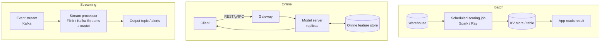

# Serving Architecture

## Overview
**Serving architecture** is how a trained model's predictions reach users: when inference runs (ahead of time or on request), how requests are batched and routed, and how capacity follows load. The first decision is the **serving mode** (batch, online or streaming), which is set by how fresh the predictions must be and how fast they must return. The choice of model server and the autoscaling setup come after that.

## Key Concepts

### Serving Modes

- **Batch (offline)**: score a known set of entities on a schedule. Highest throughput, cheapest per prediction. Results are as fresh as the last run
- **Online (real-time, synchronous)**: score on request, typically with a latency target of tens to hundreds of milliseconds. Needs features at request time ([[22.02 Feature Store]])
- **Streaming (near-real-time, asynchronous)**: score events as they arrive, with state kept per entity (sliding-window counts, sessions). For fraud, IoT, and keeping features fresh
- **Async online**: request → queue → worker → callback/poll. For slow models (long LLM jobs, video) where holding an HTTP connection open is impractical
- **Hybrid**: precompute the expensive part in batch (embeddings, candidate lists) and do the cheap, personal part online

### Model Server Responsibilities
- **Dynamic batching**: group concurrent requests into one GPU forward pass, bounded by a maximum queue delay. More throughput for a little latency
- **Model management**: multiple models/versions per server, hot reload, multiplexing many small models on shared GPUs
- **Pre/post-processing**: tokenisation, feature lookup, thresholding. Keep these in the same process, or as a pipeline step, to avoid extra network hops
- **Protocols**: REST + gRPC. The **Open Inference Protocol** (KServe v2 / Triton) gives a standard request/response format across servers
- **Health and metrics**: readiness and liveness probes, Prometheus metrics for queue time vs compute time ([[24.02 Observability Stack]])

### Capacity & Autoscaling
**Little's Law** sizes concurrency: $L = \lambda W$ (requests in flight = arrival rate × latency). At 200 req/s and 50 ms latency, about 10 requests are in flight. Combined with per-replica concurrency, this gives the replica count.

- **Scale on the right signal**: CPU% is a poor proxy for GPU inference. Use **queue depth, concurrency, or request latency** (Knative concurrency, KEDA on queue length, HPA on custom metrics)
- **Cold starts**: GPU nodes + container pull + loading weights can take minutes for large models. Keep warm minimum replicas for latency-critical paths, and use scale-to-zero only for spiky or internal workloads ([[31.03 Lazy Loading]] trade-off)
- **Batch size vs latency**: larger batches raise throughput up to the memory/compute limit, then add queueing delay ([[11.18 LLM Throughput & Memory Bound]])
- **Load shedding & timeouts**: reject or downgrade when saturated (fallback model, cached answer). A slow model must not take down its callers

## Comparison Table

### Serving Modes

| | **Batch** | **Online** | **Streaming** |
|---|---|---|---|
| Trigger | Schedule | Request | Event |
| Latency | Minutes–hours | ms | Seconds |
| Freshness | Last run | Request time | Near-real-time |
| Cost per prediction | Lowest | Highest (idle capacity) | Medium |
| Infra | Spark/Ray + KV store | Model server + autoscaling + online features | Kafka + Flink + state store |
| Fits | Churn scores, nightly recs, embeddings backfill | Search ranking, credit decision at checkout | Fraud on transactions, anomaly detection |

### Model Servers

| Server | Strength | Notes |
|---|---|---|
| **NVIDIA Triton** | Multi-framework (TensorRT, ONNX, PyTorch, Python), dynamic batching, model ensembles | High-performance GPU default |
| **KServe** | Kubernetes-native `InferenceService` CRD, canary rollouts, scale-to-zero via Knative, Open Inference Protocol | Platform layer; runs Triton/vLLM/etc. underneath |
| **Ray Serve** | Python-first composition of multi-model pipelines, fractional GPUs | Good when the pipeline is Python logic + several models |
| **BentoML** | Packages model + code into a deployable "Bento"; adaptive batching | Developer-friendly; self-host or managed |
| **TF Serving** | Mature for TensorFlow SavedModels | TF-only |
| **FastAPI wrapper** | Simple, full control ([[71.03 FastAPI]]) | You must build batching, metrics and model management yourself |
| **TorchServe** | PyTorch-native | **Limited maintenance**: repo archived Aug 2025, no further security patches. Avoid for new work |

### LLM Serving
LLMs need specialised engines: continuous batching, paged KV cache, prefix caching, speculative decoding. Use **vLLM, SGLang, TensorRT-LLM or TGI** rather than general model servers. See [[11.27 LLM Generation Engines]], [[11.41 Speculative Decoding]], [[11.42 Chunked Prefill]], [[11.21 Prompt Caching]] and [[11.39 Quantization]]. LLM-specific metrics: **TTFT**, inter-token latency, tokens/s, KV-cache usage.

## Practical Use Cases

> [!EXAMPLE] Choosing a mode
> - "Recommend products in tomorrow's email" → **batch**
> - "Rank search results as the user types" → **online**, precomputed item embeddings + ANN
> - "Block a card transaction within 1 s, using the last 10 minutes of activity" → **streaming** features + online scoring

> [!TIP] Default path
> 1. Can it be batch? Then make it batch.
> 2. If online: start with KServe or BentoML + Triton for GPUs. Use an LLM engine for LLMs.
> 3. Measure queue time vs compute time before adding replicas. Batching often doubles throughput at no extra cost.
> 4. Roll out via shadow → canary ([[31.01 ML System Design Patterns]]).

> [!WARNING] Pitfalls
> - **Training–serving skew**: different preprocessing code online and offline. Share the transform ([[43.01 Feature Engineering Patterns]])
> - **Ignoring p99**: averages hide GC pauses, cold replicas and oversized batches
> - **GPU for everything**: small tree models and linear models are often cheaper and faster on CPU ([[32.05 Training vs Inference Costs]])

## Related Concepts
- [[31_System_Design_MOC]] - parent index
- [[31.01 ML System Design Patterns]] - serving patterns (cascade, fallback, rollout)
- [[11.27 LLM Generation Engines]] - LLM-specific serving engines
- [[11.18 LLM Throughput & Memory Bound]] - why batching raises GPU throughput
- [[22.02 Feature Store]] - online feature lookup at request time
- [[24.02 Observability Stack]] - latency, queue and GPU metrics
- [[32.05 Training vs Inference Costs]] - cost implications of serving choices
- [[31.03 Lazy Loading]] - model loading and cold-start trade-offs

## References
- KServe, NVIDIA Triton, Ray Serve and BentoML documentation
- TorchServe docs: "Limited Maintenance" notice
