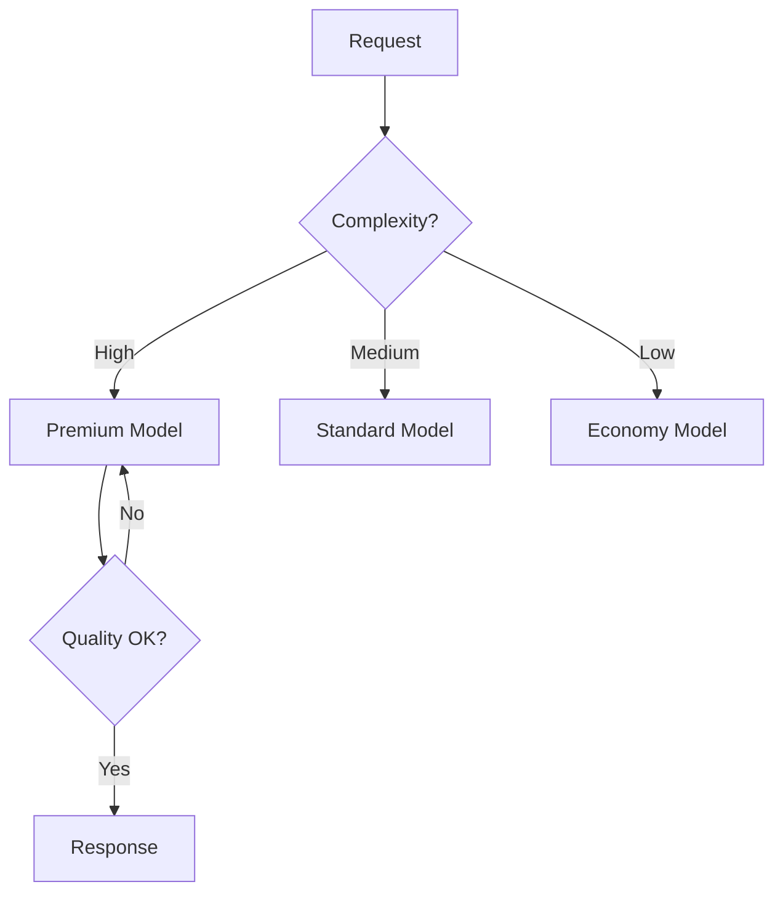

# Multi-Model Cost Strategy

## Overview
Use different AI models for different tasks based on cost, latency, and quality trade-offs. Intelligent routing optimizes spend while maintaining quality where it matters.

## Model Tiering

| Tier | Examples | Cost | Quality | Use Case |
|------|----------|------|---------|----------|
| **Premium** | GPT-6 Astra, Claude Fable 5.1, Claude Opus 5.5, Gemini 4 Argon | $$$ | ⭐⭐⭐⭐⭐ | Complex reasoning, critical decisions |
| **Standard** | GPT-6.1 Sol, Claude Sonnet 5.5, Gemini 3.8 Flash | $$ | ⭐⭐⭐ | General tasks, good balance |
| **Economy** | GPT-6 Luna, Claude Haiku 5.5, Gemini 3.5 Flash-Lite, self-hosted Llama 4 / Mistral Small 4 | $ | ⭐⭐ | High volume, cost-sensitive |

## Pricing (as of 2026-11)

Per 1M tokens, USD, standard tier, short-context prompts.

| Model | Input | Output | Best For |
|-------|-------|--------|----------|
| GPT-6 Astra | $10.00 | $50.00 | Hardest reasoning (>272K input: $20/$75) |
| Claude Fable 5.1 | $10.00 | $50.00 | Hardest reasoning, agents |
| Claude Opus 5.5 | $4.00 | $20.00 | Code, complex analysis |
| Gemini 4 Argon | $2.00 | $10.00 | Flagship reasoning; rises to $4/$20 on 2026-12-01 |
| GPT-6.1 Sol | $2.00 | $10.00 | General, vision |
| Claude Sonnet 5.5 | $2.00 | $10.00 | Code, general production |
| Gemini 3.8 Flash | $0.75 | $3.75 | Fast general; rises to $1.50/$7.50 on 2027-01-01 |
| Gemini 3.5 Flash-Lite | $0.30 | $2.50 | Cheap, multimodal |
| GPT-6 Luna | $0.10 | $0.50 | Cost-effective general |
| Claude Haiku 5.5 | $0.10 | $0.50 | Fast, cheap (prompts >100K: $0.50/$2.50) |

## Intelligent Routing

### Classification Strategy

**Complexity Indicators**:
- High: analyze, synthesize, compare, architecture, code review
- Low: format, classify, translate simple, yes/no questions
- Context length >50K tokens → Higher tier

### Routing by Task Type

| Task | Recommended Tier | Rationale |
|------|------------------|-----------|
| Classification | Economy | Pattern matching |
| Summarization | Standard | Balance quality/cost |
| Code generation | Premium | Accuracy critical |
| Chat support | Standard | Good enough quality |
| Complex analysis | Premium | Reasoning required |
| Data extraction | Economy | Structured output |

## Fallback Chains

**Configuration**:
1. Primary: Preferred model
2. Secondary: Backup (different provider)
3. Tertiary: Reliable fallback

Handle: rate limits, timeouts, API errors, quality failures.

## Budget Allocation

| Category | Budget % | Models | Examples |
|----------|----------|--------|----------|
| **Critical** | 40% | Premium | User-facing chat, key decisions |
| **Standard** | 35% | Standard | Summarization, classification |
| **Batch** | 25% | Economy | Embeddings, data processing |

### Budget Controls
- Set spending caps per category
- Alert at 70%, 90%, 100% thresholds
- Auto-downgrade when budget exceeded

## A/B Testing Models

Test model performance before switching:
1. Split traffic (e.g., 50/50)
2. Track: cost, latency, quality score
3. Calculate cost-per-quality-point
4. Graduate winner to 100%

## Optimization Strategies

### Cost Reduction

| Strategy | Savings | Tradeoff |
|----------|---------|----------|
| Prompt caching | 50-90% | Setup complexity |
| Response caching | 70-90% | Stale responses |
| Shorter prompts | 20-40% | Less context |
| Model downgrade | 50-80% | Quality loss |
| Batching | 10-20% | Higher latency |

### Quality Preservation

- Use premium for user-visible outputs
- Use economy for internal processing
- Hybrid: cheap model drafts, expensive reviews

## Implementation Checklist

- [ ] Define model tiers and use cases
- [ ] Implement task classifier
- [ ] Set up fallback chains
- [ ] Configure budget limits per category
- [ ] Track cost/quality metrics
- [ ] A/B test before major changes

## Related Concepts
- [[32_Cost_Management_MOC]] - Parent category
- [[32.06 FinOps Practices]] - Governance for model selection policies
- [[32.05 Training vs Inference Costs]] - Cost basis for model selection
- [[32.01 Cost Monitoring Tools]] - Track per-model costs
- [[11.21 Prompt Caching]] - Reduce per-model inference costs via KV cache reuse

## References
- OpenAI Pricing Page
- Anthropic Pricing
- LiteLLM (multi-provider routing)
