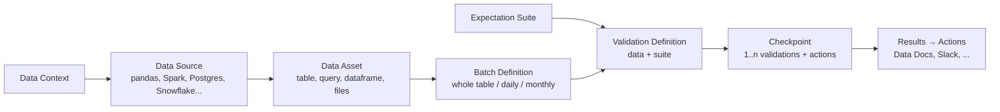
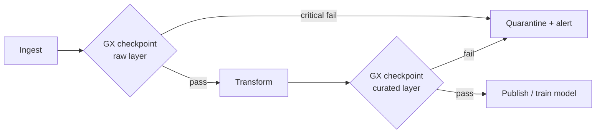

# Great Expectations

## Overview
**Great Expectations (GX)** is an open-source Python framework for **data validation**: you declare what the data should look like as **Expectations** ("`passenger_count` is between 1 and 6", "`id` is never null"), run them against batches of data, and get structured results plus human-readable **Data Docs**. Tests for code have a long tradition; GX applies the same idea to data. It is often the enforcement engine behind [[42.02 Data Contracts]]. This note covers the **GX Core 1.x** API. The 1.0 release (2024) replaced the older 0.x `Validator`/YAML-checkpoint style, so most blog posts from before 2024 are out of date.

## Key Concepts

### Object Model (GX 1.x)



- **Data Context**: entry point and config store. `gx.get_context()` returns a **File** context if one exists in the folder tree, otherwise an **Ephemeral** (in-memory) one. Use `mode="file"` / `mode="ephemeral"` to choose explicitly. GX Cloud is the managed option
- **Data Source → Data Asset**: where data lives (`context.data_sources.add_postgres(...)`, `add_pandas(...)`, `add_spark(...)`) and which table, query or dataframe inside it
- **Batch Definition**: how to slice an asset into **batches**: whole table, or partitioned by a date column (`add_batch_definition_daily(column=...)`). The batch is chosen at run time with `batch_parameters`
- **Expectation**: a declarative assertion, now a Python class (`gx.expectations.ExpectColumnValuesToNotBeNull`). Each one has a `severity` (`critical` / `warning` / `info`)
- **Expectation Suite**: a named collection of expectations for one asset
- **Validation Definition**: links one Batch Definition to one Suite. "Validate *this data* against *these rules*"
- **Checkpoint**: runs one or more Validation Definitions and then **Actions** (`UpdateDataDocsAction`, `SlackNotificationAction`, etc.), with `notify_on` set to `failure`, `critical`, `warning` and so on
- **Data Docs**: generated HTML site of suites and validation results, for people to read

### Core API Pattern

```python
context = gx.get_context()
batch_def = (context.data_sources.add_postgres("wh", connection_string="${PG_CONN}")
             .add_table_asset(name="trips", table_name="trips")
             .add_batch_definition_daily(name="daily", column="pickup_ts"))
suite = context.suites.add(gx.ExpectationSuite(name="trips_suite"))
suite.add_expectation(gx.expectations.ExpectColumnValuesToNotBeNull(column="trip_id"))
vd = context.validation_definitions.add(gx.ValidationDefinition(name="trips_vd", data=batch_def, suite=suite))
cp = context.checkpoints.add(gx.Checkpoint(name="trips_cp", validation_definitions=[vd]))
result = cp.run(batch_parameters={"year": 2026, "month": 11, "day": 7})  # result.success → gate
```

For one-off exploration, run `batch.validate(expectation)` directly on a batch. Use the Checkpoint path in pipelines.

### Useful Expectation Families
- **Schema**: `ExpectTableColumnsToMatchOrderedList`, `ExpectColumnValuesToBeOfType`
- **Completeness / uniqueness**: `ExpectColumnValuesToNotBeNull` (accepts a `mostly` fraction), `ExpectColumnValuesToBeUnique`, `ExpectCompoundColumnsToBeUnique`
- **Validity**: `ExpectColumnValuesToBeBetween`, `ExpectColumnValuesToBeInSet`, `ExpectColumnValuesToMatchRegex`
- **Volume / distribution**: `ExpectTableRowCountToBeBetween`, `ExpectColumnMeanToBeBetween`, `ExpectColumnKLDivergenceToBeLessThan` (a rough drift check, see [[24.01 Model Drift Detection]])
- **Custom SQL**: `UnexpectedRowsExpectation`, where a query that returns rows means failure. Use it for business rules

> [!TIP] Parameterise thresholds
> Expectation values can come from `expectation_parameters` at run time (e.g. `{"$PARAMETER": "max_fare"}`). One suite can then serve several environments, or thresholds computed from historical data.

## Comparison Table

| Tool | Style | Runs on | Strength | Weak spot |
|---|---|---|---|---|
| **Great Expectations** | Python classes, suites + checkpoints | Pandas, Spark, SQL warehouses | Large expectation library, Data Docs, actions | Several concepts to learn; config overhead for small jobs |
| **dbt tests** | SQL/YAML next to models | Warehouse | Zero extra infra if you already use dbt | Mostly row-level checks; limited distribution checks |
| **Soda Core** | YAML checks language (SodaCL) | SQL, Spark | Concise checks, contracts support | Smaller library than GX |
| **Pandera** | Schema-as-code (Pydantic-like) | pandas, Polars, PySpark | Lightweight, type-checker friendly, good for ML code | No orchestration or reporting layer |
| **Deequ / PyDeequ** | Scala/Python on Spark | Spark | Scales to very large tables, anomaly detection on metrics | Spark-only |

## Practical Use Cases



- **Pipeline gate**: run a Checkpoint as an Airflow/Dagster task after each load. Fail the DAG on `critical`, alert on `warning`
- **ML training gate**: validate the training snapshot (nulls, label balance, value ranges) before a training run, so bad data does not become a bad model ([[31.01 ML System Design Patterns]])
- **Contract enforcement**: turn the schema and quality clauses of a [[42.02 Data Contracts|data contract]] into a suite, and run it in the producer's CI
- **Ingest validation for files**: check [[41.01 Parquet File Format|Parquet]] or [[41.02 CSV File Format|CSV]] drops before loading them

> [!WARNING] Pitfalls
> - **Suite bloat**: hundreds of auto-profiled expectations nobody owns → alert fatigue. Start with a few critical checks per table
> - **Validating everything, every run**: on large tables, use daily/partitioned batch definitions, not whole-table scans
> - **0.x tutorials**: `context.sources`, `get_validator`, `run_checkpoint` YAML configs are pre-1.0. Check the API version before copying
> - **Validation ≠ drift**: expectations check rules, not shifts in distribution relative to a baseline. Pair them with drift monitoring

## Related Concepts
- [[42_Data_Quality_MOC]] - parent index
- [[42.02 Data Contracts]] - contracts define what expectations enforce
- [[24.01 Model Drift Detection]] - statistical complement to rule-based checks
- [[41.01 Parquet File Format]] - common validated data format
- [[22.03 CI-CD for ML]] - where checkpoints run as gates
- [[43.01 Feature Engineering Patterns]] - validate features before training

## References
- GX Core documentation: docs.greatexpectations.io (Try GX Core, Connect to SQL data, Run a Checkpoint)
