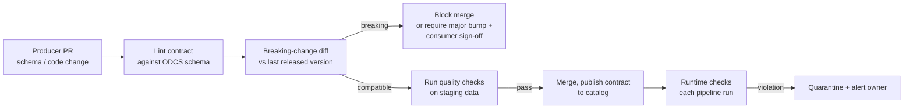

# Data Contracts

## Overview
A **data contract** is a versioned, machine-readable agreement between a data **producer** and its **consumers**. It covers what a dataset contains (schema), what the values mean (semantics), how good the data must be (quality rules), and how it will be delivered (SLAs). For data it plays the same role an API spec plays for a service. It moves responsibility for data quality *upstream* to the team that produces the data, and turns silent breaking changes into failed CI checks.

## Key Concepts

### What a Contract Contains
- **Schema**: tables/objects, columns, types, nullability, keys, partitioning. The structural guarantee
- **Semantics**: business meaning per field ("`amount` is gross, in THB, tax included"), units, enums, links to glossary terms. Most real incidents are semantic, not structural
- **Quality rules**: completeness, uniqueness, ranges, row-count bounds, freshness. These become executable checks
- **SLAs**: latency/freshness, update frequency, availability window, retention, support hours
- **Ownership & support**: owning team, on-call channel, escalation path
- **Access & classification**: PII flags, roles allowed to read, usage restrictions
- **Versioning & lifecycle**: semantic version, status (`draft` / `active` / `deprecated`), end-of-support dates

### Open Data Contract Standard (ODCS)
**ODCS** is the vendor-neutral YAML spec for data contracts, maintained by the **Bitol** project under the Linux Foundation (LF AI & Data). Latest release: **v3.2.0** (Sep 2026). It is Apache-2.0 licensed and ships a JSON Schema for IDE validation.

| Section | Key(s) | Purpose |
|---|---|---|
| Fundamentals | `apiVersion`, `kind: DataContract`, `id`, `version`, `status`, `domain`, `dataProduct`, `description` | Identity and purpose |
| Schema | `schema[]` → `properties[]` (`logicalType`, `physicalType`, `primaryKey`, `classification`...) | Structure, with semantics attached to each field |
| Data quality | `quality[]` at table or property level (e.g. `rowCount`, `nullValues`, with `mustBe` / `mustBeGreaterThan`) | Executable checks |
| SLA | `slaProperties[]` (`latency`, `frequency`, `retention`, `timeOfAvailability`...) | Delivery guarantees |
| Infrastructure | `servers[]` | Where the data physically lives |
| People | `team`, `roles`, `support` | Ownership and access |
| Other | `price`, `tags`, `authoritativeDefinitions`, `customProperties` | Commercial terms, extensions |

```yaml
apiVersion: v3.2.0
kind: DataContract
id: orders-v1
version: 1.2.0
status: active
schema:
  - name: orders
    properties:
      - { name: order_id, logicalType: string, primaryKey: true, required: true }
      - { name: amount_thb, logicalType: number, description: "Gross, VAT incl." }
    quality: [{ metric: rowCount, mustBeGreaterThan: 0 }]
slaProperties: [{ property: frequency, value: 1, unit: d }]
```

> [!INFO] ODCS vs data products
> Bitol also maintains the **Open Data Product Standard (ODPS)**. ODCS describes one dataset's guarantees. ODPS describes a data product, which can expose several contracted ports.

### Enforcement in CI



- **Design time (CI)**: lint the contract, diff it against the previous version, and run tests against staging data. **datacontract-cli** supports ODCS natively, with `lint`, `test` (checks against real data sources), `breaking` (fails on consumer-breaking changes), `changelog`, and `export`/`import` (SQL DDL, dbt, etc.)
- **Run time**: compile quality clauses into executable checks ([[42.01 Great Expectations]], Soda, dbt tests) that run on every load. Violations quarantine the batch instead of publishing it
- **At the source**: for event streams, enforce the schema in a **schema registry** (Avro/Protobuf/JSON Schema with compatibility modes), so producers can't publish incompatible events at all

**Breaking vs non-breaking changes**

| Non-breaking (minor/patch) | Breaking (major) |
|---|---|
| Add an optional column | Remove or rename a column |
| Widen a type (`int32` → `int64`) | Narrow a type, change units or meaning |
| Tighten a guarantee (stricter rule, fresher SLA) | Weaken a guarantee (required → nullable, slower SLA) |
| Add an enum value *if* consumers tolerate unknowns | Change primary key or grain |

## Comparison Table

| | **Data contract** | **Schema registry** | **Data tests only** | **Data catalog** |
|---|---|---|---|---|
| Scope | Schema + semantics + quality + SLA + owner | Schema + compatibility | Quality rules | Discovery + metadata |
| Enforced where | CI + runtime | At produce time | At runtime | Not enforced |
| Owner | Producer, agreed with consumers | Platform | Usually the consumer | Data governance |
| Catches semantic changes | Partly (descriptions, units, enums, rules) | No | Only if a rule covers it | No |

## Practical Use Cases

> [!EXAMPLE] Upstream service renames a field
> The payments team renames `amount` → `amount_minor` and changes units from baht to satang (minor units). Without a contract, ML features silently become 100× larger and the fraud model degrades ([[24.01 Model Drift Detection]] fires days later). With a contract, `breaking` fails the payments PR, and the change ships as v2 alongside v1 with a deprecation date.

- **ML feature pipelines**: contract the upstream tables feeding the [[22.02 Feature Store]], so feature definitions break loudly, not silently ([[43.01 Feature Engineering Patterns]])
- **Model outputs as data products**: publish prediction tables with a contract (score range, freshness SLA), because downstream teams will depend on them ([[31.01 ML System Design Patterns]] "undeclared consumers")
- **LLM/RAG ingestion**: contract the document metadata (source, timestamps, ACL fields) that retrieval filters rely on ([[11.12 RAG]])

> [!TIP] Adoption path
> 1. Start with the 3–5 tables that cause the most incidents, not the whole warehouse.
> 2. Generate a first draft from existing DDL or dbt models (`import`), then add semantics and SLAs by hand.
> 3. Keep the contract in the producer's repo, next to the code that writes the data.
> 4. Block merges on breaking changes first. Add runtime quality gates second.

> [!WARNING] Pitfalls
> - **Contracts as documentation only**: if nothing in CI or at runtime enforces it, the contract drifts from reality within weeks
> - **Consumer-written contracts**: the producer must own and agree to the guarantees, or nobody fixes violations
> - **Over-specifying**: dozens of strict rules on day one produce constant violations and get ignored

## Related Concepts
- [[42_Data_Quality_MOC]] - parent index
- [[42.01 Great Expectations]] - runtime engine for contract quality checks
- [[22.02 Feature Store]] - downstream consumer relying on contracts
- [[22.03 CI-CD for ML]] - where contract checks gate merges
- [[23.05 Database Schema Documentation]] - contrast: descriptive docs, not enforced
- [[41.01 Parquet File Format]] - schema embedded in the storage format
- [[71.09 Pydantic]] - same contract idea at the application level

## References
- Open Data Contract Standard (bitol-io/open-data-contract-standard), v3.2.0
- datacontract-cli documentation (github.com/datacontract/datacontract-cli)
