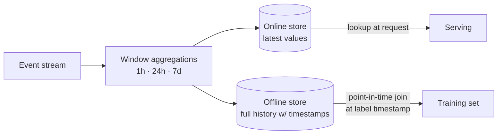

# Feature Engineering Patterns

## Overview
**Feature engineering** turns raw data into inputs a model can learn from. For tabular ML it is still usually the biggest driver of model quality. The **patterns** below are reusable transformations: encodings, aggregations, crosses and so on. The bigger risks in production are the operational ones: **leakage** (using information that won't exist at prediction time) and **training–serving skew** (computing the feature differently online and offline). A feature that is clever but leaks is worse than having no feature.

## Key Concepts

### Numeric Patterns
- **Scaling**: standardise $z = \frac{x-\mu}{\sigma}$ or min-max. Required for linear models, SVMs, neural nets and distance-based methods. Tree models don't care about scale
- **Power / log transforms**: $\log(1+x)$, Box-Cox or Yeo-Johnson for heavy-tailed values (amounts, counts, durations)
- **Clipping / winsorising**: cap at chosen percentiles so outliers don't dominate the fit
- **Discretisation (binning)**: for non-linear effects in linear models and for robustness ([[12.05 Feature Discretization]])
- **Ratios & differences**: `debt / income`, `price - category_median_price`. These often encode domain knowledge better than the raw columns

### Categorical Patterns
- **One-hot**: for low cardinality ([[12.06 One-Hot Encoding]])
- **Target (mean) encoding**: replace a category with a smoothed label mean, blending the category mean with the global mean:

$$\hat{x}_c = \frac{n_c\,\bar{y}_c + m\,\bar{y}}{n_c + m}$$

where $n_c$ is the category count and $m$ the smoothing strength. Rare categories shrink towards the global mean $\bar{y}$. **Must be computed out-of-fold**, otherwise the row's own label leaks in.
- **Frequency / count encoding**: replace a category with how often it appears. Cheap, and works well with trees
- **Hashing trick**: `hash(value) mod N` buckets. Fixed memory, handles values never seen in training, at the cost of collisions
- **Learned embeddings**: dense vectors for high-cardinality IDs (users, items, merchants), trained end-to-end or pre-trained (two-tower models)
- **Rare-category grouping**: collapse categories below a frequency threshold into `"__other__"`

### Temporal & Aggregation Patterns
- **Windowed aggregates**: `count / sum / mean / distinct` over the last 1h, 24h, 7d, 30d per entity. This is the main feature source in fraud, ads and recommendations
- **Recency**: time since last event / purchase / login
- **Calendar features**: hour, weekday, holiday flags. Use **cyclical encoding** $(\sin\frac{2\pi h}{24}, \cos\frac{2\pi h}{24})$ so 23:00 and 00:00 end up close together
- **Lags & deltas**: value at $t-k$, and change vs. the previous period (time series)
- **Point-in-time correctness**: every aggregate must use only events *before* the prediction timestamp. In training, use an **as-of join** of label time to feature time ([[22.02 Feature Store]])

### Interaction & Representation Patterns
- **Feature crosses**: `country × device`, `hour × weekday`. Give linear models non-linearity; often hashed
- **Text**: TF-IDF ([[23.02 TF-IDF]]), sentence embeddings ([[11.72 Embedding Models]]), or LLM-extracted structured attributes (sentiment, intent, entities) used as features
- **Embedding similarity features**: cosine similarity of user and item vectors as one scalar input to a ranker ([[23.06 Vector Similarity Metrics]])
- **Missing-value indicators**: impute *and* add a `is_missing` flag, because the fact that a value is missing often carries signal

## Comparison Table

| Categorical encoding | Cardinality | Leakage risk | Unseen values | Best with |
|---|---|---|---|---|
| **One-hot** | Low (< ~50) | None | All-zeros / ignore | Linear models, small trees |
| **Ordinal** | Any | None | Need a fallback code | Trees (when categories are naturally ordered) |
| **Target encoding** | High | **High** unless computed out-of-fold | Global mean | GBDTs on high-cardinality columns |
| **Count/frequency** | High | Low (unless counts include the future) | 0 | Trees |
| **Hashing** | Very high / open-ended | None | Handled by design | Linear models at scale, online learning |
| **Learned embedding** | Very high | Low | OOV vector | Deep models, recommenders |

## Practical Use Cases

> [!EXAMPLE] Card fraud model
> - Velocity: `txn_count_card_1h`, `amount_sum_card_24h`, `distinct_merchants_card_7d` (streaming windows)
> - Deviation: `amount / card_avg_amount_30d`
> - Merchant risk: out-of-fold target encoding of `merchant_id`, smoothed
> - Context: cyclical hour encoding, `is_new_device`, `km_from_last_txn`
> - All computed by one feature definition that feeds both the online and offline stores, to avoid skew

- **Churn / LTV**: recency–frequency–monetary (RFM) aggregates over several windows, plus trend features (last 30d vs previous 30d)
- **Search & recommendation ranking**: query–document match scores, embedding similarities, item popularity counts, user–category affinity
- **LLM-era tabular**: an LLM extracts structured fields from free text once (offline), and those fields become ordinary features for a cheap model ([[32.04 Multi-Model Cost Strategy]])

> [!WARNING] Leakage checklist
> - Fit scalers, encoders and imputers **on the training fold only**: use a `Pipeline` inside cross-validation ([[12.08 Cross-Validation]])
> - Time-ordered splits for anything temporal. Random splits leak the future
> - No features updated *after* the outcome (e.g. "account status" that is set to `closed` *because* of churn)
> - A suspiciously strong single feature is usually a leak. Investigate before celebrating

> [!TIP] Operational best practices
> - **Define once, compute everywhere**: one feature definition shared by training and serving (feature store or a shared transform library)
> - **Version features** like code. A changed definition is a new feature version, not an edit in place
> - **Validate feature distributions** before training and in production ([[42.01 Great Expectations]], [[24.01 Model Drift Detection]])
> - **Prune**: remove features with near-zero importance or high serving cost. Each feature is a pipeline that has to be maintained

## Related Concepts
- [[43_Feature_Engineering_MOC]] - parent index
- [[22.02 Feature Store]] - operationalises shared, point-in-time features
- [[12.05 Feature Discretization]] - technique: binning continuous features
- [[12.06 One-Hot Encoding]] - technique: low-cardinality categorical encoding
- [[12.08 Cross-Validation]] - fit transforms inside folds to avoid leakage
- [[12.14 Imbalanced Classification]] - target encoding with rare positive labels
- [[42.02 Data Contracts]] - stable upstream schemas for feature pipelines
- [[31.02 Serving Architecture]] - online vs batch feature computation

## References
- Zheng & Casari, *Feature Engineering for Machine Learning* (O'Reilly, 2018)
- Micci-Barreca, "A Preprocessing Scheme for High-Cardinality Categorical Attributes" (2001), the source of smoothed target encoding
