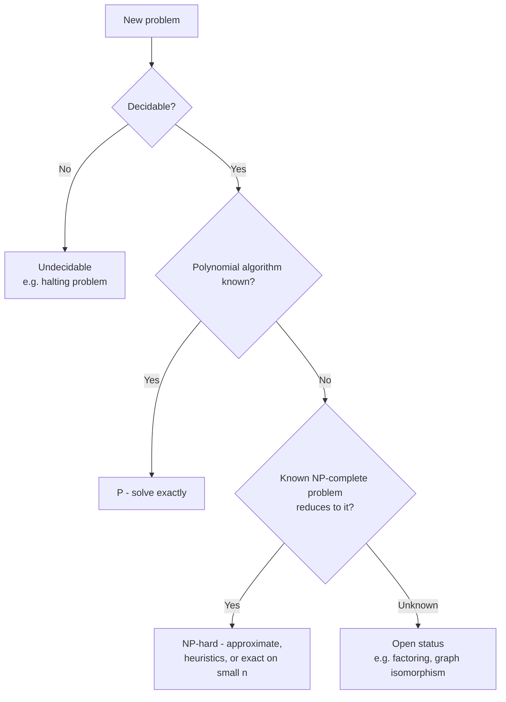

# Limitations of Algorithm Power

## Overview

**Limitations of Algorithm Power** (Levitin, Ch. 11) asks what *no* algorithm can do: how fast a problem can possibly be solved (**lower bounds**), which problems have no known polynomial algorithm (**NP-complete**), and which cannot be solved at all (**undecidable**). Knowing the limit tells you when to stop optimising and start approximating ([[72.10 Coping with Limitations]]).

## Key Concepts

| Concept | Description |
|---------|-------------|
| **Lower bound** | Minimum work *any* algorithm must do for the problem, e.g. $\Omega(n \log n)$ comparisons for sorting |
| **Tight bound** | A lower bound matched by a known algorithm (merge sort is tight for comparison sorting) |
| **Decision tree** | Model of a comparison-based algorithm: internal nodes = comparisons, leaves = outcomes |
| **Reduction** | Transform problem A into B; if A is hard, B is at least as hard |
| **Decision problem** | Yes/no question; complexity classes are defined over these |
| **Pseudo-polynomial** | Polynomial in the numeric *value* of input, not its bit length (knapsack DP $O(nW)$) |

## Ways to Establish Lower Bounds

| Method | Idea | Example |
|--------|------|---------|
| **Trivial** | Must read all input / write all output | Generating all permutations: $\Omega(n!)$; evaluating a degree-$n$ polynomial: $\Omega(n)$ |
| **Information-theoretic** | $k$ possible outcomes need $\lceil \log_2 k \rceil$ yes/no answers | Guess a number in $1..n$: $\lceil \log_2 n \rceil$ questions |
| **Adversary argument** | Adversary answers to force the most work | Merging two sorted lists of size $n$: $2n - 1$ comparisons |
| **Problem reduction** | Reduce a known-hard problem to yours | Element uniqueness ($\Omega(n \log n)$) → closest pair is $\Omega(n \log n)$ |

> [!WARNING] Lower Bounds Are Model-Specific
> $\Omega(n \log n)$ holds only for **comparison-based** sorting. Radix and counting sort beat it by inspecting digits, not comparing ([[72.33 Non-Comparison Sorting Algorithms]]).

## Decision Trees

A comparison algorithm on input size $n$ is a binary tree; its worst-case comparisons = tree height $h$. A binary tree with $l$ leaves has $h \geq \lceil \log_2 l \rceil$.

- **Sorting**: every permutation must be a distinct leaf, so $l \geq n!$:

$$
C_{worst}(n) \geq \lceil \log_2 n! \rceil \approx n \log_2 n - 1.44n
$$

- The **average** case obeys the same bound ($\geq \log_2 n!$), so no comparison sort is asymptotically better on average either.
- **Searching a sorted array**: a ternary tree ($<, =, >$) with $n$ success + $n+1$ failure leaves gives $\lceil \log_2(n+1) \rceil$ — binary search is optimal ([[72.23 Binary Search]]).

## P, NP, and NP-Completeness

| Class | Definition | Examples |
|-------|------------|----------|
| **P** | Solvable in polynomial time by a deterministic algorithm | Sorting, shortest path, MST, max flow, linear programming |
| **NP** | A proposed solution (certificate) can be **verified** in polynomial time | Everything in P, plus SAT, Hamiltonian circuit |
| **NP-complete** | In NP **and** every NP problem reduces to it in polynomial time | SAT (Cook–Levin), 3-SAT, TSP (decision), 0/1 knapsack (decision), graph colouring, vertex cover |
| **NP-hard** | At least as hard as NP-complete; need not be in NP | TSP optimisation, halting problem |
| **Undecidable** | No algorithm answers it correctly for all inputs | Halting problem (Turing, 1936) |

$$
P \subseteq NP, \qquad NP\text{-complete} = NP \cap NP\text{-hard}
$$

> [!INFO] P vs NP
> Whether $P = NP$ is the central open problem of computer science. Practically everyone assumes $P \neq NP$; a polynomial algorithm for **any** NP-complete problem would give one for all of them.

> [!TIP] Proving Your Problem Is Hard
> Reduce a **known** NP-complete problem *to* yours (not the other way round). Direction matters: reducing your problem to SAT only shows SAT is at least as hard.

## Challenges of Numerical Algorithms

Continuous problems hit a different limit: real numbers are finite-precision floats.

| Error | Cause | Mitigation |
|-------|-------|------------|
| **Truncation** | Approximating an infinite process (series, iteration) | More terms, error bounds |
| **Round-off** | Finite mantissa | Stable algorithms, higher precision |
| **Overflow / underflow** | Exponent out of range | Work in log space (log-sum-exp) |
| **Subtractive cancellation** | Subtracting nearly equal numbers | Reformulate (e.g. stable quadratic formula) |

Example: naive softmax overflows on large logits; subtracting the max first is the standard fix ([[13.14 Softmax]]).

## Practical Use Cases

Spotting NP-hardness early saves weeks. Common ones in Data/ML work:

| Problem | Hardness | What people actually do |
|---------|----------|-------------------------|
| Optimal feature subset selection | NP-hard | Greedy forward/backward selection, L1 regularisation |
| Optimal decision tree learning | NP-complete | Greedy splits (CART, ID3) |
| Exact k-means clustering | NP-hard | Lloyd's heuristic + k-means++ init |
| Training a 3-node neural net | NP-complete (Blum & Rivest, 1992) | SGD finds good local optima anyway |
| Bayesian network structure learning | NP-hard | Score-based greedy / hill climbing |
| Job scheduling, bin packing, vehicle routing | NP-hard | ILP/CP-SAT solvers, heuristics |

## Related Concepts

- [[72_Algorithms_MOC]] - parent index
- [[72.10 Coping with Limitations]] - next step: strategies when problems are hard
- [[72.01 Brute Force and Exhaustive Search]] - exponential baseline for NP problems
- [[72.06 Dynamic Programming]] - pseudo-polynomial knapsack solution
- [[72.32 Comparison Sorting Algorithms]] - algorithms bound by $\Omega(n \log n)$
- [[72.23 Binary Search]] - optimal by the decision tree argument
- [[13.14 Softmax]] - example of numerical stability fix
