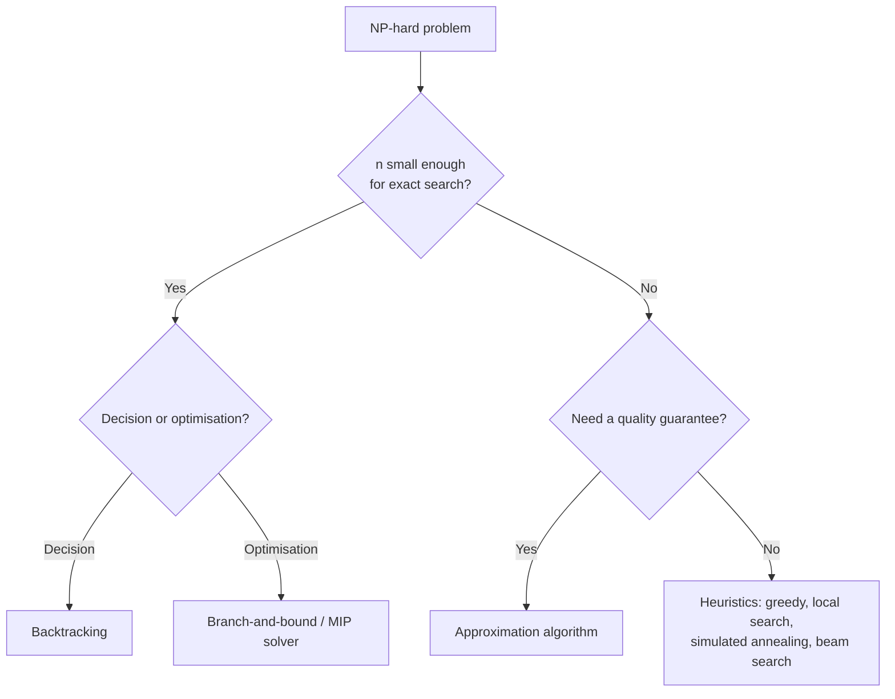

# Coping with the Limitations of Algorithm Power

## Overview

**Coping with the Limitations of Algorithm Power** (Levitin, Ch. 12) covers what to do once a problem is known to be NP-hard ([[72.09 Limitations of Algorithm Power]]). You either keep the **exact** answer but prune the search (**backtracking**, **branch-and-bound**), or give up optimality for speed (**approximation algorithms**, **heuristics**). Most real optimisation work in industry lives here.

## Key Concepts

| Concept | Description |
|---------|-------------|
| **State-space tree** | Tree of partial solutions; root = empty, each level = one more decision |
| **Promising node** | Partial solution that can still lead to a valid (or better) complete solution |
| **Pruning** | Abandoning a subtree once it is shown to be non-promising |
| **Bound** | Optimistic estimate of the best value reachable from a node |
| **Approximation ratio** | How far an approximate answer can be from optimal, guaranteed |
| **Heuristic** | Rule of thumb that works well in practice, with no guarantee |

## Techniques

| Technique | Exact? | Problem type | Core idea | Classic examples |
|-----------|--------|--------------|-----------|------------------|
| **Backtracking** | ✅ | Decision / constraint satisfaction | DFS the state-space tree, undo and backtrack on dead ends | n-Queens, subset sum, Hamiltonian circuit, Sudoku |
| **Branch-and-bound** | ✅ | Optimisation | Backtracking + a bound; prune nodes that cannot beat the best so far | Assignment, 0/1 knapsack, TSP |
| **Approximation** | ❌ (bounded) | Optimisation | Polynomial algorithm with a guaranteed ratio | Twice-around-the-tree TSP, greedy knapsack |
| **Heuristics / metaheuristics** | ❌ | Anything | Local search, randomisation, population search | Simulated annealing, tabu search, genetic algorithms, beam search |
| **Numerical iteration** | ≈ (to tolerance) | Nonlinear equations | Shrink an interval or follow the tangent | Bisection, false position, Newton's method |

## Backtracking

Build a solution one component at a time; as soon as a partial solution breaks a constraint, undo the last choice and try the next.

```python
def n_queens(n):
    cols, diag, anti = set(), set(), set()
    def place(row):
        if row == n:
            return 1
        count = 0
        for c in range(n):
            if c in cols or row - c in diag or row + c in anti:
                continue                                    # prune
            cols.add(c); diag.add(row - c); anti.add(row + c)
            count += place(row + 1)
            cols.remove(c); diag.remove(row - c); anti.remove(row + c)  # undo
        return count
    return place(0)   # n_queens(8) == 92
```

- Worst case is still exponential; the gain comes from pruning large subtrees early.
- **Order matters**: try the most constrained variable first (the MRV heuristic in CSP solvers).

## Branch-and-Bound

For optimisation (maximisation shown), each node stores a **bound**: the best value any completion of it could reach.

```
best = -inf
explore nodes best-bound-first (priority queue):
    if bound(node) <= best: prune            # cannot beat incumbent
    if node is complete: best = max(best, value(node))
    else: push children with their bounds
```

- **0/1 knapsack bound**: $ub = v + (W - w) \cdot \frac{v_{i+1}}{w_{i+1}}$ (current value + fill the remaining capacity at the next best value/weight ratio).
- **TSP lower bound**: $lb = \lceil \frac{1}{2} \sum_{v} (\text{two cheapest edges at } v) \rceil$.
- A tighter bound prunes more but costs more per node — the main tuning trade-off.

> [!TIP] Don't Hand-Roll It in Production
> Modern **MIP/CP-SAT solvers** (OR-Tools, Gurobi, HiGHS) are industrial-strength branch-and-bound with cutting planes and presolve. Model the problem; let the solver search.

## Approximation Algorithms

For a minimisation problem, the **accuracy ratio** of an approximate solution $s_a$ against optimal $s^*$ is:

$$
r(s_a) = \frac{f(s_a)}{f(s^*)} \geq 1
$$

An algorithm is a **c-approximation** if $r(s_a) \leq c$ for every instance.

| Problem | Algorithm | Guarantee |
|---------|-----------|-----------|
| TSP (general) | Any polynomial algorithm | No constant $c$ unless $P = NP$ |
| TSP (metric / Euclidean) | Nearest neighbour | Unbounded ratio — simple but no guarantee |
| TSP (metric) | Twice-around-the-tree (MST + shortcut) | $2$ |
| TSP (metric) | Christofides | $1.5$ |
| 0/1 Knapsack | Greedy by $v/w$, then compare with best single item | $2$ |
| 0/1 Knapsack | Approximation scheme (FPTAS) | $1 + \epsilon$, polynomial in $n$ and $1/\epsilon$ |
| Vertex cover | Take both ends of a maximal matching | $2$ |

> [!WARNING] Heuristic ≠ Approximation
> An **approximation algorithm** comes with a proof of $c$. A **heuristic** (nearest neighbour, simulated annealing) may be excellent in practice but can be arbitrarily bad on adversarial input.

## Choosing a Strategy



## Practical Use Cases

| Domain | Hard problem | Coping strategy |
|--------|--------------|-----------------|
| **ML: clustering** | Exact k-means | Lloyd's heuristic; k-means++ gives $O(\log k)$-approx in expectation |
| **ML: tuning** | Hyperparameter search | Random search, Bayesian optimisation (heuristic) |
| **ML: feature selection** | Best subset | Greedy forward selection, L1 |
| **LLM decoding** | Most likely sequence (exponential space) | Beam search, greedy decoding |
| **Scheduling / routing** | Job-shop, vehicle routing | CP-SAT / MIP with time limit, accept best incumbent |
| **Config / dependency resolution** | SAT | CDCL SAT solvers (pip, conda, apt resolvers) |

## Related Concepts

- [[72_Algorithms_MOC]] - parent index
- [[72.09 Limitations of Algorithm Power]] - prerequisite: why these techniques are needed
- [[72.01 Brute Force and Exhaustive Search]] - what backtracking prunes
- [[72.07 Greedy Technique]] - fast approximations and heuristics
- [[72.08 Iterative Improvement]] - local search heuristics
- [[72.12 Beam Search]] - bounded heuristic search
- [[72.16 Heap and Priority Queue]] - drives best-first branch-and-bound
- [[72.17 Binary Search Patterns]] - bisection method for equations
- [[12.09 Hyperparameter Tuning]] - heuristic search in ML practice
