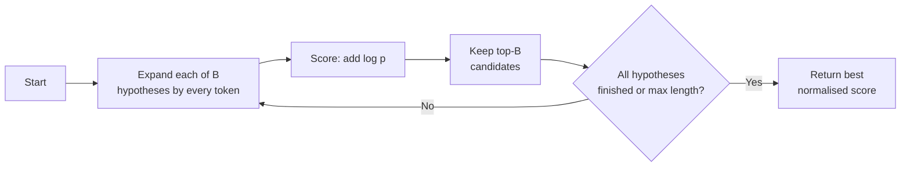

# Beam Search

## Overview

**Beam search** is a heuristic, breadth-first search that keeps only the **$B$ best partial solutions** (the **beam**) at each step and discards the rest. It sits between greedy search ($B = 1$) and exhaustive search ($B = \infty$). Its best-known use is sequence decoding in LLMs, machine translation, and speech recognition, where the full space of $|V|^T$ sequences is far too large to search.

## Key Concepts

| Concept | Description |
|---------|-------------|
| **Beam width $B$** | Number of hypotheses kept per step; the main knob |
| **Hypothesis** | Partial sequence + its cumulative score |
| **Score** | Sum of log-probabilities $\sum_t \log p(y_t \mid y_{<t}, x)$ |
| **Pruning** | After expanding, keep the top-$B$ of the $B \times |V|$ candidates |
| **Finished hypotheses** | Sequences that emitted `<eos>`; set aside until the search stops |
| **Length normalisation** | Divides score by length so long outputs aren't unfairly penalised |

## How It Works



```python
import heapq, math

def beam_search(start, expand, width, steps):
    beam = [(0.0, start)]                       # (log-prob, sequence)
    for _ in range(steps):
        cands = [(lp + math.log(p), seq + (tok,))
                 for lp, seq in beam for tok, p in expand(seq).items()]
        beam = heapq.nlargest(width, cands)
    return max(beam)
```

`expand(seq)` returns `{token: prob}` for the next step. Scores are summed **log**-probs, never multiplied probs, to avoid underflow.

> [!EXAMPLE] Why Greedy Loses
> Step 1: `the` 0.5, `a` 0.4. Step 2 after `the`: `cat` 0.4; after `a`: `cat` 0.9.
> - **Greedy** picks `the` → `the cat` = $0.5 \times 0.4 = 0.20$
> - **Beam ($B = 2$)** keeps both → `a cat` = $0.4 \times 0.9 = 0.36$

## Scoring and Length Penalty

Raw log-prob sums always favour **shorter** sequences (each token adds a negative term). Normalise:

$$
\text{score}(y) = \frac{1}{|y|^{\alpha}} \sum_{t=1}^{|y|} \log p(y_t \mid y_{<t}, x)
$$

- $\alpha = 0$: no normalisation; $\alpha = 1$: average log-prob per token.
- GNMT used $lp(y) = \frac{(5 + |y|)^{\alpha}}{6^{\alpha}}$ with $\alpha \in [0.6, 0.7]$.

## Comparison Table

| Strategy | Search | Deterministic | Cost per step | Best for |
|----------|--------|---------------|---------------|----------|
| **Greedy** | Top-1 only | ✅ | $O(\lvert V \rvert)$ | Fast extraction, structured output |
| **Beam search** | Top-$B$ hypotheses | ✅ | $O(B \lvert V \rvert)$, $B\times$ KV cache | Translation, summarisation, ASR, captioning |
| **Sampling (top-k / top-p)** | Random draw | ❌ | $O(\lvert V \rvert)$ | Chat, creative writing, diverse outputs |
| **Exhaustive** | All $\lvert V \rvert^T$ sequences | ✅ | Infeasible | Never, for real vocabularies |

## Pitfalls

> [!WARNING] Bigger Beam ≠ Better Text
> - **Beam search curse**: in NMT, quality often *drops* past $B \approx 5$–$10$ — higher-likelihood outputs get shorter and blander (Koehn & Knowles, 2017).
> - **Degeneration**: for open-ended generation, beam output is repetitive and generic; human text is not the max-likelihood text (Holtzman et al., 2019). Use nucleus sampling there.
> - **Low diversity**: the $B$ hypotheses often differ by one token. Use **diverse beam search** (group penalty) or sampling if you need distinct candidates.
> - **Memory**: each beam holds its own KV cache, so $B = 8$ costs roughly $8\times$ decode memory.

## Variants

| Variant | Change |
|---------|--------|
| **Diverse beam search** | Split beam into groups, penalise tokens chosen by earlier groups |
| **Constrained beam search** | Force required words/phrases to appear |
| **Stochastic beam search** | Gumbel-top-$k$ trick: sample $B$ sequences without replacement |
| **Tree-of-Thoughts BFS** | Beam over reasoning steps scored by an LLM evaluator |

## Practical Use Cases

| Domain | Typical setup |
|--------|---------------|
| Machine translation / summarisation | $B = 4$–$5$, length penalty ~$0.6$–$1.0$ |
| Speech recognition | Beam over acoustic + language model scores |
| Hugging Face `generate` | `num_beams=4, length_penalty=1.0, early_stopping=True, no_repeat_ngram_size=3` |
| Returning n-best lists | `num_return_sequences <= num_beams` for reranking |
| Vector search | HNSW's candidate list (`efSearch`) is a beam over graph neighbours ([[23.08 HNSW]]) |
| Planning / combinatorial search | Bounded-memory alternative to BFS or A* |

> [!TIP] Chat LLMs Rarely Use Beam Search
> Production chat serving defaults to sampling; beam search is mainly for tasks with a "correct" output (translation, ASR, constrained generation). Many serving engines support it only partially — check the engine docs before relying on it.

## Related Concepts

- [[72_Algorithms_MOC]] - parent index
- [[72.11 Sampling Algorithms]] - contrast: stochastic decoding (top-k, top-p)
- [[72.07 Greedy Technique]] - beam search with $B = 1$
- [[72.10 Coping with Limitations]] - beam search as a bounded heuristic
- [[72.16 Heap and Priority Queue]] - top-$B$ selection each step
- [[11.41 Speculative Decoding]] - contrast: speeds decoding without changing the search
- [[11.01 Attention Mechanism]] - decoder producing the per-step distributions
- [[23.08 HNSW]] - beam-style search over a proximity graph
