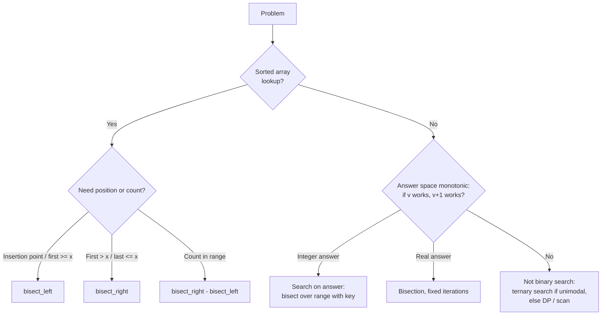

# Binary Search Patterns

## Overview

**Binary search patterns** generalise [[72.23 Binary Search]] from "find $x$ in a sorted array" to "find the **boundary** where a **monotonic predicate** flips from `False` to `True`". Once a problem is framed that way — lower/upper bound, first bad version, smallest feasible capacity — one template and Python's `bisect` module solve it in $O(\log n)$ predicate calls.

## Key Concepts

| Concept | Description |
|---------|-------------|
| **Monotonic predicate** | `ok(i)` is `False...False True...True` over the search range |
| **Boundary search** | Find the first index where `ok` is `True` (everything else is a variant) |
| **Half-open range** | `[lo, hi)` with `while lo < hi` — fewest off-by-one bugs |
| **Search on answer** | Binary search over candidate *answers*, not array indices |
| **Feasibility check** | The predicate; total cost = $O(\log(\text{range}) \times \text{cost of check})$ |

> [!INFO] The One Template
> Every pattern below is "first `True` in `[lo, hi)`":
> `while lo < hi: mid = (lo + hi) // 2; lo, hi = (lo, mid) if ok(mid) else (mid + 1, hi)`. Return `lo` (`== hi` if never `True`).

## Comparison Table

| Pattern | Predicate `ok(i)` | Returns | Example |
|---------|-------------------|---------|---------|
| **Exact match** | `a[i] >= x`, then check `a[i] == x` | Index or not found | Membership in sorted IDs |
| **Lower bound** | `a[i] >= x` | First index $\geq x$ (insertion point) | `bisect_left` |
| **Upper bound** | `a[i] > x` | First index $> x$ | `bisect_right` |
| **Count in range** | — | `bisect_right(a, hi) - bisect_left(a, lo)` | Events in a time window |
| **Last occurrence** | `a[i] > x`, minus 1 | Last index $\leq x$ | Latest snapshot before timestamp |
| **Search on answer** | `feasible(v)` | Smallest feasible value | Min capacity, max batch size |
| **Rotated sorted array** | `a[mid] <= a[-1]` | Index of minimum (pivot) | `[4,5,6,7,0,1,2]` → `0` |
| **Peak finding** | `a[i] > a[i+1]` | A local maximum | Mountain array, unimodal tuning curve |
| **Real-valued (bisection)** | `f(mid) >= 0` | Root within tolerance | $\sqrt{2}$, IRR, calibration threshold |
| **Exponential (galloping)** | Double `hi` until `ok(hi)` | Bound for unbounded / unknown size | Infinite stream, Tim Sort merges |

## Python `bisect` Recipes

```python
from bisect import bisect_left, bisect_right, insort

a = [1, 3, 3, 3, 7, 9]
bisect_left(a, 3), bisect_right(a, 3)          # (1, 4)
bisect_right(a, 7) - bisect_left(a, 2)         # 4 values in [2, 7]
insort(a, 5)                                   # keep list sorted on insert
bisect_left(rows, 20, key=lambda r: r[1])      # 3.10+: search records by field
```

**Search on answer with stdlib only** — `range` supports random access, so `bisect` runs over it lazily:

```python
def min_capacity(weights, days):            # smallest ship capacity for `days`
    def ok(cap):
        need, load = 1, 0
        for w in weights:
            if load + w > cap:
                need, load = need + 1, 0
            load += w
        return need <= days
    lo, hi = max(weights), sum(weights)
    return lo + bisect_left(range(lo, hi + 1), True, key=ok)
# min_capacity([1,2,3,4,5,6,7,8,9,10], 5) == 15
```

**Real-valued**: iterate a fixed number of times instead of testing float equality.

```python
def bisect_root(f, lo, hi, iters=100):      # f(lo) < 0 <= f(hi), f increasing
    for _ in range(iters):
        mid = (lo + hi) / 2
        lo, hi = (mid, hi) if f(mid) < 0 else (lo, mid)
    return lo
```

> [!WARNING] `bisect` `key=` Gotcha
> With `key=`, the search value `x` is **not** passed through `key` — pass the already-extracted key (`20`, not a row). `insort(..., key=)` *does* apply `key` to `x`. Lists with `key=` must be sorted by that same key.

## Choosing a Pattern



## Practical Use Cases

| Use case | Pattern |
|----------|---------|
| Map a score to a grade / bucket / percentile | `bisect_right(breakpoints, score)` |
| Find the row valid at timestamp $t$ in an SCD or event log | Last occurrence ($\leq t$) |
| Largest batch size that fits in GPU memory | Search on answer (OOM is monotonic in batch size) |
| Classifier threshold hitting a target recall | Search on answer (recall is non-increasing in threshold) |
| `git bisect` for the first bad commit | Boundary search over history |
| Longest prefix of a prompt that fits a token budget | Search on answer over cut-off position |
| Longest increasing subsequence in $O(n \log n)$ | `bisect_left` into the tails array |

> [!TIP] Recognition Cues
> "Minimise the maximum", "maximise the minimum", "smallest $k$ such that…", or any yes/no check that gets easier as a parameter grows — reach for search on answer.

## Related Concepts

- [[72_Algorithms_MOC]] - parent index
- [[72.23 Binary Search]] - prerequisite: basic algorithm and templates
- [[72.02 Decrease-and-Conquer]] - paradigm: halving the problem space
- [[72.28 Tim Sort]] - uses galloping (exponential) search when merging
- [[72.10 Coping with Limitations]] - bisection method for nonlinear equations
- [[72.09 Limitations of Algorithm Power]] - why $\lceil \log_2(n+1) \rceil$ comparisons is optimal
