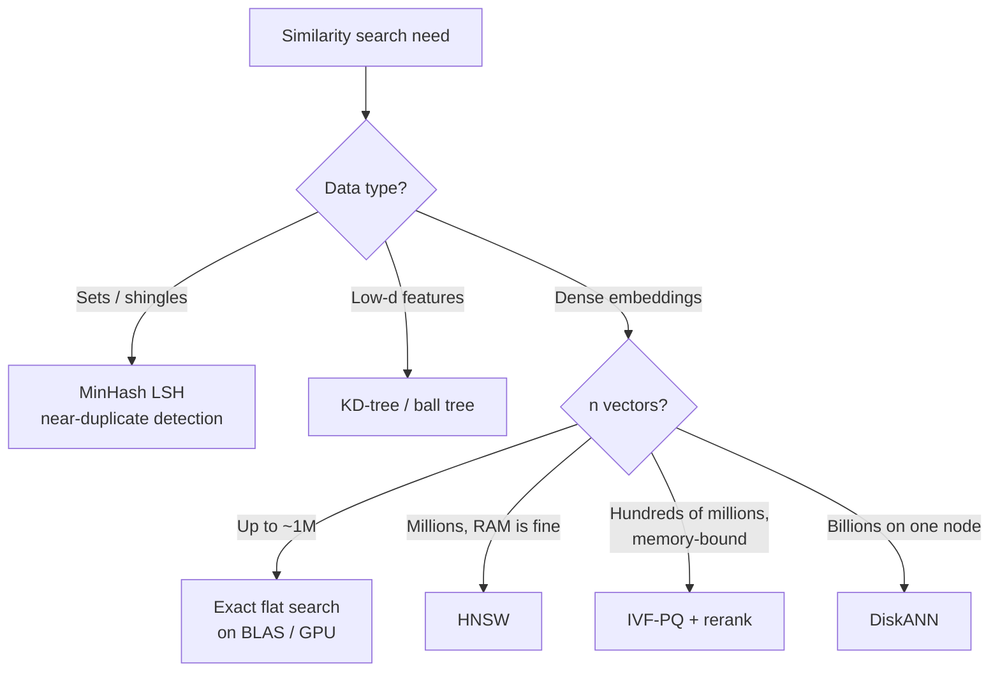

# Similarity Search

## Overview

**Similarity search** (nearest neighbour search) finds the $k$ items in a collection closest to a query under a distance or similarity metric. **Exact** search is a full scan, $O(nd)$ per query; **approximate nearest neighbour (ANN)** search trades a little recall for orders-of-magnitude speed by indexing the data. It is the core operation behind RAG retrieval, recommendations, deduplication, and kNN classifiers.

## Key Concepts

| Concept | Description |
|---------|-------------|
| **k-NN query** | Return the $k$ closest items to query $q$ |
| **Range query** | Return all items within distance $r$ of $q$ |
| **Metric** | Cosine, dot product, L2 for dense vectors; Jaccard / Hamming for sets and bits ([[23.06 Vector Similarity Metrics]]) |
| **Curse of dimensionality** | In high $d$, distances concentrate: nearest and farthest neighbours look alike, so space-partitioning trees degrade to a scan |
| **Recall@k** | $\lvert \text{ANN top-}k \cap \text{exact top-}k \rvert / k$ — the standard ANN quality metric |
| **Candidate + rerank** | Cheap ANN fetches many candidates; exact distances (or a cross-encoder) reorder them |

## Exact Search

Score every vector and keep the top-$k$ with a heap — $O(nd + n \log k)$.

```python
import heapq

def knn(query, vectors, k):                 # dot-product similarity
    dot = lambda u, v: sum(a * b for a, b in zip(u, v))
    return heapq.nlargest(k, range(len(vectors)), key=lambda i: dot(query, vectors[i]))
```

- In practice: one matrix multiply (`X @ q`) plus `np.argpartition`, or a FAISS `IndexFlat` on GPU. BLAS makes brute force fast up to roughly $10^5$–$10^6$ vectors.
- **Space-partitioning trees** (KD-tree, ball tree, VP-tree) give $O(\log n)$ queries in **low** dimensions (roughly $d \lesssim 20$) — good for geo, tabular features; useless for 768-d embeddings.

## Approximate Search Families

| Family | Idea | Representative | Strength | Weakness |
|--------|------|----------------|----------|----------|
| **Hashing** | Similar items collide in the same bucket | LSH (SimHash, MinHash) | Theory guarantees, streaming-friendly | Needs many tables for high recall |
| **Partitioning** | Cluster vectors; search only nearest clusters | IVF ([[23.09 IVF-PQ]]) | Low memory, fast build | Recall drops at cluster borders |
| **Graph** | Greedy walk over a proximity graph | HNSW ([[23.08 HNSW]]), DiskANN | Best recall/latency trade-off | High memory, slow build, hard deletes |
| **Quantization** | Compress vectors, compare compressed codes | PQ, SQ, binary | 10–100× less memory | Lossy distances — rerank needed |

Full index details, tuning knobs, and filtering: [[23.07 ANN Indexes (HNSW, IVF, PQ)]].

> [!INFO] LSH in One Line
> Random hyperplane hashing (SimHash) puts two vectors with angle $\theta$ on the same side of a random hyperplane with probability $P[h(u) = h(v)] = 1 - \theta / \pi$. Concatenate bits to sharpen; use several tables to boost recall. **MinHash** does the same for Jaccard similarity on sets: $P[h(A) = h(B)] = J(A, B)$.

## Exact vs Approximate

| Aspect | Exact (flat / brute force) | Approximate (ANN index) |
|--------|----------------------------|-------------------------|
| Recall | 100% | Tunable, typically 90–99% |
| Query time | $O(nd)$ | Sub-linear, roughly $O(\log n)$ for graphs |
| Build time | None | Minutes to hours at scale |
| Memory | Raw vectors | Raw + graph links, or compressed codes |
| Updates | Trivial (append) | Index-dependent; deletes often costly |
| Use when | $n \lesssim 10^6$, ground-truth evals, rerank stage | $n \gtrsim 10^6$ or tight latency SLO |

## Choosing an Approach



> [!TIP] Always Keep an Exact Baseline
> Run exact search on a sample of queries to compute recall@k for your ANN index. Without it you cannot tell whether a bad RAG answer is an index problem or an embedding problem.

> [!WARNING] Normalise Before Cosine
> Many indexes support only L2 or inner product. For cosine similarity, L2-normalise vectors at write **and** query time, then use inner product.

## Practical Use Cases

| Use case | Typical approach |
|----------|------------------|
| RAG chunk retrieval ([[11.12 RAG]]) | HNSW over embeddings + reranker |
| Hybrid search | ANN dense half + BM25 sparse half ([[11.65 Hybrid Search (Dense + Sparse)]]) |
| Near-duplicate removal in training corpora | MinHash LSH on n-gram shingles |
| Semantic cache for LLM responses | Flat or HNSW with a similarity threshold |
| Recommendations ("users like you") | IVF-PQ or ScaNN over user/item embeddings |
| kNN classifier / anomaly scoring | Exact search for small $n$, ANN beyond |

## Related Concepts

- [[72_Algorithms_MOC]] - parent index
- [[23.07 ANN Indexes (HNSW, IVF, PQ)]] - deep dive: index families and tuning
- [[23.08 HNSW]] - graph-based ANN in detail
- [[23.09 IVF-PQ]] - partition + quantization ANN in detail
- [[23.06 Vector Similarity Metrics]] - the metrics these algorithms accelerate
- [[23.01 Vector Databases]] - implement similarity search at scale
- [[11.72 Embedding Models]] - produce the vectors being searched
- [[11.68 Reranking (Cross-Encoders)]] - second stage after ANN candidates
- [[72.16 Heap and Priority Queue]] - top-k selection in exact search
- [[72.15 Hash Table Techniques]] - bucketing idea behind LSH
- [[11.12 RAG]] - use case: semantic retrieval
