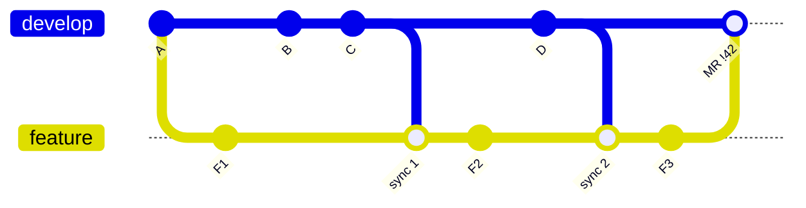
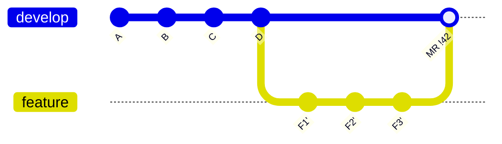

# Merge vs Rebase Workflows

## Overview
A feature branch falls behind `develop` as other MRs land. You can **catch up** in two ways: **merge `develop` into the feature branch** (adds a sync merge commit) or **rebase the feature branch onto `develop`** (replays your commits on top). For short-lived, single-owner branches, rebase is the better default. Merge stays the tool for shared branches and for landing the MR itself.

## The Problem

**Merge `develop` into feature.** Sync merges get mixed into the branch:



**Rebase feature onto `develop`.** Your commits are replayed on the tip and the branch is a straight line:



## What Goes Wrong with "Merge develop into feature"

- **Conflict fixes are hidden in the merge commit.** `git log -p` skips merge diffs. `git show <merge>` uses a combined diff, which hides any hunk where you kept one side as-is. If a resolution drops someone else's change, no commit shows it. In the MR diff it shows up only as an unexplained deletion mixed in with your feature changes, and that is easy to miss in review. Other people's work can disappear without anyone noticing.
- **Push-range tooling checks other people's work.** Pre-push hooks that diff `remote..local` pick up every file `develop` changed and the sync merge brought in. Linters, tests and secret scanners then run on code you didn't write. They get slower, and they fail on things that aren't yours.
- **Noisy history.** `git log --graph` becomes a mesh of crossing lines, `git blame` lands on sync merges, and `git bisect` has to step through merge commits whose parents are unrelated states.
- **Reverts get harder.** You have to pick a parent with `git revert -m 1 <merge>`. After that revert, merging the branch again **does not bring the work back**: Git sees those commits as already merged. You have to revert the revert first.

> [!WARNING] Myth: "merges make `.git` bigger"
> They don't. Git stores each file's contents (blob) only once. A merge commit adds one commit object and a few tree objects. Measured in one repo, **392 sync merges cost about 1.2 MB of a 178 MB pack (under 1%)**.
> Rebase actually creates **more** objects: a new copy of every replayed commit, with new trees. The old copies stay until reflog expiry and `git gc`. Choose between merge and rebase for history quality, not disk space.

## Key Terms

- **Merge-base (fork point)**: the newest commit both branches share. Rebasing moves it to the current tip of `develop`.
- **Behind / ahead**: *behind* is how many commits `develop` has that you don't. *Ahead* is how many commits you have that `develop` doesn't.

```bash
git merge-base HEAD origin/develop                       # fork point
git rev-list --left-right --count origin/develop...HEAD  # "<behind> <ahead>"
# MRs landed since you forked (first-parent = one merge commit per MR):
git rev-list --count --first-parent "$(git merge-base HEAD origin/develop)"..origin/develop
```

> [!INFO] Raw commits vs MRs
> The first-parent count only counts MRs when `develop` lands each MR with a merge commit (the *Merge commit* or *Semi-linear* methods below). With fast-forward merges it counts raw commits again.

## Why "Behind > N Commits" Rules Fail with AI Agents

- AI agents commit often and in small steps, so raw commit counts grow much faster than real change.
- In one team, `develop` got **~190 commits/day** but only **~7 MRs/day**. A "rebase when behind > 30 commits" rule fires within a few hours, so people learn to ignore it.
- Better: count **MRs** (first-parent) instead of commits. Best: **drop the threshold entirely** and rebase at fixed moments (below).

## The Rule

Run `git fetch && git rebase origin/develop`:

1. **At the start of every session, and when you resume work** (morning → afternoon, next day).
2. **Right before you open or merge the MR.**
3. **As soon as a structural MR lands** (folder moves, renames, big refactors). The longer you wait, the more of your commits conflict with it.

- When there's nothing new, the rebase does nothing, so running it often costs nothing.
- Push with `git push --force-with-lease --force-if-includes`, **never plain `--force`**. The lease refuses the push if the remote branch moved since your last fetch. `--force-if-includes` also refuses if you fetched new remote commits but didn't rebase onto them, which the `git fetch` above would otherwise let through.

> [!WARNING] Exception: shared branches
> If several people or agent sessions push to the same branch, **merge, don't rebase**. Rebasing rewrites commits other people already have. Their next pull then conflicts with your rewritten copies, or brings the old ones back.

## Enforce It with Tools, Not Docs

A written rule gets forgotten. A merge method setting is applied to every MR. GitLab options (*Settings → Merge requests → Merge method*):

| Method | Graph on `develop` | Rebase required? | Revert an MR |
|---|---|---|---|
| **Merge commit** | Overlapping branches, sync merges allowed | No | One merge commit (`-m 1`) |
| **Merge commit with semi-linear history** | Straight runs of commits, one merge bubble per MR, no overlap | Yes, the MR must be fast-forwardable (GitLab offers a *Rebase* button) | One merge commit (`-m 1`) |
| **Fast-forward merge** | Fully linear, no merge commits | Yes | Revert each commit (or squash first) |

> [!TIP] Recommended: semi-linear
> The graph has no overlapping branches, so `log`, `blame` and `bisect` stay readable. Each MR still keeps **one merge commit you can revert**, and the first-parent MR count above keeps working.

## Case Study: AI Agents Creating Merge Noise

> [!EXAMPLE] 392 "Merge origin/develop" commits in about a month
> One repo collected **392 sync merge commits** in about a month, most of them in a single month and mostly from one person's agent sessions. Two causes:
> 1. **The agent's tool config blocked every `git push --force*`**, even to the agent's own branch. The glob also matched `--force-with-lease`. After a rebase the push was rejected as non-fast-forward, so the agent merged `develop` instead and pushed that.
> 2. **The docs and the script disagreed.** The docs said the MR-opening script rebased first, but the script only pushed.

**Fixes:**
- Allow `--force-with-lease` to your own branch. Block force pushes only on **protected branches**, on the server where the agent can't route around it.
- Make the MR script do what the docs say: `fetch`, `rebase origin/develop`, `push --force-with-lease --force-if-includes`, then open the MR.
- Add a **session-start hook** that runs `git fetch -q && git rev-list --left-right --count origin/develop...HEAD` and reports how far behind the branch is. Then the agent rebases at the start of the session, before it writes any code.

## Related Concepts
- [[74_Git_Workflows_MOC]] - parent index
- [[74.06 Cherry-pick]] - another way to copy commits, and its pitfalls
- [[74.03 Git Branch Management for DS-ML]] - branch structure these workflows run on
- [[74.01 Conventional Commits]] - commit messages that stay readable in linear history
